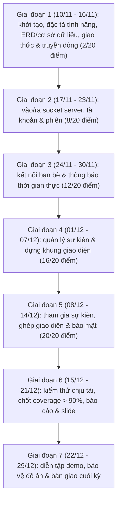

# Lộ trình phát triển dự án (roadmap) — Eventora

Tài liệu này định nghĩa lộ trình tổng quát từ khi khởi tạo dự án (`10/11/2026`) đến mốc báo cáo cuối kỳ dự kiến (`22/12/2026` – `29/12/2026`), đảm bảo hoàn thành trọn vẹn 17 tính năng (20 điểm), độ bao phủ unit test `> 90%`, bài kiểm thử chịu tải và quy tắc đóng góp Git hàng tuần.

---

## 1. Sơ đồ tổng quan các giai đoạn

---

## 2. Phân vai chủ đạo cho nhóm 2 thành viên

Để hai thành viên có thể làm việc song song trên các nhánh độc lập và đều có commit đóng góp mỗi tuần mà không xung đột mã nguồn:

| Thành viên | Mảng phụ trách chính | Mảng phối hợp chung |
| :--- | :--- | :--- |
| **`SonNX24042005`** | Vẽ sơ đồ `ERD` & lược đồ cơ sở dữ liệu (`docs/DATABASE_SCHEMA.md`), hạ tầng mạng phía server (`poll()`/`epoll`, thread pool), tầng lưu trữ dữ liệu (`SQLite`), ghi log hoạt động, nghiệp vụ quản lý sự kiện và công cụ kiểm thử chịu tải. | Cùng chốt đặc tả tính năng (`docs/FEATURE_SPEC.md`), duyệt chéo đặc tả giao thức (`docs/PROTOCOL_SPEC.md`), viết unit test giữ `coverage > 90%`, rà soát pull request, viết báo cáo & làm slide. |
| **`FATng`** | Soạn đặc tả giao thức tầng ứng dụng (`docs/PROTOCOL_SPEC.md`), bộ đóng khung truyền dòng dùng chung (`protocol/`), lõi mạng phía client (`libeventora_client` & CLI), giao diện người dùng (UI), nghiệp vụ tài khoản, bạn bè và tham gia sự kiện. | Cùng chốt đặc tả tính năng (`docs/FEATURE_SPEC.md`), duyệt chéo lược đồ cơ sở dữ liệu (`docs/DATABASE_SCHEMA.md`), viết unit test & kiểm thử tích hợp, thiết kế giao diện demo, viết báo cáo & làm slide. |

> **Quy định kỷ luật hàng tuần**: tối thiểu **5 commit/tuần** (khuyến nghị mỗi thành viên duy trì ≥ 3 commit/tuần), hai commit liên tiếp cách nhau **tối thiểu 30 phút**, mọi mã nguồn mới đều đi kèm unit test trước khi gộp vào nhánh `main`.

---

## 3. Lộ trình chi tiết theo từng tuần

### Giai đoạn 1 — tuần 1 (`10/11/2026` – `16/11/2026`): khởi tạo, đặc tả hệ thống & nền tảng truyền dòng
- **Mục tiêu điểm tính năng**: **2 / 20 điểm** (lũy kế: **2/20**).
- **Đầu việc cần hoàn thành**:
  - [x] Tạo kho lưu trữ GitHub công khai, cập nhật `README.md` và `PROJECT_PLAN.md`.
  - [x] Gửi lời mời cộng tác cho thành viên `FATng`.
  - [x] Xác nhận `FATng` tham gia repo và điền liên kết kho lưu trữ vào trang tính (sheet) của lớp.
  - [ ] **Bước thiết kế 1 (cả nhóm chốt chung)**: soạn đặc tả tính năng (`docs/FEATURE_SPEC.md`) cho toàn bộ 17 chức năng — làm rõ tác nhân, đầu vào, quy tắc kiểm tra nghiệp vụ, kết quả mong muốn và các trường hợp lỗi.
  - [ ] **Bước thiết kế 2 (`SonNX24042005` viết chính, `FATng` duyệt chéo)**: vẽ sơ đồ quan hệ thực thể (`ERD`) dựa trên đặc tả tính năng và chi tiết hóa thành lược đồ cơ sở dữ liệu (`docs/DATABASE_SCHEMA.md`).
  - [ ] **Bước thiết kế 3 (`FATng` viết chính, `SonNX24042005` duyệt chéo)**: soạn đặc tả giao thức tầng ứng dụng (`docs/PROTOCOL_SPEC.md`) khớp với các trường dữ liệu, luồng thông báo đẩy và mã lỗi ở bước 1–2.
  - [ ] Dựng cấu trúc thư mục tách lớp (`include/`, `src/`, `tests/`), cấu hình `CMakeLists.txt` (bật cờ `--coverage`) và `GitHub Actions` tự động đo độ bao phủ.
  - [ ] **[1 điểm]** Cài đặt bộ **xử lý truyền dòng** (`per-client buffer`, đóng khung bản tin, chống dính gói/phân mảnh gói, hàm `send_all`) kèm bộ unit test cắt mảnh dữ liệu.
  - [ ] **[1 điểm]** Cài đặt module **ghi log hoạt động** an toàn đa luồng (`pthread_mutex_t`, ghi thời gian, `IP:Port`, tài khoản, lệnh và mã kết quả).
  - [ ] Chạy thông luồng mẫu `PING` → `200 PONG` giữa client và server.
- **Kiểm tra kỷ luật tuần 1**: `[ ]` Đạt ≥ 5 commit (cách nhau ≥ 30 phút) • `[ ]` Đủ cả 2 thành viên commit.

---

### Giai đoạn 2 — tuần 2 (`17/11/2026` – `23/11/2026`): vào/ra socket server, tài khoản & quản lý phiên
- **Mục tiêu điểm tính năng**: **+6 điểm** (lũy kế: **8/20**).
- **Đầu việc cần hoàn thành**:
  - [ ] **[2 điểm - trọng tâm]** Cài đặt **cơ chế vào/ra socket trên server** sử dụng socket bất đồng bộ (`O_NONBLOCK`) kết hợp `poll()`/`epoll` và nhóm luồng xử lý (`thread pool`), bật `SO_REUSEADDR` và chặn `SIGPIPE`.
  - [ ] Cài đặt tầng lưu trữ bền vững cho bảng người dùng và phiên đăng nhập.
  - [ ] **[2 điểm - trọng tâm]** Cài đặt chức năng **đăng ký và quản lý tài khoản** (kiểm tra định dạng, chống trùng tên, băm mật khẩu kèm `salt`, xem/cập nhật thông tin tài khoản).
  - [ ] **[2 điểm - trọng tâm]** Cài đặt chức năng **đăng nhập và quản lý phiên** theo máy trạng thái hữu hạn (FSM), chặn lệnh trái phép khi chưa xác thực, xử lý đăng xuất và tự động thu hồi phiên khi ngắt kết nối.
  - [ ] Viết unit test và kiểm thử tích hợp cho phân hệ xác thực, duy trì `coverage > 90%`.
- **Kiểm tra kỷ luật tuần 2**: `[ ]` Đạt ≥ 5 commit (cách nhau ≥ 30 phút) • `[ ]` Đủ cả 2 thành viên commit.

---

### Giai đoạn 3 — tuần 3 (`24/11/2026` – `30/11/2026`): kết nối bạn bè & thông báo đẩy thời gian thực
- **Mục tiêu điểm tính năng**: **+4 điểm** (lũy kế: **12/20**).
- **Đầu việc cần hoàn thành**:
  - [ ] Xây dựng cơ chế server chủ động đẩy thông báo (`1xx` push notification) tới các client đang trực tuyến và lõi `C/C++ client` lắng nghe hai kênh đồng thời (`poll()`).
  - [ ] **[1 điểm]** Cài đặt chức năng **gửi lời mời kết bạn** (chặn tự kết bạn hoặc gửi trùng lời mời đang chờ).
  - [ ] **[1 điểm]** Cài đặt chức năng **chấp nhận/từ chối lời mời kết bạn**.
  - [ ] **[1 điểm]** Cài đặt chức năng **hủy kết bạn**.
  - [ ] **[1 điểm]** Cài đặt chức năng **hiển thị danh sách bạn bè** (kèm trạng thái online/offline theo bảng phiên).
  - [ ] Bổ sung đầy đủ unit test cho toàn bộ ca thành công và ca biên của phân hệ bạn bè (`coverage > 90%`).
- **Kiểm tra kỷ luật tuần 3**: `[ ]` Đạt ≥ 5 commit (cách nhau ≥ 30 phút) • `[ ]` Đủ cả 2 thành viên commit.

---

### Giai đoạn 4 — tuần 4 (`01/12/2026` – `07/12/2026`): quản lý sự kiện & dựng khung giao diện người dùng
- **Mục tiêu điểm tính năng**: **+4 điểm** (lũy kế: **16/20**).
- **Đầu việc cần hoàn thành**:
  - [ ] **[1 điểm]** Cài đặt chức năng **tạo mới sự kiện** (thời điểm, địa điểm, phân loại `private` / `public`, mô tả chi tiết).
  - [ ] **[1 điểm]** Cài đặt chức năng **lấy danh sách sự kiện** (phân quyền hiển thị đúng giữa sự kiện `public` và sự kiện `private`).
  - [ ] **[1 điểm]** Cài đặt chức năng **sửa thông tin sự kiện** (chỉ cho phép người tạo sự kiện chỉnh sửa, trả lỗi `403` nếu không đủ quyền).
  - [ ] **[1 điểm]** Cài đặt chức năng **xóa thông tin sự kiện** (kiểm tra quyền sở hữu và dọn dữ liệu lời mời/yêu cầu liên quan).
  - [ ] Khởi dựng giao diện người dùng (UI) ghép nối với lõi mạng `C/C++ client` cho màn hình đăng nhập, bạn bè và danh sách sự kiện.
  - [ ] Viết unit test cho toàn bộ nghiệp vụ sự kiện, giữ vững `coverage > 90%`.
- **Kiểm tra kỷ luật tuần 4**: `[ ]` Đạt ≥ 5 commit (cách nhau ≥ 30 phút) • `[ ]` Đủ cả 2 thành viên commit.

---

### Giai đoạn 5 — tuần 5 (`08/12/2026` – `14/12/2026`): tham gia sự kiện, hoàn thiện UI & nâng cấp bảo mật
- **Mục tiêu điểm tính năng**: **+4 điểm** (lũy kế: **20/20 — hoàn tất 100% tính năng**).
- **Đầu việc cần hoàn thành**:
  - [ ] **[1 điểm]** Cài đặt chức năng **gửi lời mời tham gia sự kiện** tới bạn bè (kèm thông báo đẩy thời gian thực).
  - [ ] **[1 điểm]** Cài đặt chức năng **chấp nhận lời mời tham gia** sự kiện từ bạn bè.
  - [ ] **[1 điểm]** Cài đặt chức năng **yêu cầu tham gia sự kiện** đối với các sự kiện công khai (`public`).
  - [ ] **[1 điểm]** Cài đặt chức năng **chấp nhận yêu cầu tham gia sự kiện** dành cho người tổ chức.
  - [ ] Hoàn thiện toàn bộ các màn hình trên giao diện người dùng (UI) và luồng thông báo trực quan.
  - [ ] *(Điểm cộng nâng cao)* Tích hợp tùy chọn mã hóa kênh truyền TLS bằng thư viện `OpenSSL`.
  - [ ] Hoàn tất bộ unit test cho phân hệ tham gia sự kiện (`coverage > 90%`).
- **Kiểm tra kỷ luật tuần 5**: `[ ]` Đạt ≥ 5 commit (cách nhau ≥ 30 phút) • `[ ]` Đủ cả 2 thành viên commit.

---

### Giai đoạn 6 — tuần 6 (`15/12/2026` – `21/12/2026`): kiểm thử chịu tải, tối ưu chất lượng & viết báo cáo
- **Mục tiêu**: đáp ứng trọn vẹn các điều kiện kỹ thuật bắt buộc trước mốc dự kiến đầu tiên (`22/12/2026`).
- **Đầu việc cần hoàn thành**:
  - [ ] Xây dựng công cụ **kiểm thử khả năng chịu tải (`load_tester`)** giả lập đồng thời hàng trăm đến hàng nghìn kết nối, đo thông lượng (`requests/sec`) và độ trễ (`p50`, `p95`, `p99`).
  - [ ] Kiểm tra rò rỉ bộ nhớ và rò rỉ file descriptor bằng `Valgrind`, xử lý triệt để các cảnh báo biên dịch.
  - [ ] Xuất báo cáo HTML độ bao phủ bằng `LCOV`, xác nhận tổng độ bao phủ **unit test > 90%**.
  - [ ] Chụp kết quả kiểm thử giao thức bằng `Netcat` (`nc`), bắt gói `Wireshark`, biểu đồ chịu tải và bảng `coverage`.
  - [ ] Hoàn thiện **tệp báo cáo chi tiết** và **slide thuyết trình**.
- **Kiểm tra kỷ luật tuần 6**: `[ ]` Đạt ≥ 5 commit (cách nhau ≥ 30 phút) • `[ ]` Đủ cả 2 thành viên commit.

---

### Giai đoạn 7 — tuần 7 (`22/12/2026` – `29/12/2026`): dự phòng, diễn tập & bảo vệ đồ án
- **Mục tiêu**: sẵn sàng bảo vệ và nộp sản phẩm cho cả hai mốc dự kiến `22/12/2026` và `29/12/2026`.
- **Đầu việc cần hoàn thành**:
  - [ ] Đóng băng tính năng, rà soát lại toàn bộ hướng dẫn biên dịch và chạy thử từ đầu trên máy sạch theo `README.md`.
  - [ ] Diễn tập kịch bản demo trực tiếp nhiều client tương tác thời gian thực và chạy thử bài test chịu tải.
  - [ ] Đóng gói và nộp đầy đủ 3 hạng mục: **file báo cáo**, **slide thuyết trình** và **mã nguồn**.

---

## 4. Bảng kiểm tra tổng thể trước ngày nộp bài

| Tiêu chí bắt buộc | Mục tiêu cần đạt | Trạng thái |
| :--- | :--- | :---: |
| Kho lưu trữ GitHub công khai | Đã tạo `public` repo và điền link vào sheet lớp | `[x]` |
| Độ hoàn thiện chức năng | Hoàn thành đủ 17/17 tính năng (20/20 điểm) | `[ ]` |
| Kiểm thử đơn vị (unit test) | Độ bao phủ mã nguồn (`coverage`) đạt `> 90%` | `[ ]` |
| Kiểm thử khả năng chịu tải | Có công cụ test tải, kịch bản rõ ràng và số liệu đo đạc | `[ ]` |
| Kỷ luật Git hàng tuần | Mỗi tuần ≥ 5 commit, cách nhau ≥ 30 phút, đủ 2 thành viên | `[ ]` |
| Bộ hồ sơ bàn giao cuối kỳ | Đầy đủ file báo cáo + slide + toàn bộ mã nguồn | `[ ]` |
