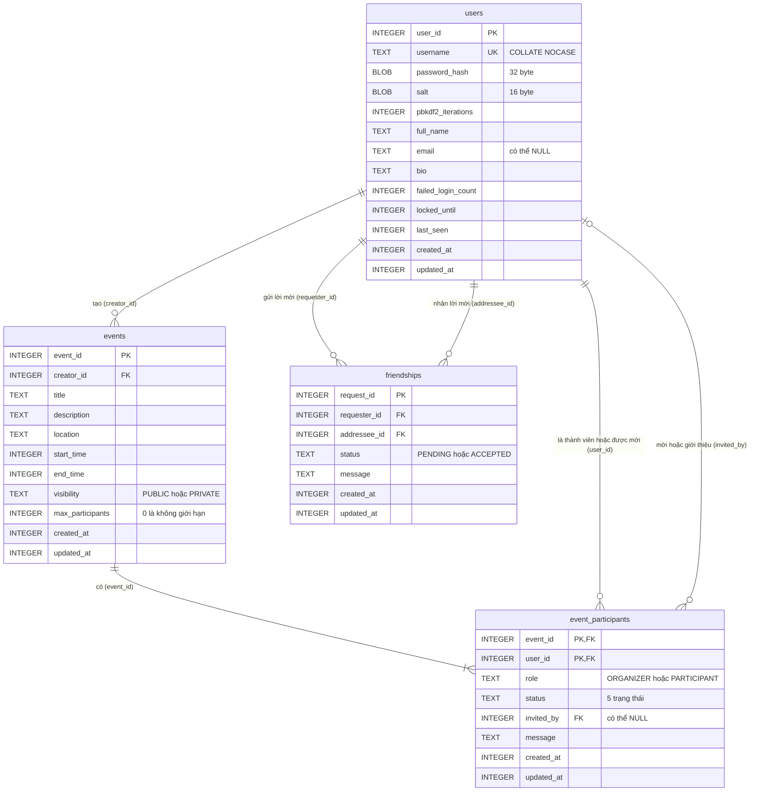

# Lược đồ cơ sở dữ liệu (database schema) — Eventora

| Thông tin tài liệu | Chi tiết |
| :--- | :--- |
| **Mã tài liệu** | `DOC-DB-01` |
| **Đường dẫn tệp** | `docs/DATABASE_SCHEMA.md` |
| **Phiên bản** | `1.0.0` (lược đồ `user_version = 1`) |
| **Ngày lập** | 16/11/2026 |
| **Tài liệu gốc** | [FEATURE_SPEC.md](./FEATURE_SPEC.md) phiên bản `2.0.1` |
| **Phân công** | `SonNX24042005` viết chính, `FATng` duyệt chéo |
| **Trạng thái** | Bản đầu tiên, chờ `FATng` duyệt chéo |
| **Hệ quản trị** | SQLite, yêu cầu tối thiểu `3.37.0` (bảng `STRICT`); máy phát triển dùng `3.45.1` |

---

## 1. Mục đích và phạm vi

Tài liệu này chi tiết hóa mục 2.8 và 2.9 của `FEATURE_SPEC.md` thành lược đồ SQLite có thể chạy ngay. Nội dung gồm sơ đồ quan hệ thực thể (ERD), đặc tả từng bảng, chỉ mục, trigger, câu lệnh tạo lược đồ (DDL), cấu hình kết nối và các truy vấn mẫu cho những quy tắc nghiệp vụ dễ sai.

**Dữ liệu lưu trong cơ sở dữ liệu**: tài khoản (`users`), quan hệ bạn bè (`friendships`), sự kiện (`events`), quan hệ giữa người dùng và sự kiện (`event_participants`).

**Dữ liệu cố ý không lưu trong cơ sở dữ liệu**:
- **Phiên đăng nhập**: chỉ tồn tại trong RAM (`session_map`) theo FEAT-04, nên không có bảng `sessions`. Mất kết nối hoặc khởi động lại server đồng nghĩa mọi phiên kết thúc.
- **Thông báo đẩy**: không lưu cho người offline; người dùng lấy lại thông tin bằng lệnh truy vấn bù (FEATURE_SPEC mục 2.6).
- **Log hoạt động**: ghi ra tệp `LOG_PATH` (FEAT-17).

---

## 2. Nguyên tắc thiết kế

1. **Bảng `STRICT`**: mọi bảng khai báo `STRICT`, nên SQLite từ chối giá trị sai kiểu (ví dụ chuỗi `'abc'` vào cột `INTEGER`) bằng lỗi `SQLITE_CONSTRAINT_DATATYPE`, thay vì lặng lẽ lưu sai như bảng thường. Tính năng này có từ SQLite 3.37.0 ([nguồn](https://www.sqlite.org/stricttables.html), tra cứu 16/11/2026).
2. **Thời gian là `INTEGER`** (Unix timestamp, giây, UTC) và **luôn do server truyền vào**. Lược đồ không dùng giá trị mặc định lấy từ đồng hồ của SQLite (`unixepoch()`, `CURRENT_TIMESTAMP`), để đồng hồ giả trong unit test điều khiển được mọi mốc thời gian (FEATURE_SPEC mục 1.3).
3. **ID không tái sử dụng**: `users`, `events` và `friendships` dùng `INTEGER PRIMARY KEY AUTOINCREMENT`. Nếu không có `AUTOINCREMENT`, SQLite có thể cấp lại ID của dòng lớn nhất vừa bị xóa. Khi đó, một lệnh cũ của client (ví dụ `RESPOND_FRIEND_REQUEST` với `request_id` của lời mời đã bị từ chối và xóa) có thể tác động nhầm lên một bản ghi mới cùng ID. Đây là cùng lý do khiến server dùng `conn_id` thay cho `fd` (FEAT-02).
4. **Phân tầng kiểm tra**:
   - Tầng service kiểm tra đầy đủ định dạng và quy tắc nghiệp vụ, rồi trả mã lý do theo FEATURE_SPEC.
   - Cơ sở dữ liệu giữ các **bất biến cấu trúc**: kiểu dữ liệu, miền giá trị, độ dài, quan hệ khóa ngoại, tính duy nhất và một số bất biến liên bảng (trigger). Đây là lớp phòng thủ cuối cùng: vi phạm ràng buộc ở tầng này nghĩa là tầng service có lỗi (trừ ràng buộc `UNIQUE` dùng để chống tranh chấp, mục 9).
   - Quy tắc phụ thuộc thời gian thực (ví dụ `start_time > now`) chỉ kiểm tra ở tầng service, vì `CHECK` không được phụ thuộc vào đồng hồ.
5. **Độ dài tính theo ký tự**: hàm `length()` của SQLite với giá trị `TEXT` đếm số ký tự chứ không đếm byte (đã chạy thử: `length('Nguyễn Ấn')` trả 9, trong khi dạng byte là 13), khớp định nghĩa "ký tự" ở FEATURE_SPEC mục 1.3.
6. **Không lưu số đếm dư thừa**: `participant_count`, `pending_request_count` và các số đếm khác tính bằng `COUNT(*)` trên chỉ mục ngay khi truy vấn, nên không bao giờ lệch so với dữ liệu thật.
7. **Trạng thái lưu dưới dạng chuỗi liệt kê** (`'PENDING'`, `'INVITED'`...), có `CHECK` giới hạn miền giá trị, trùng với giá trị trên giao thức nên dễ đọc khi gỡ lỗi.

---

## 3. Sơ đồ quan hệ thực thể (ERD)



**Đọc sơ đồ**:
- Một người dùng tạo nhiều sự kiện; mỗi sự kiện có đúng một người tạo.
- `friendships` là quan hệ nhiều-nhiều tự thân giữa các người dùng, lưu theo chiều gửi. Mỗi cặp người dùng có tối đa một bản ghi, bất kể chiều (mục 4.2).
- `event_participants` là quan hệ nhiều-nhiều giữa người dùng và sự kiện, mang trạng thái tham gia. Mỗi sự kiện có **ít nhất một** bản ghi (`||--|{`), chính là bản ghi `ORGANIZER` được tạo cùng sự kiện.
- `invited_by` là khóa ngoại thứ hai từ `event_participants` tới `users`, có thể `NULL` (`|o`), ví dụ với yêu cầu tự xin tham gia.

---

## 4. Đặc tả chi tiết từng bảng

### 4.1. Bảng `users` (tài khoản)

| Cột | Kiểu | Ràng buộc | Mô tả | Dùng ở |
| :--- | :--- | :--- | :--- | :--- |
| `user_id` | `INTEGER` | khóa chính, `AUTOINCREMENT` | Định danh người dùng, không tái sử dụng. | mọi tính năng |
| `username` | `TEXT` | `NOT NULL`, `UNIQUE`, `COLLATE NOCASE`, dài 3–32, chỉ gồm `[A-Za-z0-9_]` | Tên đăng nhập, duy nhất không phân biệt hoa thường; lưu nguyên dạng người dùng nhập. | FEAT-03, FEAT-04, tham chiếu người dùng |
| `password_hash` | `BLOB` | `NOT NULL`, đúng 32 byte | Kết quả `PBKDF2-HMAC-SHA256`. | FEAT-03, FEAT-04 |
| `salt` | `BLOB` | `NOT NULL`, đúng 16 byte | Muối ngẫu nhiên từ `RAND_bytes()`, sinh mới mỗi lần đổi mật khẩu. | FEAT-03, FEAT-04 |
| `pbkdf2_iterations` | `INTEGER` | `NOT NULL`, `> 0` | Số vòng lặp đã dùng khi băm; cho phép tăng `PBKDF2_ITERATIONS` về sau. | FEAT-03, FEAT-04 |
| `full_name` | `TEXT` | `NOT NULL`, dài 2–100 | Họ tên hiển thị. | FEAT-03, mọi danh sách |
| `email` | `TEXT` | có thể `NULL`; nếu có thì dài 3–100 và có `@` không ở đầu | Email tùy chọn; chỉ chính chủ và bạn bè xem được. | FEAT-03 |
| `bio` | `TEXT` | `NOT NULL`, mặc định `''`, tối đa 255 | Tiểu sử, cho phép nhiều dòng. | FEAT-03 |
| `failed_login_count` | `INTEGER` | `NOT NULL`, mặc định 0, `>= 0` | Số lần sai mật khẩu liên tiếp của tài khoản. | FEAT-04 |
| `locked_until` | `INTEGER` | `NOT NULL`, mặc định 0 | Thời điểm hết khóa tạm thời; `0` hoặc giá trị đã qua nghĩa là không khóa. | FEAT-04 |
| `last_seen` | `INTEGER` | `NOT NULL`, mặc định 0 | Lần rời mạng gần nhất; `0` nếu chưa từng rời mạng. | FEAT-03, FEAT-04, FEAT-12 |
| `created_at` | `INTEGER` | `NOT NULL` | Thời điểm đăng ký. | FEAT-03 |
| `updated_at` | `INTEGER` | `NOT NULL` | Lần sửa hồ sơ hoặc mật khẩu gần nhất. | FEAT-03 |

**Ghi chú**:
- `COLLATE NOCASE` của SQLite chỉ gộp hoa thường cho ký tự ASCII; điều này đủ vì `username` chỉ chứa ASCII.
- Khi đạt `ACCOUNT_LOCK_THRESHOLD` lần sai, server đặt `locked_until = now + ACCOUNT_LOCK_DURATION` và **đưa `failed_login_count` về 0**. Nhờ vậy, sau khi hết khóa, người dùng lại có đủ số lần thử thay vì bị khóa ngay ở lần sai kế tiếp (truy vấn mẫu Q11).
- Trong phạm vi hiện tại, tài khoản không bị xóa (FEATURE_SPEC mục 7), nên mọi khóa ngoại trỏ tới `users` dùng hành vi mặc định: chặn xóa người dùng còn dữ liệu liên quan.

### 4.2. Bảng `friendships` (lời mời kết bạn và quan hệ bạn bè)

| Cột | Kiểu | Ràng buộc | Mô tả | Dùng ở |
| :--- | :--- | :--- | :--- | :--- |
| `request_id` | `INTEGER` | khóa chính, `AUTOINCREMENT` | Định danh lời mời; vẫn giữ nguyên sau khi được chấp nhận. | FEAT-09, FEAT-10, FEAT-12 |
| `requester_id` | `INTEGER` | `NOT NULL`, khóa ngoại tới `users` | Người gửi lời mời ban đầu. | FEAT-09, FEAT-10, FEAT-12 |
| `addressee_id` | `INTEGER` | `NOT NULL`, khóa ngoại tới `users`, khác `requester_id` | Người nhận lời mời; chỉ người này được phản hồi. | FEAT-09, FEAT-10, FEAT-12 |
| `status` | `TEXT` | `NOT NULL`, thuộc `PENDING`, `ACCEPTED` | Trạng thái quan hệ. | FEAT-09 → FEAT-12 |
| `message` | `TEXT` | `NOT NULL`, mặc định `''`, tối đa 200 | Lời nhắn kèm lời mời. | FEAT-09, FEAT-12 |
| `created_at` | `INTEGER` | `NOT NULL` | Thời điểm gửi lời mời. | FEAT-12 |
| `updated_at` | `INTEGER` | `NOT NULL` | Thời điểm thay đổi trạng thái gần nhất (với `ACCEPTED` là lúc trở thành bạn bè). | FEAT-10 |

**Ràng buộc quan trọng — một bản ghi cho mỗi cặp**: chỉ mục duy nhất `ux_friendships_pair` lập trên hai biểu thức `min(requester_id, addressee_id)` và `max(requester_id, addressee_id)`. Vì vậy, khi A đã gửi lời mời cho B, việc chèn thêm một bản ghi B gửi A cũng bị từ chối, kể cả khi hai yêu cầu đến đồng thời. Cách này giữ được chiều gửi (truy vấn lời mời đến hoặc đi chỉ cần một điều kiện), đồng thời vẫn bảo đảm tính duy nhất không phụ thuộc chiều. Chỉ mục trên biểu thức chỉ cho phép hàm tất định, và `min`/`max` nhiều tham số là hàm tất định. Bộ lập kế hoạch truy vấn chỉ dùng chỉ mục này khi biểu thức trong `WHERE` viết **giống hệt** biểu thức trong `CREATE INDEX` ([nguồn](https://www.sqlite.org/expridx.html), tra cứu 16/11/2026), nên truy vấn mẫu Q1 viết đúng dạng đó.

### 4.3. Bảng `events` (sự kiện)

| Cột | Kiểu | Ràng buộc | Mô tả | Dùng ở |
| :--- | :--- | :--- | :--- | :--- |
| `event_id` | `INTEGER` | khóa chính, `AUTOINCREMENT` | Định danh sự kiện, không tái sử dụng sau khi xóa. | FEAT-05 → FEAT-08, FEAT-13 → FEAT-16 |
| `creator_id` | `INTEGER` | `NOT NULL`, khóa ngoại tới `users`, không được sửa (trigger) | `Organizer` của sự kiện. | mọi kiểm tra quyền `Organizer` |
| `title` | `TEXT` | `NOT NULL`, dài 3–150 | Tiêu đề. | FEAT-05 → FEAT-07 |
| `description` | `TEXT` | `NOT NULL`, mặc định `''`, tối đa 2000 | Mô tả, cho phép nhiều dòng; chỉ trả trong `GET_EVENT_DETAIL`. | FEAT-05 → FEAT-07 |
| `location` | `TEXT` | `NOT NULL`, dài 3–255 | Địa điểm. | FEAT-05 → FEAT-07 |
| `start_time` | `INTEGER` | `NOT NULL` | Thời điểm bắt đầu. | FEAT-05 → FEAT-07 |
| `end_time` | `INTEGER` | `NOT NULL`; `end_time - start_time` trong đoạn 900–2.592.000 | Thời điểm kết thúc; sự kiện đã kết thúc khi `end_time <= now`. | FEAT-05 → FEAT-16 |
| `visibility` | `TEXT` | `NOT NULL`, thuộc `PUBLIC`, `PRIVATE` | Phân loại hiển thị. | FEAT-05, FEAT-07, FEAT-13, FEAT-15 |
| `max_participants` | `INTEGER` | `NOT NULL`, mặc định 0, trong đoạn 0–10.000 | Sức chứa, không tính `Organizer`; `0` là không giới hạn. | FEAT-06, FEAT-07, FEAT-14 → FEAT-16 |
| `created_at` | `INTEGER` | `NOT NULL` | Thời điểm tạo. | FEAT-05 |
| `updated_at` | `INTEGER` | `NOT NULL` | Lần sửa gần nhất. | FEAT-05, FEAT-07 |

**Ghi chú**: quy tắc "`start_time` trong tương lai và không xa hơn 2 năm" phụ thuộc `now`, nên chỉ kiểm tra ở tầng service. `CHECK` của bảng chỉ giữ quy tắc thời lượng, vốn không phụ thuộc đồng hồ.

### 4.4. Bảng `event_participants` (quan hệ người dùng – sự kiện)

| Cột | Kiểu | Ràng buộc | Mô tả | Dùng ở |
| :--- | :--- | :--- | :--- | :--- |
| `event_id` | `INTEGER` | thuộc khóa chính, khóa ngoại tới `events` với `ON DELETE CASCADE` | Sự kiện. | FEAT-05 → FEAT-16 |
| `user_id` | `INTEGER` | thuộc khóa chính, khóa ngoại tới `users` | Người dùng có quan hệ với sự kiện. | FEAT-05 → FEAT-16 |
| `role` | `TEXT` | `NOT NULL`, thuộc `ORGANIZER`, `PARTICIPANT`, không được sửa (trigger) | Vai trò; mỗi sự kiện có đúng một `ORGANIZER`. | FEAT-05, FEAT-06, FEAT-13 |
| `status` | `TEXT` | `NOT NULL`, thuộc `INVITED`, `REQUEST_PENDING`, `ACCEPTED`, `DECLINED`, `REJECTED` | Trạng thái theo bảng chuyển trạng thái ở FEATURE_SPEC phân nhóm V. | FEAT-05, FEAT-07, FEAT-08, FEAT-11, FEAT-13 → FEAT-16 |
| `invited_by` | `INTEGER` | có thể `NULL`, khóa ngoại tới `users`, khác `user_id`; bắt buộc có khi `INVITED` | Người đã mời hoặc giới thiệu. | FEAT-07, FEAT-11, FEAT-13, FEAT-14 |
| `message` | `TEXT` | `NOT NULL`, mặc định `''`, tối đa 200 | Lời nhắn của yêu cầu xin tham gia. | FEAT-05, FEAT-15 |
| `created_at` | `INTEGER` | `NOT NULL` | Thời điểm bản ghi được tạo lần đầu. | — |
| `updated_at` | `INTEGER` | `NOT NULL` | Lần chuyển trạng thái gần nhất; dùng để sắp xếp danh sách chờ duyệt. | FEAT-05 |

**Ràng buộc trên bảng**:
- Khóa chính `(event_id, user_id)` thực hiện yêu cầu `UNIQUE(event_id, user_id)` của FEATURE_SPEC.
- Bản ghi `ORGANIZER` luôn có `status = 'ACCEPTED'` và `invited_by` là `NULL`.
- Bản ghi `INVITED` luôn có `invited_by`; không ai tự mời chính mình (`invited_by <> user_id`).
- Mỗi sự kiện có **tối đa một** bản ghi `ORGANIZER`. Bất biến này suy ra từ ba ràng buộc, nên không cần chỉ mục riêng: trigger `trg_ep_organizer_is_creator` chỉ cho bản ghi `ORGANIZER` thuộc về `events.creator_id`; khóa chính `(event_id, user_id)` không cho người đó có hai bản ghi; hai trigger cấm sửa `creator_id` và `role` (mục 6). Giao dịch của FEAT-06 bảo đảm có **ít nhất một**.

### 4.5. Ánh xạ trạng thái nghiệp vụ sang dữ liệu

**Quan hệ bạn bè** (FEATURE_SPEC phân nhóm IV):

| Trạng thái nghiệp vụ | Dữ liệu trong `friendships` |
| :--- | :--- |
| Hai người chưa có quan hệ | Không có bản ghi nào cho cặp. |
| A đã gửi lời mời cho B | `requester_id = A`, `addressee_id = B`, `status = 'PENDING'`. |
| A và B là bạn bè | `status = 'ACCEPTED'`; `requester_id` vẫn là người gửi ban đầu. |
| B từ chối, hoặc một bên hủy kết bạn | Xóa bản ghi. |

**Quan hệ người dùng – sự kiện** (các hàng của bảng chuyển trạng thái ở FEATURE_SPEC phân nhóm V):

| Trạng thái trong bảng chuyển trạng thái | `role` | `status` | `invited_by` |
| :--- | :--- | :--- | :--- |
| Chưa có bản ghi | — | — (không có dòng) | — |
| `Organizer` | `ORGANIZER` | `ACCEPTED` | `NULL` |
| `INVITED` bởi `O` | `PARTICIPANT` | `INVITED` | bằng `events.creator_id` |
| `INVITED` bởi `P` | `PARTICIPANT` | `INVITED` | ID của `Participant`, khác `events.creator_id` |
| `REQUEST_PENDING` | `PARTICIPANT` | `REQUEST_PENDING` | `NULL` nếu tự xin; giữ ID người giới thiệu nếu đi từ lời giới thiệu |
| `ACCEPTED` | `PARTICIPANT` | `ACCEPTED` | giữ giá trị trước đó (để truy vết ai đã mời) |
| `DECLINED` | `PARTICIPANT` | `DECLINED` | giữ người mời cuối cùng |
| `REJECTED` | `PARTICIPANT` | `REJECTED` | giữ giá trị trước đó |

Quy tắc ghi `invited_by` khi chuyển trạng thái:
- `O` hoặc `P` mời → `invited_by` là người mời.
- `U` tự xin từ "chưa có bản ghi" hoặc `DECLINED` → `invited_by = NULL`.
- Lời giới thiệu chuyển thành `REQUEST_PENDING` → giữ nguyên `invited_by`.
- Mọi chuyển trạng thái khác → giữ nguyên `invited_by`.

"Lời mời của `Organizer`" được nhận biết bằng `invited_by = events.creator_id`, không cần cột riêng.

---

## 5. Chỉ mục (index)

| Chỉ mục | Bảng và cột | Phục vụ |
| :--- | :--- | :--- |
| khóa duy nhất của `username` (tự tạo) | `users (username COLLATE NOCASE)` | `LOGIN`, `REGISTER`, tham chiếu người dùng bằng `username`. |
| `ux_friendships_pair` | `friendships (min(requester_id, addressee_id), max(requester_id, addressee_id))`, duy nhất | Một bản ghi mỗi cặp; tra trạng thái cặp ở FEAT-09, FEAT-11, `GET_PROFILE` (Q1). |
| `ix_friendships_addressee` | `friendships (addressee_id, status)` | Lời mời đến, nửa thứ hai của danh sách bạn bè, đếm lời mời khi `LOGIN`. |
| `ix_friendships_requester` | `friendships (requester_id, status)` | Lời mời đi, nửa thứ nhất của danh sách bạn bè. |
| `ix_events_start` | `events (start_time)` | `GET_EVENTS` sắp xếp theo `start_time`, `event_id` (rowid tự động nằm cuối mọi chỉ mục). |
| `ix_events_creator` | `events (creator_id, start_time)` | `GET_EVENTS` với `scope=MINE`, đếm yêu cầu chờ khi `LOGIN`. |
| khóa chính của `event_participants` | `(event_id, user_id)` | Tra quan hệ của người gọi với một sự kiện (quyền xem, bảng chuyển trạng thái). |
| `ix_ep_event_status` | `event_participants (event_id, status, updated_at)` | Đếm thành viên và sức chứa, `GET_EVENT_MEMBERS` sắp xếp theo `updated_at`, danh sách người nhận thông báo. |
| `ix_ep_user_status` | `event_participants (user_id, status)` | `GET_EVENTS` với `scope` là `JOINED`, `INVITED`, `REQUESTED`; đếm lời mời khi `LOGIN`. |
| `ix_ep_pending_invites` | `event_participants (invited_by, user_id) WHERE status = 'INVITED'` | Thu hồi lời mời khi hủy kết bạn (FEAT-11, Q8). |

---

## 6. Trigger bảo toàn bất biến

| Trigger | Bất biến được bảo vệ |
| :--- | :--- |
| `trg_events_creator_immutable` | Không được đổi `events.creator_id`; mọi kiểm tra quyền `Organizer` dựa vào cột này. |
| `trg_ep_organizer_is_creator` | Bản ghi `ORGANIZER` chỉ được thuộc về đúng `events.creator_id`. |
| `trg_ep_identity_immutable` | Không được sửa `event_id`, `user_id`, `role` của một bản ghi; chuyển trạng thái chỉ sửa `status`, `invited_by`, `message`, `updated_at`. |
| `trg_ep_keep_organizer` | Không được xóa riêng bản ghi `ORGANIZER` khi sự kiện còn tồn tại; bản ghi này chỉ mất khi xóa sự kiện (xóa dây chuyền). |

Trigger báo lỗi bằng `RAISE(ABORT, ...)`, tương ứng mã lỗi mở rộng `SQLITE_CONSTRAINT_TRIGGER`.

---

## 7. Ma trận truy cập dữ liệu theo tính năng (CRUD)

`C` = tạo, `R` = đọc, `U` = cập nhật, `D` = xóa.

| Tính năng | `users` | `friendships` | `events` | `event_participants` |
| :--- | :---: | :---: | :---: | :---: |
| FEAT-03 `REGISTER` | C | | | |
| FEAT-03 `GET_PROFILE` | R | R | | |
| FEAT-03 `UPDATE_PROFILE`, `CHANGE_PASSWORD` | R, U | | | |
| FEAT-04 `LOGIN` | R, U | R | R | R |
| FEAT-04 `LOGOUT`, mất kết nối | U | R | | |
| FEAT-05 | R | | R | R |
| FEAT-06 | R | | C | C |
| FEAT-07 | R | | R, U | R, D |
| FEAT-08 | | | R, D | R, D (dây chuyền) |
| FEAT-09 | R | R, C, U | | |
| FEAT-10 | R | R, U, D | | |
| FEAT-11 | R | R, D | | D |
| FEAT-12 | R | R | | |
| FEAT-13 | R | R | R | R, C, U |
| FEAT-14 | R | | R | R, U |
| FEAT-15 | R | | R | R, C, U |
| FEAT-16 | R | | R | R, U |
| FEAT-01, FEAT-02, FEAT-17 | | | | |

---

## 8. Câu lệnh tạo lược đồ (DDL)

Server chạy khối lệnh dưới đây **một lần** khi mở một cơ sở dữ liệu có `PRAGMA user_version = 0` (mục 10). Toàn bộ nằm trong một giao dịch, nên nếu lỗi giữa chừng thì không để lại lược đồ dở dang.

```sql
-- schema: eventora, user_version = 1, yêu cầu SQLite >= 3.37.0
BEGIN IMMEDIATE;

CREATE TABLE users (
    user_id            INTEGER PRIMARY KEY AUTOINCREMENT,
    username           TEXT    NOT NULL COLLATE NOCASE UNIQUE
                               CHECK (length(username) BETWEEN 3 AND 32
                                      AND username NOT GLOB '*[^A-Za-z0-9_]*'),
    password_hash      BLOB    NOT NULL CHECK (length(password_hash) = 32),
    salt               BLOB    NOT NULL CHECK (length(salt) = 16),
    pbkdf2_iterations  INTEGER NOT NULL CHECK (pbkdf2_iterations > 0),
    full_name          TEXT    NOT NULL CHECK (length(full_name) BETWEEN 2 AND 100),
    email              TEXT             CHECK (email IS NULL
                                               OR (length(email) BETWEEN 3 AND 100
                                                   AND instr(email, '@') > 1)),
    bio                TEXT    NOT NULL DEFAULT '' CHECK (length(bio) <= 255),
    failed_login_count INTEGER NOT NULL DEFAULT 0 CHECK (failed_login_count >= 0),
    locked_until       INTEGER NOT NULL DEFAULT 0,
    last_seen          INTEGER NOT NULL DEFAULT 0,
    created_at         INTEGER NOT NULL,
    updated_at         INTEGER NOT NULL
) STRICT;

CREATE TABLE friendships (
    request_id   INTEGER PRIMARY KEY AUTOINCREMENT,
    requester_id INTEGER NOT NULL REFERENCES users (user_id),
    addressee_id INTEGER NOT NULL REFERENCES users (user_id),
    status       TEXT    NOT NULL CHECK (status IN ('PENDING', 'ACCEPTED')),
    message      TEXT    NOT NULL DEFAULT '' CHECK (length(message) <= 200),
    created_at   INTEGER NOT NULL,
    updated_at   INTEGER NOT NULL,
    CHECK (requester_id <> addressee_id)
) STRICT;

CREATE UNIQUE INDEX ux_friendships_pair
    ON friendships (min(requester_id, addressee_id), max(requester_id, addressee_id));
CREATE INDEX ix_friendships_addressee ON friendships (addressee_id, status);
CREATE INDEX ix_friendships_requester ON friendships (requester_id, status);

CREATE TABLE events (
    event_id         INTEGER PRIMARY KEY AUTOINCREMENT,
    creator_id       INTEGER NOT NULL REFERENCES users (user_id),
    title            TEXT    NOT NULL CHECK (length(title) BETWEEN 3 AND 150),
    description      TEXT    NOT NULL DEFAULT '' CHECK (length(description) <= 2000),
    location         TEXT    NOT NULL CHECK (length(location) BETWEEN 3 AND 255),
    start_time       INTEGER NOT NULL,
    end_time         INTEGER NOT NULL,
    visibility       TEXT    NOT NULL CHECK (visibility IN ('PUBLIC', 'PRIVATE')),
    max_participants INTEGER NOT NULL DEFAULT 0 CHECK (max_participants BETWEEN 0 AND 10000),
    created_at       INTEGER NOT NULL,
    updated_at       INTEGER NOT NULL,
    CHECK (end_time - start_time BETWEEN 900 AND 2592000)
) STRICT;

CREATE INDEX ix_events_start   ON events (start_time);
CREATE INDEX ix_events_creator ON events (creator_id, start_time);

CREATE TABLE event_participants (
    event_id   INTEGER NOT NULL REFERENCES events (event_id) ON DELETE CASCADE,
    user_id    INTEGER NOT NULL REFERENCES users (user_id),
    role       TEXT    NOT NULL CHECK (role IN ('ORGANIZER', 'PARTICIPANT')),
    status     TEXT    NOT NULL CHECK (status IN ('INVITED', 'REQUEST_PENDING', 'ACCEPTED',
                                                  'DECLINED', 'REJECTED')),
    invited_by INTEGER          REFERENCES users (user_id),
    message    TEXT    NOT NULL DEFAULT '' CHECK (length(message) <= 200),
    created_at INTEGER NOT NULL,
    updated_at INTEGER NOT NULL,
    PRIMARY KEY (event_id, user_id),
    CHECK (role = 'PARTICIPANT' OR (status = 'ACCEPTED' AND invited_by IS NULL)),
    CHECK (status <> 'INVITED' OR invited_by IS NOT NULL),
    CHECK (invited_by IS NULL OR invited_by <> user_id)
) STRICT;

CREATE INDEX ix_ep_event_status ON event_participants (event_id, status, updated_at);
CREATE INDEX ix_ep_user_status  ON event_participants (user_id, status);
CREATE INDEX ix_ep_pending_invites
    ON event_participants (invited_by, user_id) WHERE status = 'INVITED';

CREATE TRIGGER trg_events_creator_immutable
BEFORE UPDATE OF creator_id ON events
WHEN NEW.creator_id <> OLD.creator_id
BEGIN
    SELECT RAISE(ABORT, 'events.creator_id is immutable');
END;

CREATE TRIGGER trg_ep_organizer_is_creator
BEFORE INSERT ON event_participants
WHEN NEW.role = 'ORGANIZER'
 AND NEW.user_id IS NOT (SELECT creator_id FROM events WHERE event_id = NEW.event_id)
BEGIN
    SELECT RAISE(ABORT, 'organizer row must belong to events.creator_id');
END;

CREATE TRIGGER trg_ep_identity_immutable
BEFORE UPDATE OF event_id, user_id, role ON event_participants
WHEN NEW.event_id <> OLD.event_id OR NEW.user_id <> OLD.user_id OR NEW.role <> OLD.role
BEGIN
    SELECT RAISE(ABORT, 'event_participants identity and role are immutable');
END;

CREATE TRIGGER trg_ep_keep_organizer
BEFORE DELETE ON event_participants
WHEN OLD.role = 'ORGANIZER'
 AND EXISTS (SELECT 1 FROM events WHERE event_id = OLD.event_id)
BEGIN
    SELECT RAISE(ABORT, 'organizer row can only be removed by deleting the event');
END;

PRAGMA user_version = 1;
COMMIT;
```

---

## 9. Ánh xạ lỗi cơ sở dữ liệu sang mã phản hồi

Server bật mã lỗi mở rộng bằng `sqlite3_extended_result_codes(db, 1)` để phân biệt các loại vi phạm ràng buộc.

| Lỗi SQLite | Tình huống | Xử lý ở tầng service |
| :--- | :--- | :--- |
| `SQLITE_CONSTRAINT_UNIQUE` trên `users.username` | Hai `REGISTER` cùng tên chạy song song: vì băm mật khẩu nằm ngoài giao dịch (FEATURE_SPEC mục 2.8), bước kiểm tra trùng tên và bước chèn không nằm chung một giao dịch. | `409 USERNAME_ALREADY_EXISTS`. |
| `SQLITE_CONSTRAINT_UNIQUE` trên `ux_friendships_pair`, `SQLITE_CONSTRAINT_PRIMARYKEY` trên `event_participants` | Không xảy ra nếu luồng "đọc rồi ghi" dùng `BEGIN IMMEDIATE`; nếu vẫn gặp thì là dấu hiệu tranh chấp. | Rollback, ghi log `ERROR`, trả `500 INTERNAL_ERROR`. |
| `SQLITE_CONSTRAINT_CHECK`, `_NOTNULL`, `_FOREIGNKEY`, `_TRIGGER`, `_DATATYPE` | Tầng service bỏ sót một bước kiểm tra. | Rollback, ghi log `ERROR` kèm tên ràng buộc, trả `500 INTERNAL_ERROR`; bổ sung unit test cho ca đó. |
| `SQLITE_BUSY` | Quá `busy_timeout`, hoặc giao dịch `DEFERRED` không nâng lên giao dịch ghi được. | Rollback và chạy lại toàn bộ giao dịch tối đa `SQLITE_MAX_RETRIES` lần, sau đó `503 SERVER_BUSY`. |

---

## 10. Cấu hình kết nối và khởi tạo

**Khi khởi động server** (chạy một lần):
1. Kiểm tra `sqlite3_libversion_number() >= 3037000`; nếu thấp hơn, ghi log `CRITICAL` và dừng.
2. Mở `DB_PATH`, đọc `PRAGMA user_version`:
   - `0`: cơ sở dữ liệu mới → chạy DDL ở mục 8.
   - `1`: đúng phiên bản → tiếp tục.
   - Giá trị khác: lược đồ không tương thích → ghi log `CRITICAL` và dừng, không tự sửa dữ liệu.
3. Chạy `PRAGMA journal_mode = WAL` (chế độ này được lưu bền trong tệp cơ sở dữ liệu).

**Mỗi kết nối** (mỗi luồng `worker pool` và `auth pool` mở một kết nối riêng):

```sql
PRAGMA foreign_keys = ON;      -- tắt theo mặc định và tính riêng từng kết nối
PRAGMA busy_timeout = 5000;    -- SQLITE_BUSY_TIMEOUT
PRAGMA synchronous = NORMAL;   -- an toàn khi dùng WAL; mất điện có thể mất giao dịch cuối nhưng không hỏng tệp
```

**Khi tắt server an toàn**: chạy `PRAGMA optimize;` trên từng kết nối trước khi `sqlite3_close()`, để SQLite cập nhật thống kê phục vụ lập kế hoạch truy vấn.

---

## 11. Truy vấn mẫu cho các quy tắc dễ sai

Các truy vấn dùng tham số đặt tên (`:uid`, `:now`...), gắn giá trị bằng `sqlite3_bind_*` qua `sqlite3_bind_parameter_index()`. Tham số `:keyword_pattern` là chuỗi tìm kiếm đã escape `\`, `%`, `_` bằng `\` và bọc trong `%...%`, hoặc `NULL` khi không tìm kiếm. Mọi truy vấn "đọc rồi ghi" chạy trong `BEGIN IMMEDIATE` (FEATURE_SPEC mục 2.8).

**Q1 — trạng thái của một cặp người dùng** (FEAT-09, FEAT-11, `relation` trong `GET_PROFILE`). Biểu thức viết đúng như trong `ux_friendships_pair` để dùng được chỉ mục:

```sql
-- query: q1_friend_pair
SELECT request_id, requester_id, addressee_id, status
FROM friendships
WHERE min(requester_id, addressee_id) = min(:a, :b)
  AND max(requester_id, addressee_id) = max(:a, :b);
```

**Q2 — danh sách bạn bè** (FEAT-12). Trạng thái trực tuyến, lọc `ONLINE_ONLY` và phân trang được xử lý ở tầng service sau khi đối chiếu `session_map`:

```sql
-- query: q2_friends
SELECT u.user_id, u.username, u.full_name, u.last_seen
FROM (
    SELECT addressee_id AS friend_id FROM friendships
    WHERE requester_id = :uid AND status = 'ACCEPTED'
    UNION ALL
    SELECT requester_id FROM friendships
    WHERE addressee_id = :uid AND status = 'ACCEPTED'
) AS f
JOIN users AS u ON u.user_id = f.friend_id
WHERE :keyword_pattern IS NULL
   OR u.username  LIKE :keyword_pattern ESCAPE '\'
   OR u.full_name LIKE :keyword_pattern ESCAPE '\'
ORDER BY u.username;
```

**Q3 — lời mời kết bạn đến và đi** (FEAT-12):

```sql
-- query: q3_friend_requests_incoming
SELECT f.request_id, u.user_id, u.username, u.full_name, f.message, f.created_at
FROM friendships AS f
JOIN users AS u ON u.user_id = f.requester_id
WHERE f.addressee_id = :uid AND f.status = 'PENDING'
ORDER BY f.created_at DESC, f.request_id DESC
LIMIT :limit OFFSET :offset;
```

```sql
-- query: q3_friend_requests_outgoing
SELECT f.request_id, u.user_id, u.username, u.full_name, f.message, f.created_at
FROM friendships AS f
JOIN users AS u ON u.user_id = f.addressee_id
WHERE f.requester_id = :uid AND f.status = 'PENDING'
ORDER BY f.created_at DESC, f.request_id DESC
LIMIT :limit OFFSET :offset;
```

**Q4 — kiểm tra quyền xem một sự kiện** (dùng chung cho mọi lệnh có `event_id`). Không có dòng trả về nghĩa là `404 EVENT_NOT_FOUND`, kể cả khi sự kiện `PRIVATE` có tồn tại. Các cột `my_*` đủ để tra bảng chuyển trạng thái ở phân nhóm V; lời mời là của `Organizer` khi `my_invited_by = creator_id`:

```sql
-- query: q4_visible_event
SELECT e.event_id, e.creator_id, e.visibility, e.start_time, e.end_time, e.max_participants,
       me.role AS my_role, me.status AS my_status, me.invited_by AS my_invited_by
FROM events AS e
LEFT JOIN event_participants AS me
       ON me.event_id = e.event_id AND me.user_id = :uid
WHERE e.event_id = :event_id
  AND (e.visibility = 'PUBLIC' OR me.status IN ('ACCEPTED', 'INVITED'));
```

**Q5 — danh sách sự kiện** (FEAT-05 `GET_EVENTS`). Bản ghi `ORGANIZER` luôn có `status = 'ACCEPTED'`, nên điều kiện quyền xem đã bao gồm `Organizer`. `total` của phản hồi dùng cùng mệnh đề `FROM` và `WHERE`, thay danh sách cột bằng `COUNT(*)` và bỏ `ORDER BY`, `LIMIT`:

```sql
-- query: q5_events
SELECT e.event_id, e.title, e.location, e.start_time, e.end_time, e.visibility,
       e.creator_id, c.full_name AS creator_name,
       (SELECT COUNT(*) FROM event_participants AS p
         WHERE p.event_id = e.event_id
           AND p.status = 'ACCEPTED' AND p.role = 'PARTICIPANT') AS participant_count,
       e.max_participants,
       CASE WHEN me.role = 'ORGANIZER' THEN 'OWNER'
            ELSE coalesce(me.status, 'NONE') END AS my_relation,
       CASE WHEN me.role = 'ORGANIZER' THEN
            (SELECT COUNT(*) FROM event_participants AS p
              WHERE p.event_id = e.event_id AND p.status = 'REQUEST_PENDING')
       END AS pending_request_count
FROM events AS e
JOIN users AS c ON c.user_id = e.creator_id
LEFT JOIN event_participants AS me
       ON me.event_id = e.event_id AND me.user_id = :uid
WHERE (e.visibility = 'PUBLIC' OR me.status IN ('ACCEPTED', 'INVITED'))
  AND (:scope = 'ALL'
       OR (:scope = 'MINE'      AND me.role = 'ORGANIZER')
       OR (:scope = 'JOINED'    AND me.role = 'PARTICIPANT' AND me.status = 'ACCEPTED')
       OR (:scope = 'INVITED'   AND me.status = 'INVITED')
       OR (:scope = 'REQUESTED' AND me.status = 'REQUEST_PENDING'))
  AND (:include_finished = 1 OR e.end_time > :now)
  AND (:from_time IS NULL OR e.start_time >= :from_time)
  AND (:to_time   IS NULL OR e.start_time <= :to_time)
  AND (:keyword_pattern IS NULL
       OR e.title       LIKE :keyword_pattern ESCAPE '\'
       OR e.description LIKE :keyword_pattern ESCAPE '\')
ORDER BY e.start_time, e.event_id
LIMIT :limit OFFSET :offset;
```

**Q6 — sức chứa** (mọi chuyển trạng thái có dấu `*` ở phân nhóm V). Sự kiện đã đầy khi `max_participants > 0 AND accepted_count >= max_participants`. Vì chạy trong `BEGIN IMMEDIATE`, kết quả không đổi cho tới khi giao dịch ghi xong:

```sql
-- query: q6_capacity
SELECT e.max_participants,
       (SELECT COUNT(*) FROM event_participants AS p
         WHERE p.event_id = e.event_id
           AND p.status = 'ACCEPTED' AND p.role = 'PARTICIPANT') AS accepted_count
FROM events AS e
WHERE e.event_id = :event_id;
```

**Q7 — ghi kết quả chuyển trạng thái** (FEAT-13 → FEAT-16). Tầng service tra bảng chuyển trạng thái từ kết quả Q4 để quyết định `:new_status` và `:invited_by` (mục 4.5), rồi ghi bằng một câu lệnh. `created_at` của bản ghi cũ được giữ nguyên:

```sql
-- query: q7_upsert_participant
INSERT INTO event_participants
    (event_id, user_id, role, status, invited_by, message, created_at, updated_at)
VALUES
    (:event_id, :user_id, 'PARTICIPANT', :new_status, :invited_by, :message, :now, :now)
ON CONFLICT (event_id, user_id) DO UPDATE SET
    status     = excluded.status,
    invited_by = excluded.invited_by,
    message    = excluded.message,
    updated_at = excluded.updated_at;
```

**Q8 — thu hồi lời mời khi hủy kết bạn** (FEAT-11). `RETURNING` (có từ SQLite 3.35.0) trả về các lời mời vừa bị xóa để gửi `114 PUSH_INVITATION_REVOKED`:

```sql
-- query: q8_revoke_invitations_between
DELETE FROM event_participants
WHERE status = 'INVITED'
  AND ((user_id = :a AND invited_by = :b) OR (user_id = :b AND invited_by = :a))
RETURNING event_id, user_id;
```

**Q9 — dọn dữ liệu khi sự kiện chuyển từ `PUBLIC` sang `PRIVATE`** (FEAT-07). Dòng có `status = 'REQUEST_PENDING'` nhận `112`, dòng có `status = 'INVITED'` nhận `114`:

```sql
-- query: q9_cleanup_on_private
DELETE FROM event_participants
WHERE event_id = :event_id
  AND (status = 'REQUEST_PENDING'
       OR (status = 'INVITED'
           AND invited_by <> (SELECT creator_id FROM events WHERE event_id = :event_id)))
RETURNING user_id, status;
```

**Q10 — xóa sự kiện** (FEAT-08). `RETURNING` không trả các dòng bị xóa dây chuyền qua khóa ngoại ([nguồn](https://www.sqlite.org/lang_returning.html), tra cứu 16/11/2026), nên phải lấy danh sách người nhận `121` **trước**, trong cùng giao dịch `BEGIN IMMEDIATE`, rồi mới xóa:

```sql
-- query: q10a_cancel_recipients
SELECT user_id
FROM event_participants
WHERE event_id = :event_id
  AND role = 'PARTICIPANT'
  AND status IN ('ACCEPTED', 'INVITED', 'REQUEST_PENDING');
```

```sql
-- query: q10b_delete_event
DELETE FROM events WHERE event_id = :event_id;
```

**Q11 — ghi nhận đăng nhập sai và khóa tạm thời** (FEAT-04). Trong `UPDATE` của SQLite, mọi biểu thức ở vế phải đều dùng giá trị **trước khi** cập nhật, nên hai cột được tính nhất quán với nhau:

```sql
-- query: q11_login_failed
UPDATE users
SET failed_login_count = CASE WHEN failed_login_count + 1 >= :threshold
                              THEN 0 ELSE failed_login_count + 1 END,
    locked_until       = CASE WHEN failed_login_count + 1 >= :threshold
                              THEN :now + :lock_duration ELSE locked_until END
WHERE user_id = :uid
RETURNING failed_login_count, locked_until;
```

**Q12 — các số đếm trong phản hồi `LOGIN`** (FEAT-04):

```sql
-- query: q12_login_counters
SELECT
    (SELECT COUNT(*) FROM friendships
      WHERE addressee_id = :uid AND status = 'PENDING') AS pending_friend_requests,
    (SELECT COUNT(*) FROM event_participants AS p
       JOIN events AS e ON e.event_id = p.event_id
      WHERE p.user_id = :uid AND p.status = 'INVITED'
        AND e.end_time > :now) AS pending_event_invitations,
    (SELECT COUNT(*) FROM event_participants AS p
       JOIN events AS e ON e.event_id = p.event_id
      WHERE e.creator_id = :uid AND p.status = 'REQUEST_PENDING'
        AND e.end_time > :now) AS pending_join_requests;
```

**Q13 — thành viên của sự kiện** (FEAT-05 `GET_EVENT_MEMBERS`). Với `status = 'ACCEPTED'`, kết quả có cả `Organizer` (cột `role` phân biệt):

```sql
-- query: q13_event_members
SELECT u.user_id, u.username, u.full_name, p.role, p.status,
       p.invited_by, p.message, p.updated_at
FROM event_participants AS p
JOIN users AS u ON u.user_id = p.user_id
WHERE p.event_id = :event_id AND p.status = :status
ORDER BY p.updated_at, p.user_id
LIMIT :limit OFFSET :offset;
```

---

## 12. Kiểm chứng

Script `tests/schema/check_schema.py` đọc thẳng tài liệu này, chạy nguyên văn DDL ở mục 8, khối PRAGMA ở mục 10 và toàn bộ truy vấn mẫu ở mục 11 trên cơ sở dữ liệu thử. Các ca kiểm tra gồm:
- Tạo lược đồ và đọc lại `user_version`.
- Từng ràng buộc `CHECK`, `UNIQUE`, khóa ngoại, kiểu `STRICT` và từng trigger, cả ca hợp lệ lẫn ca bị từ chối, kèm mã lỗi mở rộng tương ứng.
- Xóa dây chuyền khi xóa sự kiện.
- Kết quả của từng truy vấn mẫu trên dữ liệu thử, và việc Q1 dùng chỉ mục `ux_friendships_pair`.
- Hành vi `SQLITE_BUSY` khi hai kết nối cùng ghi ở chế độ WAL, và lỗi `SQLITE_BUSY_SNAPSHOT` trả về ngay khi giao dịch `DEFERRED` đọc trước rồi mới ghi.

Chạy từ gốc repo:

```sh
python3 tests/schema/check_schema.py
```

Script cần Python 3.11 trở lên (thuộc tính `sqlite_errorname` có từ 3.11 theo tài liệu module `sqlite3` tại https://docs.python.org/3/library/sqlite3.html, tra ngày 16/11/2026) và SQLite 3.37.0 trở lên (bản đi kèm module `sqlite3` của Python). Mã thoát là 0 khi mọi ca đạt, 1 khi có ca hỏng, 2 khi môi trường hoặc tài liệu không hợp lệ. Lần chạy ngày 16/11/2026 trên Python 3.12.3 và SQLite 3.45.1 đạt 102/102 ca.

Script nhận ra từng khối mã theo dòng đầu tiên: `-- schema:` cho DDL, `PRAGMA foreign_keys` cho khối PRAGMA, `-- query: <tên>` cho từng truy vấn mẫu. Khi sửa tài liệu phải giữ nguyên các dòng đầu này.

Khi sửa lược đồ, phải tăng `user_version`, cập nhật mục 8, sửa các ca kiểm tra tương ứng trong script rồi chạy lại.
