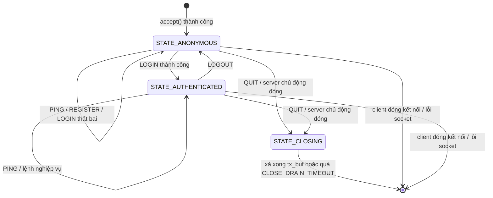
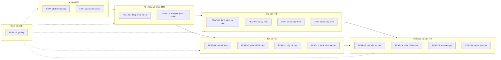

# Đặc tả yêu cầu chức năng (feature specification) — Eventora

| Thông tin dự án | Chi tiết |
| :--- | :--- |
| **Tên dự án** | **Eventora** — ứng dụng quản lý sự kiện và kết nối bạn bè |
| **Mã tài liệu** | `DOC-SPEC-01` |
| **Đường dẫn tệp** | `docs/FEATURE_SPEC.md` |
| **Phiên bản** | `2.0.1` |
| **Ngày lập** | 14/11/2026 (cập nhật: 16/11/2026) |
| **Nhóm tác giả** | `SonNX24042005` & `FATng` |
| **Trạng thái** | Đã duyệt và chốt thiết kế cơ sở (baseline approved) |

### Lịch sử thay đổi

| Phiên bản | Ngày | Nội dung chính |
| :---: | :---: | :--- |
| `1.0.0` | 14/11/2026 | Bản đặc tả đầu tiên cho 17 tính năng. |
| `1.1.0` | 16/11/2026 | Chuẩn hóa cách viết; chốt khung bản tin văn bản theo dòng, băm `PBKDF2-HMAC-SHA256`, chính sách đăng nhập trùng và mô hình một bảng `event_participants`. |
| `2.0.0` | 16/11/2026 | Rà soát toàn diện: trường dạng `khóa=giá trị` và khối phản hồi danh sách nhiều dòng; xử lý tuần tự theo phiên và định danh kết nối không tái sử dụng; danh mục mã lý do và thứ tự kiểm tra lỗi thống nhất; bảng chuyển trạng thái tham gia sự kiện (`Organizer` là người duyệt duy nhất); không để lộ sự kiện `PRIVATE`; chống dò mật khẩu và khóa tài khoản tạm thời; thời gian chờ phiên; ghi log bất đồng bộ; tách chỉ tiêu tải cho lệnh băm mật khẩu. |
| `2.0.1` | 16/11/2026 | Đồng bộ ràng buộc bảng `friendships` (mục 2.9) với `docs/DATABASE_SCHEMA.md`: lưu theo chiều gửi, duy nhất theo cặp không thứ tự. |

---

## 1. Giới thiệu tổng quan

### 1.1. Mục đích tài liệu
Tài liệu này xác định yêu cầu nghiệp vụ và kỹ thuật cho toàn bộ **17 chức năng (tổng điểm: 20 điểm)** của hệ thống **Eventora** theo [README.md](../README.md) và [ROADMAP.md](../ROADMAP.md). Đây là cơ sở thống nhất giữa hai thành viên để:
1. Thiết kế lược đồ cơ sở dữ liệu (`docs/DATABASE_SCHEMA.md` và sơ đồ ERD), tuân thủ các ràng buộc tối thiểu ở mục 2.9.
2. Viết đặc tả giao thức (`docs/PROTOCOL_SPEC.md`): tên khóa và ví dụ của từng lệnh, tuân thủ khung bản tin ở mục 2.2.
3. Cài đặt server (C/C++, socket POSIX, `epoll`, thread pool, SQLite) và client (`libeventora_client`, CLI).
4. Xây dựng unit test (`coverage > 90%`) và kiểm thử tải (`load_tester`).

### 1.2. Phạm vi hệ thống
Hệ thống hoạt động theo mô hình client-server tập trung trên TCP. Server giữ trạng thái kết nối, điều phối truy vấn cơ sở dữ liệu, kiểm soát quyền truy cập và chủ động đẩy thông báo thời gian thực tới các client đang trực tuyến: lời mời kết bạn, trạng thái trực tuyến, lời mời sự kiện, yêu cầu và kết quả duyệt tham gia, cập nhật hoặc hủy sự kiện.

### 1.3. Thuật ngữ và quy ước diễn giải
- **Ký tự**: một Unicode code point sau khi giải mã UTF-8 và bỏ escape. Mọi giới hạn độ dài trong tài liệu tính theo ký tự, trừ khi ghi rõ là byte.
- **Cắt khoảng trắng**: các trường văn bản (trừ mật khẩu) được bỏ khoảng trắng hai đầu trước khi kiểm tra độ dài và trước khi lưu.
- **Trường một dòng**: không được chứa ký tự xuống dòng hoặc tab sau khi bỏ escape. Chỉ `description` (sự kiện) và `bio` (hồ sơ) được phép nhiều dòng.
- **Thời gian**: mọi mốc thời gian là Unix timestamp tính bằng giây (số nguyên 64 bit, UTC). Đồng hồ của server là nguồn chuẩn duy nhất (`now`). Mã nguồn lấy `now` qua một giao diện đồng hồ có thể thay thế, để unit test chủ động điều khiển thời gian.
- **Sự kiện đã kết thúc**: `end_time <= now`. **Sự kiện đang diễn ra**: `start_time <= now < end_time`.
- **Sự kiện xem được**: sự kiện `PUBLIC`, hoặc sự kiện `PRIVATE` mà người gọi là `Organizer`, đang `ACCEPTED` hoặc đang `INVITED` (chi tiết ở FEAT-05).
- **Tham chiếu người dùng**: mọi lệnh có tham số người dùng đích nhận **đúng một** trong hai khóa `user_id` hoặc `username`. Thiếu cả hai hoặc có cả hai → `400 INVALID_FIELD`.
- **Cách viết mã phản hồi**: trong tài liệu, `409 ALREADY_FRIENDS` nghĩa là dòng phản hồi `409|ALREADY_FRIENDS` (mục 2.2).

---

## 2. Quy ước chung và quy tắc hệ thống

### 2.1. Danh mục tác nhân
- **Theo trạng thái phiên**:
  - **`Guest`**: client đã kết nối TCP nhưng chưa đăng nhập.
  - **`User`**: người dùng đã đăng nhập thành công trên kết nối hiện tại.
- **Theo quan hệ hoặc sự kiện cụ thể** (đều là `User`):
  - **`Friend`**: hai người dùng có quan hệ bạn bè `ACCEPTED`.
  - **`Organizer`**: người tạo sự kiện, có toàn quyền sửa, xóa, mời và là **người duy nhất quyết định ai trở thành thành viên** của sự kiện.
  - **`Participant`**: thành viên `ACCEPTED` của sự kiện, không phải `Organizer`.
  - **`Inviter`**: người gửi lời mời tham gia sự kiện (`Organizer`, hoặc `Participant` của sự kiện `PUBLIC`).
  - **`Invitee`**: người nhận lời mời tham gia sự kiện.
  - **`Requester`**: người gửi yêu cầu xin tham gia sự kiện `PUBLIC`.
- **Hạ tầng (`server core`)**: gồm `network thread` (vòng lặp I/O), `worker pool` và `auth pool` (xử lý nghiệp vụ), `logger` (luồng ghi log) và tầng lưu trữ SQLite. Tài liệu dùng thống nhất các tên này.

### 2.2. Khung bản tin và mã hóa trường

Cú pháp cụ thể của từng lệnh (tên khóa, ví dụ) do `docs/PROTOCOL_SPEC.md` quy định, nhưng phải tuân thủ khung chung dưới đây.

- **Ranh giới bản tin**: mỗi bản tin là một dòng văn bản UTF-8 kết thúc bằng `\n`. Server chấp nhận cả `\r\n` lẫn `\n` (bỏ `\r` đứng ngay trước `\n`), để có thể gõ lệnh trực tiếp bằng `nc` (mặc định chỉ gửi `\n`) hoặc `telnet`. Server luôn gửi `\r\n`.
- **Kích thước tối đa**: mỗi dòng dài tối đa `MAX_FRAME_SIZE` (65.536 byte, tính cả ký tự kết thúc), áp dụng cho cả hai chiều.
- **Cấu trúc dòng**: `<đầu dòng>[|<khóa>=<giá trị>]...`
  - Yêu cầu: đầu dòng là tên lệnh viết `UPPER_SNAKE_CASE`, ví dụ `LOGIN`.
  - Phản hồi: đầu dòng là `<mã trạng thái>|<mã lý do>`, ví dụ `409|ALREADY_FRIENDS`. Phản hồi thành công dùng mã lý do `OK` (200) hoặc `CREATED` (201); riêng `PING` và `QUIT` trả `200|PONG` và `200|BYE`.
  - Thông báo đẩy: `<mã 1xx>|<tên thông báo>`, ví dụ `101|PUSH_FRIEND_REQ`.
  - Khóa gồm chữ thường, chữ số và `_` (`[a-z0-9_]+`), không trùng lặp trong cùng một dòng. Giá trị là phần nằm sau dấu `=` đầu tiên.
- **Escape trong giá trị**: `\` → `\\`, `|` → `\|`, CR (0x0D) → `\r` (hai ký tự `\` và `r`), LF (0x0A) → `\n`, TAB (0x09) → `\t`. Các ký tự điều khiển khác (U+0000–U+001F, U+007F) bị cấm. Chuỗi escape không thuộc danh sách này là lỗi khung.
- **Trường vắng mặt và trường rỗng**: không có khóa nghĩa là "không cung cấp"; `khóa=` (giá trị rỗng) nghĩa là chuỗi rỗng. Nhờ đó các lệnh cập nhật phân biệt được "giữ nguyên" và "xóa trắng".
- **Kiểu dữ liệu**: số nguyên viết dạng thập phân; boolean là `0`/`1`; giá trị liệt kê viết `UPPER_SNAKE_CASE`.
- **Khóa lạ**: khóa không được định nghĩa cho lệnh → `400 INVALID_FIELD`, giúp phát hiện sớm lỗi gõ sai ở client.
- **Khối phản hồi danh sách**: lệnh trả danh sách gửi một dòng tiêu đề có `total`, `page`, `page_size`, `count=N`, tiếp theo là đúng `N` dòng `ITEM|...`, mỗi dòng một phần tử. Server ghi cả khối vào `tx_buf` trong một lần giữ khóa, nên không thông báo đẩy nào chen được vào giữa khối.
- **Thứ tự**: phản hồi của một kết nối luôn đúng thứ tự các yêu cầu; client có thể gửi liên tiếp nhiều lệnh mà không chờ (FEAT-02 bảo đảm điều này). Thông báo đẩy có thể xuất hiện giữa hai phản hồi và được nhận biết bằng mã `1xx`.

Ví dụ minh họa (`C` là client, `S` là server, dòng thứ hai của khối danh sách được rút gọn):

```text
C: LOGIN|username=an_nguyen|password=matkhau123
S: 200|OK|user_id=5|username=an_nguyen|full_name=Nguyễn An|pending_friend_requests=2|pending_event_invitations=1|pending_join_requests=0
C: GET_EVENTS|scope=ALL|page=1|page_size=2
S: 200|OK|total=5|page=1|page_size=2|count=2
S: ITEM|event_id=12|title=Họp lớp K68|location=Hà Nội|start_time=1796475600|end_time=1796482800|visibility=PUBLIC|creator_id=5|creator_name=Nguyễn An|participant_count=3|max_participants=0|my_relation=OWNER|pending_request_count=1
S: ITEM|event_id=15|title=Đá bóng \| giao hữu|location=Sân Bách Khoa|...
S: 110|PUSH_EVENT_INVITE|event_id=20|title=Sinh nhật Bình|inviter_id=7|inviter_name=Trần Bình|pre_approved=1
```

### 2.3. Máy trạng thái phiên làm việc



- **Lệnh hợp lệ theo trạng thái**:

| Lệnh | `STATE_ANONYMOUS` | `STATE_AUTHENTICATED` | `STATE_CLOSING` |
| :--- | :--- | :--- | :--- |
| `PING` | `200 PONG` | `200 PONG` | bỏ qua |
| `QUIT` | `200 BYE` → `STATE_CLOSING` | `200 BYE` → `STATE_CLOSING` | bỏ qua |
| `REGISTER`, `LOGIN` | cho phép | `400 ALREADY_AUTHENTICATED` | bỏ qua |
| `LOGOUT` và mọi lệnh nghiệp vụ | `401 AUTHENTICATION_REQUIRED` | cho phép (theo phân quyền đối tượng) | bỏ qua |
| Lệnh không tồn tại | `400 UNKNOWN_COMMAND` | `400 UNKNOWN_COMMAND` | bỏ qua |

- **`STATE_CLOSING`**: server ngừng đọc socket (gỡ `EPOLLIN`), xả nốt `tx_buf` rồi đóng. Nếu sau `CLOSE_DRAIN_TIMEOUT` vẫn chưa xả xong thì đóng luôn. Mọi lần server chủ động đóng kết nối đều đi qua trạng thái này, để client nhận được bản tin cuối (`199`, `200 BYE` hoặc `400 FRAME_TOO_LARGE`). Các lý do server chủ động đóng: đăng nhập nơi khác, hết thời gian chờ, sai mật khẩu quá số lần, dòng quá dài, tắt server.
- **Thời gian chờ**: tính từ bản tin hợp lệ gần nhất (kể cả `PING`): `ANON_IDLE_TIMEOUT` ở `STATE_ANONYMOUS`, `AUTH_IDLE_TIMEOUT` ở `STATE_AUTHENTICATED`. Hết hạn → `199 PUSH_SESSION_TERMINATED` (`reason=IDLE_TIMEOUT`) rồi sang `STATE_CLOSING`. Khi đã đăng nhập và không có lệnh nào khác, `libeventora_client` tự gửi `PING` sau mỗi `CLIENT_PING_INTERVAL`; khi bị đóng do chờ lâu ở `STATE_ANONYMOUS`, client tự kết nối lại ở lệnh kế tiếp.
- Client đóng kết nối hoặc lỗi socket ở bất kỳ trạng thái nào → giải phóng phiên ngay (dọn phiên như FEAT-04 nếu đang đăng nhập).

### 2.4. Mã trạng thái và mã lý do

#### 2.4.1. Nhóm mã trạng thái

| Mã | Ý nghĩa | Nguyên tắc dùng |
| :---: | :--- | :--- |
| `1xx` | Thông báo đẩy | Server chủ động gửi, không gắn với yêu cầu nào (danh mục ở mục 2.6). |
| `200`, `201` | Thành công | `200 OK` cho truy vấn và cập nhật; `201 CREATED` khi tạo bản ghi mới. |
| `400` | Yêu cầu sai cú pháp hoặc sai miền giá trị | Kiểm tra được mà không cần đọc cơ sở dữ liệu. |
| `401` | Chưa xác thực hoặc xác thực thất bại | Chỉ dùng cho trạng thái đăng nhập và lệnh `LOGIN`. |
| `403` | Không đủ quyền với đối tượng mà người gọi xem được | |
| `404` | Đối tượng không tồn tại, hoặc người gọi không được phép biết đối tượng tồn tại | Sự kiện `PRIVATE` mà người gọi không xem được luôn trả `404`, không bao giờ trả `403`. |
| `409` | Xung đột với trạng thái hiện tại của dữ liệu | Trùng lặp, đã xử lý, đã đầy, đã kết thúc. |
| `422` | Đúng cú pháp nhưng vi phạm quy tắc ngữ nghĩa | Chủ yếu là quy tắc thời gian và mật khẩu. |
| `500`, `503` | Lỗi phía server | `500` là lỗi nội bộ đã được bắt; `503` là quá tải tạm thời. |

#### 2.4.2. Danh mục mã lý do

| Mã | Mã lý do | Khi nào |
| :---: | :--- | :--- |
| 400 | `MALFORMED_FRAME` | UTF-8 không hợp lệ, ký tự điều khiển bị cấm, escape hỏng, khóa sai định dạng hoặc trùng lặp. |
| 400 | `FRAME_TOO_LARGE` | Dòng vượt `MAX_FRAME_SIZE`; server gửi phản hồi rồi chuyển sang `STATE_CLOSING`. |
| 400 | `UNKNOWN_COMMAND` | Tên lệnh không tồn tại. |
| 400 | `INVALID_FIELD` | Thiếu trường bắt buộc, khóa lạ, sai kiểu, sai độ dài hoặc sai giá trị liệt kê; phản hồi kèm `field=<tên khóa>`. |
| 400 | `NOTHING_TO_UPDATE` | Lệnh cập nhật không chứa trường nào để sửa. |
| 400 | `CANNOT_TARGET_SELF` | Người dùng đích là chính người gọi (kết bạn, hủy kết bạn, mời vào sự kiện). |
| 400 | `ALREADY_AUTHENTICATED` | Gửi `LOGIN` hoặc `REGISTER` khi kết nối đã đăng nhập. |
| 401 | `AUTHENTICATION_REQUIRED` | Gửi lệnh cần đăng nhập khi đang ở `STATE_ANONYMOUS`. |
| 401 | `INVALID_CREDENTIALS` | Sai tên đăng nhập hoặc mật khẩu (một mã chung cho cả hai trường hợp). |
| 403 | `ACCOUNT_LOCKED` | Tài khoản đang bị khóa tạm thời; kèm `retry_after=<số giây>`. |
| 403 | `OLD_PASSWORD_INCORRECT` | `CHANGE_PASSWORD` với mật khẩu cũ sai. |
| 403 | `NOT_EVENT_ORGANIZER` | Thao tác chỉ dành cho `Organizer`. |
| 403 | `NOT_AUTHORIZED_TO_INVITE` | Người gọi không có quyền mời trong sự kiện này. |
| 403 | `NOT_FRIENDS` | Mời người không phải bạn bè vào sự kiện. |
| 403 | `NOT_REQUEST_ADDRESSEE` | Phản hồi một lời mời kết bạn không gửi cho mình. |
| 404 | `USER_NOT_FOUND` | Người dùng đích không tồn tại. |
| 404 | `EVENT_NOT_FOUND` | Sự kiện không tồn tại hoặc người gọi không xem được. |
| 404 | `FRIEND_REQUEST_NOT_FOUND` | Lời mời kết bạn không tồn tại (kể cả đã bị từ chối). |
| 404 | `FRIENDSHIP_NOT_FOUND` | Hai người không phải bạn bè. |
| 404 | `INVITATION_NOT_FOUND` | Người gọi không có lời mời `INVITED` cho sự kiện. |
| 404 | `JOIN_REQUEST_NOT_FOUND` | Người dùng đích không có yêu cầu `REQUEST_PENDING` cho sự kiện. |
| 409 | `USERNAME_ALREADY_EXISTS` | Tên đăng nhập đã được dùng. |
| 409 | `ALREADY_FRIENDS` | Hai người đã là bạn bè. |
| 409 | `FRIEND_REQUEST_PENDING` | Người gọi đã gửi lời mời kết bạn và đang chờ. |
| 409 | `REQUEST_ALREADY_PROCESSED` | Lời mời kết bạn đã được chấp nhận trước đó. |
| 409 | `ALREADY_MEMBER` | Người dùng đích đã là `Organizer` hoặc `ACCEPTED` của sự kiện. |
| 409 | `INVITATION_PENDING` | Người dùng đích đang có lời mời `INVITED` cho sự kiện. |
| 409 | `JOIN_REQUEST_PENDING` | Người dùng đích đang có yêu cầu `REQUEST_PENDING`. |
| 409 | `JOIN_REQUEST_REJECTED` | Người dùng đích từng bị `Organizer` từ chối; chỉ `Organizer` mời lại được. |
| 409 | `EVENT_CAPACITY_REACHED` | Sự kiện đã đủ `max_participants`. |
| 409 | `EVENT_ALREADY_FINISHED` | Thao tác trên sự kiện đã kết thúc. |
| 409 | `CAPACITY_LESS_THAN_CURRENT_MEMBERS` | Giảm `max_participants` xuống dưới số thành viên hiện có. |
| 422 | `START_TIME_IN_PAST` | Thời điểm bắt đầu không nằm trong tương lai. |
| 422 | `INVALID_EVENT_TIMES` | Vi phạm quy tắc thời lượng, giới hạn xa nhất hoặc quy tắc sửa thời gian. |
| 422 | `PASSWORD_UNCHANGED` | Mật khẩu mới trùng mật khẩu cũ. |
| 500 | `INTERNAL_ERROR` | Lỗi nội bộ đã được bắt; server vẫn chạy. |
| 503 | `SERVER_BUSY` | Hết file descriptor, đủ `MAX_CLIENTS`, hoặc SQLite vẫn bận sau số lần thử lại cho phép. |

### 2.5. Thứ tự kiểm tra lỗi
Khi một yêu cầu vi phạm nhiều quy tắc, server trả lỗi của bước kiểm tra **đầu tiên** thất bại theo thứ tự cố định dưới đây, để client và unit test có kết quả xác định:

1. Khung bản tin (`MALFORMED_FRAME`, `FRAME_TOO_LARGE`).
2. Tên lệnh (`UNKNOWN_COMMAND`).
3. Trạng thái phiên (`AUTHENTICATION_REQUIRED`, `ALREADY_AUTHENTICATED`).
4. Cú pháp và miền giá trị của từng trường, kiểm tra được mà không cần đọc cơ sở dữ liệu (`INVALID_FIELD`, `NOTHING_TO_UPDATE`, `CANNOT_TARGET_SELF`).
5. Đối tượng chính (người dùng đích, sự kiện, lời mời kết bạn) tồn tại và xem được (`404`).
6. Quyền thao tác trên đối tượng chính (`403`).
7. Bản ghi phụ thuộc (quan hệ bạn bè, lời mời sự kiện, yêu cầu tham gia) tồn tại (`404`).
8. Trạng thái nghiệp vụ và quy tắc ngữ nghĩa (`409`, `422`), theo đúng thứ tự trong mục "Các trường hợp lỗi" của từng tính năng.

Lỗi `500`/`503` có thể xảy ra ở bất kỳ bước nào. Mục "Các trường hợp lỗi" của mỗi tính năng liệt kê lỗi theo đúng thứ tự trên.

### 2.6. Thông báo đẩy

- Chỉ gửi tới phiên đang trực tuyến; không lưu lại cho người offline. **Mỗi thông báo đều có lệnh truy vấn bù** (cột cuối bảng), để người dùng vừa đăng nhập lấy lại đủ thông tin.
- Không gửi cho chính người thực hiện hành động, vì họ đã nhận phản hồi `2xx`.
- Thông báo chỉ được tạo sau khi giao dịch cơ sở dữ liệu commit thành công, rồi mới ghi vào `tx_buf` của người nhận.
- Mỗi thông báo mang đủ định danh (`event_id`, `user_id`, `request_id`...) và tên hiển thị, để client cập nhật giao diện mà không cần hỏi lại.
- Client CLI dùng `poll()` theo dõi đồng thời bàn phím (`STDIN_FILENO`) và socket, để hiển thị thông báo ngay cả khi người dùng đang gõ lệnh.

| Mã | Tên | Người nhận | Phát sinh khi | Lệnh truy vấn bù |
| :---: | :--- | :--- | :--- | :--- |
| `101` | `PUSH_FRIEND_REQ` | người nhận lời mời | FEAT-09 tạo lời mời `PENDING` | `GET_FRIEND_REQUESTS` |
| `102` | `PUSH_FRIEND_ACC` | người đã gửi lời mời | FEAT-10 `ACCEPT`; FEAT-09 tự xác lập khi hai bên cùng mời | `GET_FRIENDS` |
| `103` | `PUSH_FRIEND_STATUS` | bạn bè đang trực tuyến | FEAT-04 đăng nhập, đăng xuất, mất kết nối | `GET_FRIENDS` |
| `104` | `PUSH_FRIEND_REMOVED` | người bị hủy kết bạn | FEAT-11 | `GET_FRIENDS` |
| `110` | `PUSH_EVENT_INVITE` | người được mời | chuyển sang `INVITED` (FEAT-13) | `GET_EVENTS` với `scope=INVITED` |
| `111` | `PUSH_JOIN_REQ` | `Organizer` | chuyển sang `REQUEST_PENDING` (FEAT-14, FEAT-15) | `GET_EVENT_MEMBERS` với `status=REQUEST_PENDING` |
| `112` | `PUSH_JOIN_DECIDED` | người xin tham gia | yêu cầu được duyệt, bị từ chối, hoặc bị hủy do sự kiện chuyển sang `PRIVATE` (FEAT-07, FEAT-13, FEAT-16) | `GET_EVENTS` với `scope=JOINED` hoặc `REQUESTED` |
| `113` | `PUSH_INVITATION_RESPONDED` | người đã mời (`invited_by`) | lời mời được chấp nhận, chuyển thành chờ duyệt, hoặc bị từ chối (FEAT-14, FEAT-15) | `GET_EVENT_MEMBERS` (đầy đủ với `Organizer`) |
| `114` | `PUSH_INVITATION_REVOKED` | người được mời | lời mời bị thu hồi (FEAT-07, FEAT-11) | `GET_EVENTS` với `scope=INVITED` |
| `120` | `PUSH_EVENT_UPDATED` | người `ACCEPTED`, `INVITED`, `REQUEST_PENDING` (trừ `Organizer`) | FEAT-07 | `GET_EVENT_DETAIL` |
| `121` | `PUSH_EVENT_CANCELLED` | như `120` | FEAT-08 xóa sự kiện chưa kết thúc | `GET_EVENTS` |
| `199` | `PUSH_SESSION_TERMINATED` | chính kết nối sắp bị đóng | server chủ động đóng; `reason` là `LOGGED_IN_ELSEWHERE`, `IDLE_TIMEOUT`, `TOO_MANY_FAILED_ATTEMPTS` hoặc `SERVER_SHUTDOWN` | — |

### 2.7. Tham số cấu hình mặc định
Mọi tham số có thể ghi đè bằng tùy chọn dòng lệnh, ví dụ `./eventora_server --port 8888 --log logs/eventora_server.log --db data/eventora.db`.

| Tham số | Mặc định | Ý nghĩa |
| :--- | :---: | :--- |
| `PORT` | `8888` | Cổng lắng nghe. |
| `BIND_ADDR` | `0.0.0.0` | Địa chỉ lắng nghe. |
| `THREAD_POOL_SIZE` | `8` | Số luồng `worker pool` cho lệnh thường (cho phép 4–16). |
| `AUTH_POOL_SIZE` | `4` | Số luồng `auth pool` cho lệnh băm mật khẩu. |
| `MAX_CLIENTS` | `2048` | Số kết nối đồng thời tối đa. |
| `MAX_FRAME_SIZE` | `65536` byte | Độ dài tối đa một dòng, cả hai chiều. |
| `MAX_INBOX_FRAMES` | `32` | Số bản tin chờ xử lý tối đa của một phiên. |
| `MAX_TX_BUFFER` | `1048576` byte | Dung lượng tối đa bộ đệm gửi của một phiên (1 MiB). |
| `ANON_IDLE_TIMEOUT` | `60` s | Thời gian chờ ở `STATE_ANONYMOUS`. |
| `AUTH_IDLE_TIMEOUT` | `300` s | Thời gian chờ ở `STATE_AUTHENTICATED`. |
| `CLIENT_PING_INTERVAL` | `60` s | Chu kỳ client tự gửi `PING` (phía client). |
| `CLOSE_DRAIN_TIMEOUT` | `2` s | Thời gian tối đa để xả `tx_buf` trước khi đóng. |
| `PBKDF2_ITERATIONS` | `600000` | Số vòng lặp băm mật khẩu. |
| `MAX_FAILED_LOGINS_PER_CONN` | `5` | Số lần sai mật khẩu liên tiếp tối đa trên một kết nối. |
| `ACCOUNT_LOCK_THRESHOLD` | `10` | Số lần sai liên tiếp của một tài khoản trước khi khóa tạm thời. |
| `ACCOUNT_LOCK_DURATION` | `900` s | Thời gian khóa tạm thời. |
| `DEFAULT_PAGE_SIZE` / `MAX_PAGE_SIZE` | `20` / `50` | Phân trang cho mọi lệnh trả danh sách. |
| `SQLITE_BUSY_TIMEOUT` | `5000` ms | `busy_timeout` của mỗi kết nối SQLite. |
| `SQLITE_MAX_RETRIES` | `3` | Số lần chạy lại một giao dịch gặp `SQLITE_BUSY`. |
| `LOG_QUEUE_CAPACITY` | `8192` | Số bản ghi tối đa trong hàng đợi log. |
| `DB_PATH` | `data/eventora.db` | Tệp cơ sở dữ liệu. |
| `LOG_PATH` | `logs/eventora_server.log` | Tệp log. |

### 2.8. Quy tắc lưu trữ và giao dịch
- Mọi câu SQL dùng prepared statement (`sqlite3_prepare_v2` và `sqlite3_bind_*`); cấm nối chuỗi đầu vào vào câu lệnh SQL. Tìm kiếm bằng `LIKE` phải escape `%`, `_`, `\` và dùng mệnh đề `ESCAPE '\'`.
- Mỗi kết nối SQLite khi mở phải chạy `PRAGMA foreign_keys = ON` (SQLite tắt ràng buộc khóa ngoại theo mặc định và cấu hình này tính theo từng kết nối) và đặt `busy_timeout`. Cơ sở dữ liệu dùng `journal_mode = WAL` và `synchronous = NORMAL`.
- Mọi giao dịch "đọc rồi ghi" (kiểm tra trùng lặp, sức chứa, trạng thái rồi cập nhật) phải mở bằng `BEGIN IMMEDIATE`, để lấy khóa ghi ngay từ đầu. Theo tài liệu SQLite, giao dịch mặc định (`DEFERRED`) chỉ nâng lên giao dịch ghi khi gặp câu lệnh ghi, và thất bại với `SQLITE_BUSY` nếu kết nối khác đã ghi chen vào ([nguồn](https://www.sqlite.org/lang_transaction.html), tra cứu 16/11/2026).
- Gặp `SQLITE_BUSY` thì rollback và chạy lại **toàn bộ** giao dịch, tối đa `SQLITE_MAX_RETRIES` lần, sau đó trả `503 SERVER_BUSY`.
- Giao dịch phải ngắn: không băm mật khẩu và không gửi dữ liệu mạng khi đang giữ giao dịch.

### 2.9. Ràng buộc dữ liệu tối thiểu (đầu vào cho `docs/DATABASE_SCHEMA.md`)
- **`users`**: `username` duy nhất không phân biệt hoa thường (`COLLATE NOCASE`), lưu nguyên dạng người dùng nhập; `password_hash` (32 byte), `salt` (16 byte), `pbkdf2_iterations`; `failed_login_count`, `locked_until`; `full_name`, `email` (có thể `NULL`), `bio`, `created_at`, `last_seen`.
- **`friendships`**: lưu theo chiều gửi (`requester_id`, `addressee_id`, với `CHECK(requester_id <> addressee_id)`), nhưng mỗi cặp người dùng có **tối đa một** bản ghi bất kể chiều gửi, bảo đảm bằng chỉ mục duy nhất trên cặp không thứ tự (chi tiết ở `docs/DATABASE_SCHEMA.md`). `status` chỉ gồm `PENDING` và `ACCEPTED` (từ chối và hủy kết bạn đều xóa bản ghi). Thêm `message`, `created_at`, `updated_at`.
- **`events`**: `creator_id` (khóa ngoại tới `users`), `visibility IN ('PUBLIC', 'PRIVATE')`, `max_participants >= 0`, `CHECK(end_time - start_time >= 900)`, `created_at`, `updated_at`.
- **`event_participants`**: `UNIQUE(event_id, user_id)`; khóa ngoại `event_id` tới `events` với `ON DELETE CASCADE`; `role IN ('ORGANIZER', 'PARTICIPANT')`; `status IN ('INVITED', 'REQUEST_PENDING', 'ACCEPTED', 'DECLINED', 'REJECTED')`; `invited_by` (có thể `NULL`), `message`, `created_at`, `updated_at`. Mỗi sự kiện có đúng một bản ghi `ORGANIZER`.

---

## 3. Bảng tổng hợp 17 tính năng (20 điểm)

| STT | Mã tính năng | Tên tính năng | Phân nhóm | Tác nhân chính | Lệnh giao thức | Điểm |
| :---: | :---: | :--- | :--- | :--- | :--- | :---: |
| 1 | `FEAT-01` | Xử lý truyền dòng | Hạ tầng mạng và giao thức | `server core`, `libeventora_client` | dùng cho mọi lệnh | 1 |
| 2 | `FEAT-02` | Cài đặt cơ chế vào/ra socket trên server | Hạ tầng mạng và giao thức | `server core` | — | 2 |
| 3 | `FEAT-03` | Đăng ký và quản lý tài khoản | Tài khoản và phiên | Guest, User | `REGISTER`, `GET_PROFILE`, `UPDATE_PROFILE`, `CHANGE_PASSWORD` | 2 |
| 4 | `FEAT-04` | Đăng nhập và quản lý phiên | Tài khoản và phiên | Guest, User | `LOGIN`, `LOGOUT`, `PING`, `QUIT` | 2 |
| 5 | `FEAT-05` | Lấy danh sách sự kiện | Quản lý sự kiện | User | `GET_EVENTS`, `GET_EVENT_DETAIL`, `GET_EVENT_MEMBERS` | 1 |
| 6 | `FEAT-06` | Tạo mới sự kiện | Quản lý sự kiện | User (trở thành Organizer) | `CREATE_EVENT` | 1 |
| 7 | `FEAT-07` | Sửa thông tin sự kiện | Quản lý sự kiện | Organizer | `UPDATE_EVENT` | 1 |
| 8 | `FEAT-08` | Xóa thông tin sự kiện | Quản lý sự kiện | Organizer | `DELETE_EVENT` | 1 |
| 9 | `FEAT-09` | Gửi lời mời kết bạn | Kết nối bạn bè | User | `SEND_FRIEND_REQUEST` | 1 |
| 10 | `FEAT-10` | Chấp nhận/từ chối lời mời kết bạn | Kết nối bạn bè | User (người nhận) | `RESPOND_FRIEND_REQUEST` | 1 |
| 11 | `FEAT-11` | Hủy kết bạn | Kết nối bạn bè | Friend | `UNFRIEND` | 1 |
| 12 | `FEAT-12` | Hiển thị danh sách bạn bè | Kết nối bạn bè | User | `GET_FRIENDS`, `GET_FRIEND_REQUESTS` | 1 |
| 13 | `FEAT-13` | Gửi lời mời tham gia sự kiện | Tham gia sự kiện | Organizer, Participant (`PUBLIC`) | `INVITE_TO_EVENT` | 1 |
| 14 | `FEAT-14` | Chấp nhận lời mời tham gia | Tham gia sự kiện | Invitee | `RESPOND_EVENT_INVITATION` | 1 |
| 15 | `FEAT-15` | Yêu cầu tham gia sự kiện | Tham gia sự kiện | Requester | `REQUEST_JOIN_EVENT` | 1 |
| 16 | `FEAT-16` | Chấp nhận yêu cầu tham gia sự kiện | Tham gia sự kiện | Organizer | `DECIDE_JOIN_REQUEST` | 1 |
| 17 | `FEAT-17` | Ghi log hoạt động | Hệ thống và giám sát | `server core` (`logger`) | — | 1 |

---

## 4. Đặc tả chi tiết toàn bộ 17 tính năng



*Mũi tên liền: phụ thuộc chức năng. Mũi tên nét đứt: FEAT-17 được mọi nhóm dùng chung, nên cài đặt ngay từ giai đoạn 1 theo `ROADMAP.md`.*

---

### Phân nhóm I: hạ tầng mạng và giao thức

---

#### 4.1. FEAT-01: Xử lý truyền dòng (stream framing and buffer management)
- **Mức độ quan trọng / điểm**: nền tảng giao thức (1 điểm).
- **Tác nhân**: `network thread` trên server và lõi mạng client (`libeventora_client`); cả hai dùng chung module `protocol/`.
- **Mục tiêu**: tách đúng từng bản tin từ dòng byte TCP, xử lý triệt để dính gói (nhiều bản tin trong một lần `recv()`) và phân mảnh gói (một bản tin chia qua nhiều lần `recv()`).
- **Đầu vào**:
  - Dòng byte thô nhận từ `recv()`.
  - Bộ đệm nhận riêng theo kết nối: `rx_buf` dung lượng `MAX_FRAME_SIZE` (64 KiB) và `rx_len`.
  - Bộ đệm gửi riêng theo kết nối: `tx_buf` co giãn, tối đa `MAX_TX_BUFFER`, bảo vệ bằng mutex riêng.
  - Khung bản tin theo mục 2.2.
- **Quy tắc kiểm tra nghiệp vụ**:
  - **Tách khung**: sau mỗi lần `recv()`, nối dữ liệu vào cuối `rx_buf`, rồi lặp tìm `\n` để cắt mọi bản tin hoàn chỉnh (bỏ `\r` liền trước nếu có) và chuyển vào `inbox` của phiên (FEAT-02). Phần dư chưa có `\n` được dời về đầu bộ đệm (`memmove`) để chờ lần đọc sau.
  - **Phân mảnh**: nếu `rx_buf` chưa có `\n`, giữ nguyên dữ liệu và chờ sự kiện `EPOLLIN` tiếp theo.
  - **Giới hạn**: `rx_buf` đã đầy `MAX_FRAME_SIZE` byte mà vẫn chưa có `\n` → lỗi `FRAME_TOO_LARGE`.
  - **Giải mã**: sau khi cắt khung, kiểm tra UTF-8 hợp lệ, ký tự điều khiển bị cấm, cú pháp `khóa=giá trị`, khóa trùng và chuỗi escape, rồi bỏ escape để được giá trị gốc. Phía gửi mã hóa ngược lại và tự kiểm tra dòng kết quả không vượt `MAX_FRAME_SIZE`.
  - **Gửi đi**:
    - Server (socket `O_NONBLOCK`): `network thread` lặp `send()` để xả `tx_buf`; gặp `EINTR` thì gửi lại, gặp `EAGAIN`/`EWOULDBLOCK` thì giữ phần còn lại và chờ `EPOLLOUT`.
    - Client (socket blocking): hàm `send_all()` lặp đến khi gửi hết hoặc gặp lỗi thật.
    - Mọi lời gọi `send()` dùng cờ `MSG_NOSIGNAL`.
  - **Giới hạn bộ đệm gửi**: nếu ghi thêm vào `tx_buf` làm vượt `MAX_TX_BUFFER` (client không đọc kịp), hủy phần ghi đó, ghi log `WARN` và đóng kết nối ngay. Trường hợp này không đi qua `STATE_CLOSING`, vì không thể xả bộ đệm.
- **Kết quả mong muốn**:
  - Tầng nghiệp vụ nhận đúng, đủ, trọn vẹn từng bản tin theo thứ tự gửi.
  - Không đọc hoặc ghi tràn bộ nhớ, không để lại byte thừa giữa hai bản tin.
  - Unit test cắt bản tin thành mảnh 1 byte, 2 byte và ngẫu nhiên, hoặc ghép 100 bản tin trong một lần đọc, đều tách đúng 100%. Mã hóa rồi giải mã mọi chuỗi chứa `\`, `|`, `=`, CR, LF, TAB và ký tự tiếng Việt đều cho lại chuỗi gốc.
- **Các trường hợp lỗi**:
  - Dòng vượt `MAX_FRAME_SIZE` → ghi log `WARN`, trả `400 FRAME_TOO_LARGE`, chuyển kết nối sang `STATE_CLOSING`.
  - Khung sai cấu trúc (UTF-8 hỏng, ký tự điều khiển bị cấm, escape hỏng, khóa sai định dạng hoặc trùng) → `400 MALFORMED_FRAME`, giữ kết nối.
  - `recv() == 0` (phía bên kia đóng) hoặc `ECONNRESET` → dọn phiên, giải phóng bộ đệm, đóng descriptor.
  - Ghi vào socket đã đóng (`EPIPE`) → đóng kết nối; server không bị dừng vì đã chặn `SIGPIPE`.

---

#### 4.2. FEAT-02: Cài đặt cơ chế vào/ra socket trên server (I/O multiplexing and worker pool)
- **Mức độ quan trọng / điểm**: trọng tâm kỹ thuật hệ thống (2 điểm).
- **Tác nhân**: `server core`.
- **Mục tiêu**: phục vụ đồng thời hàng nghìn kết nối bằng socket non-blocking, `epoll` và thread pool; bảo đảm thứ tự xử lý trong từng kết nối và an toàn bộ nhớ khi nhiều luồng cùng chạm tới một phiên.
- **Đầu vào**:
  - Tham số cấu hình ở mục 2.7.
  - Sự kiện `epoll`: `EPOLLIN`, `EPOLLOUT`, `EPOLLERR`, `EPOLLHUP`, `EPOLLRDHUP`; `eventfd` để đánh thức vòng lặp I/O; tín hiệu `SIGINT`/`SIGTERM`.
- **Quy tắc kiểm tra nghiệp vụ**:
  - **Khởi tạo socket**: `listen_fd` và mọi `client_fd` ở chế độ `O_NONBLOCK` (dùng `accept4(..., SOCK_NONBLOCK | SOCK_CLOEXEC)`); bật `SO_REUSEADDR`; `signal(SIGPIPE, SIG_IGN)`; nâng `RLIMIT_NOFILE` đủ cho `MAX_CLIENTS` cộng phần dự phòng.
  - **Ghép kênh**: dùng `epoll` ở chế độ level-triggered. Chỉ đăng ký `EPOLLOUT` khi `tx_buf` còn dữ liệu và gỡ ngay khi đã xả hết, để vòng lặp không chiếm 100% CPU.
  - **Định danh và vòng đời phiên**:
    - Mỗi kết nối có cấu trúc `client_session_t` với `conn_id` 64 bit tăng dần, **không bao giờ tái sử dụng**. Số `fd` thì khác: hệ điều hành có thể cấp lại ngay sau khi đóng, nên không được dùng `fd` để định danh người nhận.
    - `client_session_t` có bộ đếm tham chiếu (`refcount`). Worker muốn ghi phản hồi hoặc thông báo đẩy phải tra phiên theo `conn_id` (hoặc theo `user_id` trong `session_map`) dưới khóa, và tăng `refcount` trước khi dùng. Khi đóng kết nối, `network thread` chỉ đánh dấu `closed` và gỡ phiên khỏi các bảng tra cứu; bộ nhớ được giải phóng khi `refcount` về 0. Ghi vào phiên đã `closed` thì bỏ qua.
  - **Xử lý tuần tự trong từng phiên, song song giữa các phiên**:
    - `network thread` đưa bản tin đã tách vào `inbox` của phiên (tối đa `MAX_INBOX_FRAMES`). Khi `inbox` đầy, tạm gỡ `EPOLLIN` của socket đó cho đến khi worker xử lý bớt; TCP sẽ tự giảm tốc phía gửi (backpressure).
    - Hàng đợi chung `ready_queue` chứa **phiên**, không chứa bản tin. Mỗi phiên có tối đa một mục trong hàng đợi (cờ `scheduled`), nên dung lượng `MAX_CLIENTS` là đủ và hàng đợi không bao giờ tràn.
    - Worker lấy một phiên, xử lý **một** bản tin đầu `inbox`, ghi phản hồi vào `tx_buf` rồi đánh thức `network thread` qua `eventfd`. Nếu `inbox` còn bản tin thì đưa phiên về cuối `ready_queue` (công bằng giữa các phiên), ngược lại xóa cờ `scheduled`. Nhờ vậy, tại mỗi thời điểm mỗi phiên chỉ có một bản tin được xử lý, và phản hồi luôn đúng thứ tự yêu cầu.
  - **Tách luồng cho lệnh băm mật khẩu**: `REGISTER`, `LOGIN` và `CHANGE_PASSWORD` được chuyển sang `auth_queue`, do `AUTH_POOL_SIZE` luồng riêng xử lý. Với 600.000 vòng PBKDF2, mỗi lần băm tốn khoảng 125 ms CPU (đo qua OpenSSL 3.0.13 trên máy phát triển ngày 16/11/2026), nên nếu không tách, một đợt đăng nhập dồn dập sẽ chiếm hết `worker pool` của các lệnh nhanh.
  - **Đồng bộ hóa**:
    - `pthread_mutex_t` và `pthread_cond_t` cho `ready_queue` và `auth_queue`.
    - Mutex riêng cho `tx_buf` và `inbox` của mỗi phiên.
    - `pthread_rwlock_t` cho `session_map` (ánh xạ `user_id` → phiên).
    - Thứ tự lấy khóa cố định: `session_map` → khóa của phiên → khóa hàng đợi, để tránh deadlock.
  - **SQLite**: mỗi luồng `worker pool` và `auth pool` sở hữu một kết nối `sqlite3 *` riêng, cấu hình theo mục 2.8.
  - **Từ chối kết nối khi quá tải**:
    - Đã đủ `MAX_CLIENTS`: vẫn `accept()`, gửi `503 SERVER_BUSY` rồi đóng ngay.
    - `accept()` lỗi `EMFILE`/`ENFILE`: server giữ sẵn một descriptor dự phòng (mở `/dev/null` khi khởi động). Khi gặp lỗi: đóng descriptor dự phòng, `accept()` kết nối đang chờ, gửi `503 SERVER_BUSY`, đóng kết nối đó rồi mở lại descriptor dự phòng. Nếu không làm vậy, `listen_fd` luôn ở trạng thái sẵn sàng đọc và vòng lặp `epoll` quay liên tục.
  - **Tắt server an toàn**: khi nhận `SIGINT`/`SIGTERM` (qua `signalfd`, hoặc cờ kèm `eventfd`), server ngừng `accept()`, gửi `199 PUSH_SESSION_TERMINATED` (`reason=SERVER_SHUTDOWN`) tới mọi phiên, xả `tx_buf`, chờ các luồng xong việc, đóng cơ sở dữ liệu và giải phóng toàn bộ tài nguyên. Đây là điều kiện để `Valgrind` báo sạch.
- **Kết quả mong muốn**:
  - Giữ ổn định từ vài trăm tới ít nhất 2.000 kết nối đồng thời.
  - `network thread` không bao giờ chặn: không băm mật khẩu, không truy vấn SQLite, không ghi tệp log trực tiếp.
  - Thông báo đẩy được ghi vào `tx_buf` và gửi đi ngay sau khi giao dịch commit, không phải chờ timeout của `epoll_wait()`.
  - Đạt chỉ tiêu kiểm thử tải ở mục 6; không rò rỉ bộ nhớ và file descriptor (`valgrind --leak-check=full --track-fds=yes`).
- **Các trường hợp lỗi**:
  - Hết file descriptor hoặc đủ `MAX_CLIENTS` → ghi log `CRITICAL` (hết descriptor) hoặc `WARN` (đủ kết nối), trả `503 SERVER_BUSY` theo quy tắc trên.
  - SQLite vẫn bận sau `SQLITE_MAX_RETRIES` lần chạy lại → `503 SERVER_BUSY`.
  - Lỗi nội bộ hoặc lỗi SQLite khác trong worker → rollback giao dịch, trả `500 INTERNAL_ERROR`, ghi log `ERROR`; server tiếp tục chạy.
  - Client không đọc dữ liệu làm `tx_buf` vượt `MAX_TX_BUFFER` → đóng kết nối (FEAT-01).

---

### Phân nhóm II: tài khoản và phiên làm việc

---

#### 4.3. FEAT-03: Đăng ký và quản lý tài khoản (registration and profile management)
- **Mức độ quan trọng / điểm**: trọng tâm (2 điểm).
- **Tác nhân**: `Guest` (đăng ký), `User` (xem, sửa hồ sơ, đổi mật khẩu).
- **Đầu vào**:
  - *Đăng ký (`REGISTER`)*:
    - `username`: 3–32 ký tự thuộc `[A-Za-z0-9_]`.
    - `password`: 8–64 ký tự, không cắt khoảng trắng, không chứa ký tự điều khiển.
    - `full_name`: 2–100 ký tự, trường một dòng.
    - `email` (tùy chọn): tối đa 100 ký tự, không có khoảng trắng, có đúng một `@`, phần trước `@` không rỗng, phần sau `@` chứa ít nhất một dấu `.` không nằm ở đầu hoặc cuối. Đây là quy tắc rút gọn có chủ đích; kiểm tra đầy đủ theo RFC 5322 vượt quá nhu cầu của đồ án.
  - *Xem hồ sơ (`GET_PROFILE`)*: tham chiếu người dùng (`user_id` hoặc `username`); bỏ trống nghĩa là xem hồ sơ của chính mình.
  - *Cập nhật hồ sơ (`UPDATE_PROFILE`)*: các trường tùy chọn `full_name`, `email` (rỗng = xóa email), `bio` (tối đa 255 ký tự, cho phép nhiều dòng; rỗng = xóa).
  - *Đổi mật khẩu (`CHANGE_PASSWORD`)*: `old_password`, `new_password`.
- **Quy tắc kiểm tra nghiệp vụ**:
  - Trạng thái phiên theo mục 2.3: `REGISTER` chỉ dùng ở `STATE_ANONYMOUS`; ba lệnh còn lại cần `STATE_AUTHENTICATED`. `REGISTER` thành công **không** tự đăng nhập; client gửi tiếp `LOGIN`.
  - `username` duy nhất, không phân biệt hoa thường.
  - **Lưu mật khẩu**:
    - Sinh `salt` 16 byte bằng `RAND_bytes()`, rồi tính `PKCS5_PBKDF2_HMAC(password, salt, PBKDF2_ITERATIONS, EVP_sha256(), 32)` của OpenSSL (`<openssl/evp.h>`).
    - Lưu `password_hash` (32 byte), `salt` và số vòng lặp đã dùng. Nhờ lưu số vòng lặp, về sau có thể tăng `PBKDF2_ITERATIONS` mà tài khoản cũ vẫn đăng nhập được; mật khẩu được băm lại theo số vòng mới ở lần đăng nhập thành công kế tiếp.
    - Giá trị mặc định `600000` theo khuyến nghị cho PBKDF2-HMAC-SHA256 của [OWASP Password Storage Cheat Sheet](https://cheatsheetseries.owasp.org/cheatsheets/Password_Storage_Cheat_Sheet.html) (tra cứu 16/11/2026). Unit test được phép đặt giá trị nhỏ (ví dụ `1000`) để chạy nhanh; kiểm thử tải và bản demo dùng giá trị mặc định.
    - So sánh hash bằng `CRYPTO_memcmp()` (thời gian hằng), không dùng `memcmp()`.
  - **`GET_PROFILE`** trả `user_id`, `username`, `full_name`, `bio`, `created_at`, `last_seen` và `relation` (`SELF`, `FRIEND`, `REQUEST_SENT`, `REQUEST_RECEIVED` kèm `request_id`, hoặc `NONE`). Chỉ chính chủ và bạn bè thấy thêm `email` và `online_status`. Không bao giờ trả `password_hash`, `salt` hay thông tin khóa tài khoản.
  - **`UPDATE_PROFILE`** chỉ sửa hồ sơ của chính người gọi (lệnh không có tham số người dùng đích) và phải có ít nhất một trường.
  - **`CHANGE_PASSWORD`**: `old_password` phải đúng; `new_password` hợp lệ như khi đăng ký và khác `old_password`; luôn sinh `salt` mới. Mỗi lần nhập sai `old_password` được tính vào bộ đếm sai mật khẩu của kết nối (FEAT-04).
- **Kết quả mong muốn**:
  - `REGISTER` → `201 CREATED` kèm `user_id`.
  - `GET_PROFILE` → `200 OK` kèm hồ sơ; `UPDATE_PROFILE` → `200 OK` kèm hồ sơ mới; `CHANGE_PASSWORD` → `200 OK`.
  - Ghi log `INFO` cho đăng ký, cập nhật hồ sơ và đổi mật khẩu (không ghi giá trị mật khẩu).
- **Các trường hợp lỗi**:
  - `REGISTER` khi đã đăng nhập → `400 ALREADY_AUTHENTICATED`.
  - `GET_PROFILE`, `UPDATE_PROFILE`, `CHANGE_PASSWORD` khi chưa đăng nhập → `401 AUTHENTICATION_REQUIRED`.
  - Trường sai định dạng hoặc độ dài → `400 INVALID_FIELD`; `UPDATE_PROFILE` không có trường nào → `400 NOTHING_TO_UPDATE`.
  - Người dùng cần xem không tồn tại → `404 USER_NOT_FOUND`.
  - `old_password` sai → `403 OLD_PASSWORD_INCORRECT`.
  - `username` đã tồn tại → `409 USERNAME_ALREADY_EXISTS`.
  - Mật khẩu mới trùng mật khẩu cũ → `422 PASSWORD_UNCHANGED`.

---

#### 4.4. FEAT-04: Đăng nhập và quản lý phiên (authentication and session management)
- **Mức độ quan trọng / điểm**: trọng tâm (2 điểm).
- **Tác nhân**: `Guest`, `User`.
- **Đầu vào**:
  - *Đăng nhập (`LOGIN`)*: `username`, `password`.
  - *Đăng xuất (`LOGOUT`)*, *kiểm tra kết nối (`PING`)*, *thoát (`QUIT`)*: không có tham số.
  - Sự kiện hệ thống: client đóng kết nối, lỗi socket, hết thời gian chờ.
- **Quy tắc kiểm tra nghiệp vụ**:
  - Trạng thái và lệnh hợp lệ theo mục 2.3.
  - **Quy trình xác thực**: tìm `username` (không phân biệt hoa thường). Nếu tài khoản đang bị khóa (`locked_until > now`) → `403 ACCOUNT_LOCKED` kèm `retry_after`, không băm. Ngược lại thì băm và so sánh; không tìm thấy tài khoản hoặc sai mật khẩu đều trả `401 INVALID_CREDENTIALS`.
  - **Chống dò mật khẩu**:
    - *Theo kết nối*: sau `MAX_FAILED_LOGINS_PER_CONN` lần sai liên tiếp (tính cả `CHANGE_PASSWORD` sai mật khẩu cũ), server trả phản hồi lỗi của lần đó, gửi tiếp `199 PUSH_SESSION_TERMINATED` (`reason=TOO_MANY_FAILED_ATTEMPTS`) rồi chuyển sang `STATE_CLOSING`.
    - *Theo tài khoản*: sau `ACCOUNT_LOCK_THRESHOLD` lần sai liên tiếp trên mọi kết nối, đặt `locked_until = now + ACCOUNT_LOCK_DURATION`. Đăng nhập thành công đặt lại bộ đếm về 0.
    - Việc một `username` có tồn tại là thông tin công khai: cần cho tìm bạn qua `GET_PROFILE`, và `REGISTER` cũng báo trùng tên. Vì vậy mục tiêu ở đây là chống đoán mật khẩu, không phải giấu danh sách tài khoản; mã chung `INVALID_CREDENTIALS` được giữ theo thông lệ.
  - **Phiên gắn với kết nối (stateful session)**: mỗi kết nối gắn với tối đa một `user_id`; không dùng `session_token`. Phiên chỉ tồn tại trong RAM (`session_map`), không lưu vào cơ sở dữ liệu.
  - **Đăng nhập trùng (phiên mới thắng)**: dưới khóa ghi của `session_map`, nếu tài khoản đang có phiên trên kết nối khác thì gửi `199 PUSH_SESSION_TERMINATED` (`reason=LOGGED_IN_ELSEWHERE`) tới kết nối cũ, đưa kết nối cũ sang `STATE_CLOSING`, rồi gắn tài khoản vào kết nối mới. Kiểm tra và thay thế nằm trong cùng một lần giữ khóa, nên hai `LOGIN` đồng thời của cùng tài khoản không thể cùng thành công. Người dùng vẫn trực tuyến liên tục, nên không gửi `103` cho bạn bè và không cập nhật `last_seen`.
  - **Khi đăng nhập thành công**: gắn `user_id` vào phiên, chuyển sang `STATE_AUTHENTICATED`, thêm vào `session_map`, gửi `103 PUSH_FRIEND_STATUS` (`status=ONLINE`) tới bạn bè đang trực tuyến (trừ trường hợp đăng nhập trùng ở trên).
  - **Khi `LOGOUT`**: chuyển về `STATE_ANONYMOUS` (kết nối vẫn mở và có thể đăng nhập tài khoản khác), xóa khỏi `session_map`, cập nhật `last_seen = now`, gửi `103` (`status=OFFLINE`) tới bạn bè đang trực tuyến.
  - **Thu hồi phiên khi mất kết nối**: khi kết nối đang đăng nhập bị đóng (client ngắt, `QUIT`, lỗi mạng, hết thời gian chờ), server dọn phiên giống `LOGOUT`, bảo đảm không còn phiên "ma" trong `session_map`.
  - `PING` → `200 PONG`; `QUIT` → `200 BYE` rồi sang `STATE_CLOSING`. Cả hai hợp lệ ở mọi trạng thái và làm mới bộ đếm thời gian chờ.
- **Kết quả mong muốn**:
  - `LOGIN` → `200 OK` kèm `user_id`, `username`, `full_name`, `pending_friend_requests` (số lời mời kết bạn đến), `pending_event_invitations` (số lời mời sự kiện `INVITED` chưa kết thúc) và `pending_join_requests` (số yêu cầu chờ duyệt trong các sự kiện mình làm `Organizer`).
  - `LOGOUT` → `200 OK`.
  - Ghi log `INFO` khi đăng nhập thành công, đăng xuất, ngắt kết nối (kèm IP, port, lý do); ghi log `WARN` khi đăng nhập sai, khóa tài khoản, vượt số lần sai.
- **Các trường hợp lỗi**:
  - `LOGIN` khi kết nối đã đăng nhập → `400 ALREADY_AUTHENTICATED`.
  - `LOGOUT` hoặc lệnh nghiệp vụ khi chưa đăng nhập → `401 AUTHENTICATION_REQUIRED`.
  - Thiếu trường hoặc trường vượt độ dài tối đa → `400 INVALID_FIELD`.
  - Tài khoản đang bị khóa tạm thời → `403 ACCOUNT_LOCKED` (kèm `retry_after`).
  - Sai `username` hoặc `password` → `401 INVALID_CREDENTIALS`.

---

### Phân nhóm III: quản lý sự kiện

---

#### 4.5. FEAT-05: Lấy danh sách sự kiện (event list, detail and members)
- **Mức độ quan trọng / điểm**: cần thiết (1 điểm).
- **Tác nhân**: `User`.
- **Đầu vào**:
  - *Danh sách sự kiện (`GET_EVENTS`)*:
    - `scope`: `ALL` (mặc định, mọi sự kiện xem được), `MINE` (mình là `Organizer`), `JOINED` (mình là `Participant`), `INVITED` (đang có lời mời), `REQUESTED` (đang chờ duyệt).
    - `keyword` (tùy chọn, 1–100 ký tự): tìm trong `title` và `description`.
    - `from_time`, `to_time` (tùy chọn): lọc theo `start_time` trong đoạn `[from_time, to_time]`.
    - `include_finished`: `0` (mặc định, chỉ sự kiện chưa kết thúc) hoặc `1`.
    - `page` (mặc định 1), `page_size` (mặc định `DEFAULT_PAGE_SIZE`, tối đa `MAX_PAGE_SIZE`).
  - *Chi tiết sự kiện (`GET_EVENT_DETAIL`)*: `event_id`.
  - *Thành viên sự kiện (`GET_EVENT_MEMBERS`)*: `event_id`, `status` (`ACCEPTED` mặc định, `INVITED` hoặc `REQUEST_PENDING`), `page`, `page_size`.
- **Quy tắc kiểm tra nghiệp vụ**:
  - Yêu cầu `STATE_AUTHENTICATED`.
  - **Quyền xem (quy tắc cốt lõi)**:
    - Sự kiện `PUBLIC`: mọi `User` xem được.
    - Sự kiện `PRIVATE`: chỉ xem được khi người gọi có bản ghi `event_participants` với `role = 'ORGANIZER'`, hoặc `status` là `ACCEPTED` hay `INVITED`.
    - Mọi người khác, kể cả người từng `DECLINED`, bị `REJECTED` hoặc bị thu hồi lời mời, không thấy sự kiện trong `GET_EVENTS`; **mọi lệnh** tham chiếu tới sự kiện đó (không riêng FEAT-05) đều nhận `404 EVENT_NOT_FOUND` như thể nó không tồn tại. Đây là cách duy nhất để việc dò `event_id` không làm lộ sự tồn tại của sự kiện riêng tư.
    - Quyền xem chỉ phụ thuộc vào bản ghi `event_participants`. Hủy kết bạn không trực tiếp làm mất quyền xem; FEAT-11 quy định lời mời nào bị thu hồi.
  - **Sắp xếp**: `GET_EVENTS` theo `start_time` tăng dần rồi `event_id` tăng dần (để phân trang ổn định); `GET_EVENT_MEMBERS` theo `updated_at` tăng dần (yêu cầu chờ lâu nhất lên đầu).
  - **Đếm thành viên**: `participant_count` chỉ đếm bản ghi `role = 'PARTICIPANT' AND status = 'ACCEPTED'` (không tính `Organizer`), đồng nhất với cách so sánh `max_participants`.
  - **`my_relation`**: `OWNER`, `ACCEPTED`, `INVITED`, `REQUEST_PENDING`, `DECLINED`, `REJECTED` hoặc `NONE`, phản ánh đúng trạng thái lưu trữ để client biết hành động nào hợp lệ (ví dụ `REJECTED` thì ẩn nút "Xin tham gia").
  - **Danh sách thành viên**: `status=ACCEPTED` dành cho mọi người xem được sự kiện; `INVITED` và `REQUEST_PENDING` chỉ `Organizer` xem được. Danh sách `REQUEST_PENDING` là nguồn dữ liệu cho FEAT-16 khi `Organizer` offline lúc thông báo `111` được phát.
- **Kết quả mong muốn**:
  - `GET_EVENTS` → `200 OK` và khối danh sách (mục 2.2). Mỗi phần tử gồm `event_id`, `title`, `location`, `start_time`, `end_time`, `visibility`, `creator_id`, `creator_name`, `participant_count`, `max_participants`, `my_relation`, cộng `pending_request_count` nếu người gọi là `Organizer`. Phần tử **không** chứa `description`, để mỗi dòng luôn nhỏ; mô tả lấy qua `GET_EVENT_DETAIL`.
  - `GET_EVENT_DETAIL` → `200 OK`, một dòng gồm các trường trên cộng `description`, `created_at`, `updated_at`; nếu người gọi là `Organizer` thì thêm `invited_count` và `pending_request_count`.
  - `GET_EVENT_MEMBERS` → `200 OK` và khối danh sách. Mỗi phần tử gồm `user_id`, `username`, `full_name`, `role`, `status`, `updated_at`, cộng `invited_by` (nếu có) và `message` (với `REQUEST_PENDING`).
  - `page` vượt quá số trang không phải lỗi: phản hồi có `count=0`.
- **Các trường hợp lỗi**:
  - Chưa đăng nhập → `401 AUTHENTICATION_REQUIRED`.
  - `scope`, `status`, `keyword`, `include_finished`, `page`, `page_size` sai miền giá trị, hoặc `from_time > to_time` → `400 INVALID_FIELD` (kèm `field`).
  - Sự kiện không tồn tại hoặc không xem được → `404 EVENT_NOT_FOUND`.
  - Người không phải `Organizer` xem danh sách `INVITED` hoặc `REQUEST_PENDING` → `403 NOT_EVENT_ORGANIZER`.

---

#### 4.6. FEAT-06: Tạo mới sự kiện (create event)
- **Mức độ quan trọng / điểm**: cần thiết (1 điểm).
- **Tác nhân**: `User` (trở thành `Organizer` của sự kiện mới).
- **Đầu vào** (`CREATE_EVENT`):
  - `title`: 3–150 ký tự, trường một dòng.
  - `description` (tùy chọn, mặc định rỗng): 0–2000 ký tự, cho phép nhiều dòng.
  - `location`: 3–255 ký tự, trường một dòng.
  - `start_time`, `end_time`: Unix timestamp.
  - `visibility`: `PUBLIC` hoặc `PRIVATE`.
  - `max_participants` (tùy chọn, mặc định 0): 0–10.000, **không tính `Organizer`**; 0 nghĩa là không giới hạn.
- **Quy tắc kiểm tra nghiệp vụ**:
  - Yêu cầu `STATE_AUTHENTICATED`.
  - Độ dài kiểm tra sau khi cắt khoảng trắng.
  - **Quy tắc thời gian**:
    - `start_time > now`.
    - `start_time <= now + 63.072.000` (không xa hơn 2 năm).
    - `900 <= end_time - start_time <= 2.592.000` (thời lượng từ 15 phút đến 30 ngày).
  - **Khởi tạo quan hệ**: trong cùng một giao dịch, thêm bản ghi `events` (`creator_id = current_user_id`) và một bản ghi `event_participants` với `role = 'ORGANIZER'`, `status = 'ACCEPTED'`. Bản ghi này không chiếm chỗ của `max_participants`.
- **Kết quả mong muốn**:
  - `201 CREATED` kèm đầy đủ thông tin như `GET_EVENT_DETAIL` (`participant_count = 0`, `my_relation = OWNER`).
  - Ghi log `INFO`.
- **Các trường hợp lỗi**:
  - Chưa đăng nhập → `401 AUTHENTICATION_REQUIRED`.
  - Thiếu trường bắt buộc, sai kiểu, sai độ dài, `visibility` hoặc `max_participants` ngoài miền giá trị → `400 INVALID_FIELD`.
  - `start_time <= now` → `422 START_TIME_IN_PAST`.
  - `start_time` xa hơn 2 năm, hoặc thời lượng dưới 15 phút hay trên 30 ngày → `422 INVALID_EVENT_TIMES`.

---

#### 4.7. FEAT-07: Sửa thông tin sự kiện (update event)
- **Mức độ quan trọng / điểm**: cần thiết (1 điểm).
- **Tác nhân**: `Organizer`.
- **Đầu vào** (`UPDATE_EVENT`): `event_id` và ít nhất một trong các trường `title`, `description`, `location`, `start_time`, `end_time`, `visibility`, `max_participants`. Khóa vắng mặt nghĩa là giữ nguyên; `description=` nghĩa là xóa mô tả.
- **Quy tắc kiểm tra nghiệp vụ**:
  - Yêu cầu `STATE_AUTHENTICATED`; sự kiện xem được; người gọi là `Organizer` (`events.creator_id == current_user_id`); sự kiện chưa kết thúc.
  - Mỗi trường mới phải thỏa quy tắc định dạng như FEAT-06.
  - **Quy tắc thời gian** (`new_start`, `new_end` là giá trị sau khi áp thay đổi):
    - Sự kiện chưa bắt đầu: nếu đổi `start_time` thì `new_start > now` và `new_start <= now + 63.072.000`.
    - Sự kiện đang diễn ra: không được đổi `start_time` (gửi đúng giá trị cũ coi như không đổi); `new_end > now`.
    - Luôn bảo đảm `900 <= new_end - new_start <= 2.592.000`.
  - **Sức chứa**: nếu `max_participants > 0` thì giá trị mới không được nhỏ hơn số `PARTICIPANT` đang `ACCEPTED`.
  - **Đổi `visibility` từ `PUBLIC` sang `PRIVATE`** (trong cùng giao dịch):
    - Xóa mọi yêu cầu `REQUEST_PENDING` và gửi `112 PUSH_JOIN_DECIDED` (`result=REJECTED`, `reason=EVENT_BECAME_PRIVATE`) tới người xin. Bản ghi bị xóa thay vì chuyển sang `REJECTED`, để nếu sự kiện trở lại `PUBLIC` thì họ vẫn có thể xin lại.
    - Xóa mọi lời mời `INVITED` do `Participant` gửi (`invited_by != creator_id`), vì trong sự kiện `PRIVATE` chỉ `Organizer` được mời; gửi `114 PUSH_INVITATION_REVOKED` tới người được mời. Lời mời của `Organizer` và tư cách thành viên `ACCEPTED` giữ nguyên.
  - Đổi từ `PRIVATE` sang `PUBLIC`: không thay đổi dữ liệu liên quan.
  - Toàn bộ thao tác nằm trong `BEGIN IMMEDIATE`; cập nhật `updated_at`.
- **Kết quả mong muốn**:
  - `200 OK` kèm dữ liệu sự kiện sau cập nhật.
  - Gửi `120 PUSH_EVENT_UPDATED` (kèm `event_id`, `changed_fields`) tới người `ACCEPTED`, `INVITED`, `REQUEST_PENDING` đang trực tuyến, tính sau khi đã áp các thay đổi do đổi `visibility`, trừ `Organizer`.
  - Ghi log `INFO`.
- **Các trường hợp lỗi**:
  - Chưa đăng nhập → `401 AUTHENTICATION_REQUIRED`.
  - Trường sai định dạng → `400 INVALID_FIELD`; không có trường nào để sửa → `400 NOTHING_TO_UPDATE`.
  - Sự kiện không tồn tại hoặc không xem được → `404 EVENT_NOT_FOUND`.
  - Không phải `Organizer` → `403 NOT_EVENT_ORGANIZER`.
  - Sự kiện đã kết thúc → `409 EVENT_ALREADY_FINISHED`.
  - `max_participants` nhỏ hơn số thành viên hiện có → `409 CAPACITY_LESS_THAN_CURRENT_MEMBERS`.
  - Sự kiện chưa bắt đầu mà `new_start <= now` → `422 START_TIME_IN_PAST`.
  - Đổi `start_time` khi sự kiện đang diễn ra, `new_end <= now`, hoặc vi phạm quy tắc thời lượng → `422 INVALID_EVENT_TIMES`.

---

#### 4.8. FEAT-08: Xóa thông tin sự kiện (delete event)
- **Mức độ quan trọng / điểm**: cần thiết (1 điểm).
- **Tác nhân**: `Organizer`.
- **Đầu vào** (`DELETE_EVENT`): `event_id`.
- **Quy tắc kiểm tra nghiệp vụ**:
  - Yêu cầu `STATE_AUTHENTICATED`; sự kiện xem được; người gọi là `Organizer`.
  - Được xóa ở mọi thời điểm, kể cả khi sự kiện đang diễn ra hoặc đã kết thúc.
  - **Dọn dữ liệu**: trong một giao dịch `BEGIN IMMEDIATE`, lấy danh sách người liên quan (`ACCEPTED`, `INVITED`, `REQUEST_PENDING`, trừ `Organizer`) rồi xóa bản ghi `events`. Các bản ghi `event_participants` bị xóa theo `ON DELETE CASCADE` (yêu cầu `PRAGMA foreign_keys = ON`, mục 2.8). Danh sách được lấy trong cùng giao dịch để không bỏ sót người vừa được duyệt đồng thời.
- **Kết quả mong muốn**:
  - `200 OK`.
  - Nếu sự kiện chưa kết thúc: gửi `121 PUSH_EVENT_CANCELLED` (kèm `event_id`, `title`) tới người liên quan đang trực tuyến. Sự kiện đã kết thúc thì không gửi, vì việc xóa lúc đó chỉ là dọn dữ liệu.
  - Ghi log `INFO`.
- **Các trường hợp lỗi**:
  - Chưa đăng nhập → `401 AUTHENTICATION_REQUIRED`.
  - Thiếu hoặc sai `event_id` → `400 INVALID_FIELD`.
  - Sự kiện không tồn tại hoặc không xem được → `404 EVENT_NOT_FOUND`.
  - Không phải `Organizer` → `403 NOT_EVENT_ORGANIZER`.

---

### Phân nhóm IV: kết nối bạn bè

---

> **Quy ước chung cho phân nhóm IV**: bảng `friendships` có tối đa một bản ghi cho mỗi cặp người dùng (mục 2.9), với `status` là `PENDING` hoặc `ACCEPTED`. Từ chối lời mời và hủy kết bạn đều xóa bản ghi, nên không tồn tại trạng thái `REJECTED` và hai người luôn có thể kết bạn lại về sau. `request_id` là khóa chính của bản ghi.

#### 4.9. FEAT-09: Gửi lời mời kết bạn (send friend request)
- **Mức độ quan trọng / điểm**: cần thiết (1 điểm).
- **Tác nhân**: `User` (người gửi).
- **Đầu vào** (`SEND_FRIEND_REQUEST`):
  - Tham chiếu người nhận (`user_id` hoặc `username`); người dùng thường chỉ biết `username` của nhau.
  - `message` (tùy chọn): 0–200 ký tự, trường một dòng.
- **Quy tắc kiểm tra nghiệp vụ**:
  - Yêu cầu `STATE_AUTHENTICATED`; người nhận tồn tại và không phải chính mình (so sánh `username` không phân biệt hoa thường).
  - **Xử lý theo trạng thái của cặp** (trong `BEGIN IMMEDIATE`):

| Trạng thái hiện tại của cặp | Kết quả |
| :--- | :--- |
| Chưa có bản ghi | Tạo `PENDING` (`requester_id` là người gọi) → `201 CREATED` kèm `request_id`; gửi `101 PUSH_FRIEND_REQ` (kèm `request_id`, thông tin người gửi, `message`) tới người nhận. |
| `PENDING` do người gọi gửi | `409 FRIEND_REQUEST_PENDING`. |
| `PENDING` do người kia gửi | Hai bên cùng muốn kết bạn → chuyển ngay sang `ACCEPTED` → `200 OK` kèm `status=ACCEPTED` và `request_id`; gửi `102 PUSH_FRIEND_ACC` tới người kia, như thể họ vừa được chấp nhận ở FEAT-10. |
| `ACCEPTED` | `409 ALREADY_FRIENDS`. |

  - Ràng buộc `UNIQUE` trên cặp người dùng bảo đảm hai lời mời ngược chiều gửi đồng thời không tạo ra hai bản ghi.
- **Kết quả mong muốn**: như bảng trên; ghi log `INFO`.
- **Các trường hợp lỗi**:
  - Chưa đăng nhập → `401 AUTHENTICATION_REQUIRED`.
  - Tham chiếu người dùng sai, `message` quá dài hoặc nhiều dòng → `400 INVALID_FIELD`.
  - Gửi cho chính mình → `400 CANNOT_TARGET_SELF`.
  - Người nhận không tồn tại → `404 USER_NOT_FOUND`.
  - Đã gửi và đang chờ → `409 FRIEND_REQUEST_PENDING`.
  - Đã là bạn bè → `409 ALREADY_FRIENDS`.

---

#### 4.10. FEAT-10: Chấp nhận/từ chối lời mời kết bạn (respond to friend request)
- **Mức độ quan trọng / điểm**: cần thiết (1 điểm).
- **Tác nhân**: `User` (người nhận lời mời).
- **Đầu vào** (`RESPOND_FRIEND_REQUEST`):
  - `request_id`: lấy từ thông báo `101` hoặc từ `GET_FRIEND_REQUESTS` (FEAT-12).
  - `action`: `ACCEPT` hoặc `REJECT`.
- **Quy tắc kiểm tra nghiệp vụ**:
  - Yêu cầu `STATE_AUTHENTICATED`; bản ghi `request_id` tồn tại.
  - **Quyền xử lý**: người gọi phải là người nhận, tức thuộc cặp và khác `requester_id`. Người gửi không tự duyệt được lời mời của mình.
  - Bản ghi phải đang `PENDING`.
  - `ACCEPT` → cập nhật thành `ACCEPTED`. `REJECT` → xóa bản ghi.
- **Kết quả mong muốn**:
  - `200 OK`. Với `ACCEPT`, phản hồi kèm thông tin và `online_status` của người gửi, để client thêm vào danh sách bạn ngay.
  - `ACCEPT`: gửi `102 PUSH_FRIEND_ACC` (kèm thông tin người chấp nhận) tới người gửi nếu đang trực tuyến.
  - `REJECT`: không gửi thông báo, để tránh gây khó chịu; người gửi thấy lời mời biến mất khỏi danh sách `OUTGOING`.
  - Ghi log `INFO`.
- **Các trường hợp lỗi**:
  - Chưa đăng nhập → `401 AUTHENTICATION_REQUIRED`.
  - Thiếu `request_id` hoặc `action` sai → `400 INVALID_FIELD`.
  - Lời mời không tồn tại (kể cả đã bị từ chối trước đó) → `404 FRIEND_REQUEST_NOT_FOUND`.
  - Người gọi không phải người nhận → `403 NOT_REQUEST_ADDRESSEE`.
  - Lời mời đã được chấp nhận → `409 REQUEST_ALREADY_PROCESSED`.

---

#### 4.11. FEAT-11: Hủy kết bạn (unfriend)
- **Mức độ quan trọng / điểm**: cần thiết (1 điểm).
- **Tác nhân**: `Friend`.
- **Đầu vào** (`UNFRIEND`): tham chiếu người bạn cần hủy quan hệ (`user_id` hoặc `username`).
- **Quy tắc kiểm tra nghiệp vụ**:
  - Yêu cầu `STATE_AUTHENTICATED`; không phải chính mình; người dùng đích tồn tại; hai người đang là bạn bè (`ACCEPTED`).
  - Trong một giao dịch:
    - Xóa bản ghi `friendships`.
    - **Thu hồi lời mời sự kiện đang chờ giữa hai người**: xóa các bản ghi `event_participants` có `status = 'INVITED'` mà `user_id` là một người và `invited_by` là người kia. Lý do: lời mời sự kiện chỉ hợp lệ giữa bạn bè (FEAT-13), nên lời mời còn treo phải mất hiệu lực cùng quan hệ.
  - Tư cách thành viên `ACCEPTED` và các yêu cầu `REQUEST_PENDING` **không** bị ảnh hưởng: đó là quan hệ giữa người dùng với sự kiện, đã hoặc sẽ do `Organizer` quyết định.
  - Sau khi hủy, hai người không mời được nhau vào sự kiện (FEAT-13), không còn thấy nhau trong `GET_FRIENDS` (FEAT-12) và không còn nhận `103` của nhau.
- **Kết quả mong muốn**:
  - `200 OK` kèm `revoked_invitations` (số lời mời bị thu hồi).
  - Gửi `104 PUSH_FRIEND_REMOVED` tới người kia nếu đang trực tuyến. Với mỗi lời mời bị thu hồi mà người được mời không phải người gọi, gửi `114 PUSH_INVITATION_REVOKED` tới người được mời.
  - Ghi log `INFO`.
- **Các trường hợp lỗi**:
  - Chưa đăng nhập → `401 AUTHENTICATION_REQUIRED`.
  - Tham chiếu người dùng sai → `400 INVALID_FIELD`.
  - Truyền chính mình → `400 CANNOT_TARGET_SELF`.
  - Người dùng đích không tồn tại → `404 USER_NOT_FOUND`.
  - Hai người không phải bạn bè (kể cả đang `PENDING`) → `404 FRIENDSHIP_NOT_FOUND`.

---

#### 4.12. FEAT-12: Hiển thị danh sách bạn bè (friends, online status and pending requests)
- **Mức độ quan trọng / điểm**: cần thiết (1 điểm).
- **Tác nhân**: `User`.
- **Đầu vào**:
  - *Danh sách bạn bè (`GET_FRIENDS`)*: `filter_status` (`ALL` mặc định hoặc `ONLINE_ONLY`), `keyword` (tùy chọn, 1–50 ký tự, tìm theo `username` hoặc `full_name`), `page`, `page_size`.
  - *Lời mời kết bạn đang chờ (`GET_FRIEND_REQUESTS`)*: `direction` (`INCOMING` mặc định hoặc `OUTGOING`), `page`, `page_size`.
- **Quy tắc kiểm tra nghiệp vụ**:
  - Yêu cầu `STATE_AUTHENTICATED`.
  - `GET_FRIENDS`: lấy mọi bạn bè `ACCEPTED`, đối chiếu với `session_map` dưới khóa đọc (có phiên → `ONLINE`, không có → `OFFLINE`). Lọc `ONLINE_ONLY` và phân trang thực hiện sau bước đối chiếu. Sắp xếp: `ONLINE` trước, sau đó theo `username` tăng dần.
  - `GET_FRIEND_REQUESTS`: các bản ghi `PENDING` mà người gọi là người nhận (`INCOMING`) hoặc người gửi (`OUTGOING`), mới nhất trước. Đây là lệnh truy vấn bù cho `101`, giúp người dùng không bỏ lỡ lời mời gửi tới trong lúc offline.
- **Kết quả mong muốn**:
  - `GET_FRIENDS` → `200 OK` và khối danh sách. Mỗi phần tử gồm `user_id`, `username`, `full_name`, `online_status`, `last_seen` (lần rời mạng gần nhất; `0` nếu chưa từng rời mạng).
  - `GET_FRIEND_REQUESTS` → `200 OK` và khối danh sách. Mỗi phần tử gồm `request_id`, `user_id`, `username`, `full_name` (của người còn lại trong cặp), `message`, `created_at`.
- **Các trường hợp lỗi**:
  - Chưa đăng nhập → `401 AUTHENTICATION_REQUIRED`.
  - `filter_status`, `direction`, `keyword`, `page` hoặc `page_size` không hợp lệ → `400 INVALID_FIELD`.

---

### Phân nhóm V: tham gia sự kiện

---

> **Quy ước chung cho phân nhóm V**
> - Toàn bộ nghiệp vụ mời (FEAT-13, FEAT-14) và xin tham gia (FEAT-15, FEAT-16) dùng **chung bảng `event_participants`** với `UNIQUE(event_id, user_id)` (mục 2.9). `invited_by` ghi người đã gửi lời mời.
> - **Nguyên tắc 1 — `Organizer` là người gác cổng duy nhất**: một người chỉ trở thành `ACCEPTED` khi `Organizer` đã đồng ý, bằng một trong hai cách: `Organizer` tự mời (lời mời của `Organizer` được coi như đã duyệt trước), hoặc `Organizer` duyệt yêu cầu. Lời mời của `Participant` chỉ là **lời giới thiệu**: khi người được mời đồng ý, bản ghi chuyển thành yêu cầu `REQUEST_PENDING` chờ `Organizer` duyệt.
> - **Nguyên tắc 2 — hai bên cùng chủ động thì xác lập ngay**: nếu `Organizer` mời một người đang xin vào, hoặc một người đang có lời mời của `Organizer` lại gửi yêu cầu xin vào, thì chuyển thẳng sang `ACCEPTED` (vẫn kiểm tra sức chứa). FEAT-09 áp dụng cùng nguyên tắc cho kết bạn.
> - **Nguyên tắc 3 — quyết định từ chối của `Organizer` có hiệu lực**: người bị `REJECTED` không thể tự xin lại và `Participant` không thể giới thiệu lại; chỉ `Organizer` mời lại được.
> - **Hành động thống nhất**: cả FEAT-10, FEAT-14 và FEAT-16 đều dùng `action` là `ACCEPT` hoặc `REJECT`. Trạng thái lưu trữ vẫn phân biệt `DECLINED` (người được mời từ chối) với `REJECTED` (`Organizer` từ chối).
> - **Sức chứa**: chỉ đếm `role = 'PARTICIPANT' AND status = 'ACCEPTED'`. Mọi chuyển trạng thái đánh dấu `*` trong bảng dưới đều kiểm tra: nếu `max_participants > 0` và số đã đếm `>= max_participants` → `409 EVENT_CAPACITY_REACHED`.
> - **Điều kiện chung**: mọi thao tác yêu cầu sự kiện xem được (nếu không → `404 EVENT_NOT_FOUND`) và chưa kết thúc (nếu đã kết thúc → `409 EVENT_ALREADY_FINISHED`), đồng thời chạy trong `BEGIN IMMEDIATE`.

**Bảng chuyển trạng thái của cặp (sự kiện, người dùng `U`)**. `O` là `Organizer`, `P` là `Participant`. Mỗi ô ghi trạng thái mới, hoặc mã lỗi nếu hành động bị từ chối.

| Trạng thái hiện tại của `U` | `O` mời `U` (FEAT-13) | `P` mời `U` (FEAT-13, chỉ `PUBLIC`) | `U` xin tham gia (FEAT-15) | `U` chấp nhận lời mời (FEAT-14) | `U` từ chối lời mời (FEAT-14) | `O` duyệt (FEAT-16) | `O` từ chối (FEAT-16) |
| :--- | :--- | :--- | :--- | :--- | :--- | :--- | :--- |
| Chưa có bản ghi | `INVITED` (bởi `O`) | `INVITED` (bởi `P`) | `REQUEST_PENDING` * | `404 INVITATION_NOT_FOUND` | `404 INVITATION_NOT_FOUND` | `404 JOIN_REQUEST_NOT_FOUND` | `404 JOIN_REQUEST_NOT_FOUND` |
| `INVITED` bởi `O` | `409 INVITATION_PENDING` | `409 INVITATION_PENDING` | `ACCEPTED` * | `ACCEPTED` * | `DECLINED` | `404 JOIN_REQUEST_NOT_FOUND` | `404 JOIN_REQUEST_NOT_FOUND` |
| `INVITED` bởi `P` | `INVITED` (nâng thành lời mời của `O`) | `409 INVITATION_PENDING` | `REQUEST_PENDING` * | `REQUEST_PENDING` * | `DECLINED` | `404 JOIN_REQUEST_NOT_FOUND` | `404 JOIN_REQUEST_NOT_FOUND` |
| `REQUEST_PENDING` | `ACCEPTED` * | `409 JOIN_REQUEST_PENDING` | `409 JOIN_REQUEST_PENDING` | `404 INVITATION_NOT_FOUND` | `404 INVITATION_NOT_FOUND` | `ACCEPTED` * | `REJECTED` |
| `ACCEPTED` hoặc `ORGANIZER` | `409 ALREADY_MEMBER` | `409 ALREADY_MEMBER` | `409 ALREADY_MEMBER` | `404 INVITATION_NOT_FOUND` | `404 INVITATION_NOT_FOUND` | `404 JOIN_REQUEST_NOT_FOUND` | `404 JOIN_REQUEST_NOT_FOUND` |
| `DECLINED` | `INVITED` (bởi `O`) | `INVITED` (bởi `P`) | `REQUEST_PENDING` * | `404 INVITATION_NOT_FOUND` | `404 INVITATION_NOT_FOUND` | `404 JOIN_REQUEST_NOT_FOUND` | `404 JOIN_REQUEST_NOT_FOUND` |
| `REJECTED` | `INVITED` (bởi `O`) | `409 JOIN_REQUEST_REJECTED` | `409 JOIN_REQUEST_REJECTED` | `404 INVITATION_NOT_FOUND` | `404 INVITATION_NOT_FOUND` | `404 JOIN_REQUEST_NOT_FOUND` | `404 JOIN_REQUEST_NOT_FOUND` |

*Ghi chú*:
- Với sự kiện `PRIVATE`, chỉ `O` mời được, và người ở trạng thái không xem được (chưa có bản ghi, `DECLINED`, `REJECTED`) nhận `404 EVENT_NOT_FOUND` cho mọi hành động. Trạng thái `INVITED` bởi `P` và `REQUEST_PENDING` không tồn tại trong sự kiện `PRIVATE` (FEAT-07 dọn khi đổi `visibility`).
- Khi chuyển sang `REQUEST_PENDING` từ một lời giới thiệu, `invited_by` vẫn giữ người giới thiệu để `Organizer` biết.

**Thông báo đẩy kèm theo mỗi chuyển trạng thái**:

| Chuyển trạng thái | Thông báo |
| :--- | :--- |
| → `INVITED` (tạo mới hoặc nâng cấp) | `110 PUSH_EVENT_INVITE` tới `U`, kèm `event_id`, `title`, `start_time`, `inviter_id`, `inviter_name`, `pre_approved` (`1` nếu người mời là `Organizer`). |
| → `REQUEST_PENDING` | `111 PUSH_JOIN_REQ` tới `Organizer`, kèm `event_id`, `requester_id`, `username`, `full_name`, `message`, `referred_by` (nếu đi từ lời giới thiệu). |
| `INVITED` → `ACCEPTED`, `REQUEST_PENDING` hoặc `DECLINED` | `113 PUSH_INVITATION_RESPONDED` tới người đã mời (`invited_by`), với `result` là `ACCEPTED`, `PENDING_APPROVAL` hoặc `DECLINED`. |
| `REQUEST_PENDING` → `ACCEPTED` hoặc `REJECTED` | `112 PUSH_JOIN_DECIDED` tới `U`, với `result` tương ứng. |
| `INVITED` bị thu hồi (FEAT-07, FEAT-11) | `114 PUSH_INVITATION_REVOKED` tới `U`. |

---

#### 4.13. FEAT-13: Gửi lời mời tham gia sự kiện (invite friend to event)
- **Mức độ quan trọng / điểm**: cần thiết (1 điểm).
- **Tác nhân**: `Organizer` (mọi sự kiện), hoặc `Participant` (chỉ sự kiện `PUBLIC`, dưới dạng lời giới thiệu).
- **Đầu vào** (`INVITE_TO_EVENT`): `event_id` và tham chiếu người được mời (`user_id` hoặc `username`).
- **Quy tắc kiểm tra nghiệp vụ**:
  - Yêu cầu `STATE_AUTHENTICATED`; không tự mời mình; sự kiện xem được; người được mời tồn tại.
  - **Quyền mời**: `Organizer` mời được trong mọi sự kiện của mình; `Participant` chỉ mời được trong sự kiện `PUBLIC`. Người khác bị từ chối.
  - **Quy tắc bạn bè**: người mời và người được mời phải đang là bạn bè (`ACCEPTED`). Muốn nhận một người lạ đang xin vào, `Organizer` dùng FEAT-16.
  - Chuyển trạng thái theo bảng ở đầu phân nhóm V. Không kiểm tra sức chứa khi mời; sức chứa được kiểm tra khi lời mời được chấp nhận.
- **Kết quả mong muốn**:
  - Tạo hoặc làm mới lời mời → `201 CREATED` kèm `status=INVITED`. Áp dụng nguyên tắc 2 (người được mời đang xin vào) → `200 OK` kèm `status=ACCEPTED`.
  - Thông báo đẩy theo bảng; ghi log `INFO`.
- **Các trường hợp lỗi**:
  - Chưa đăng nhập → `401 AUTHENTICATION_REQUIRED`.
  - Thiếu `event_id` hoặc tham chiếu người dùng sai → `400 INVALID_FIELD`.
  - Tự mời chính mình → `400 CANNOT_TARGET_SELF`.
  - Sự kiện không tồn tại hoặc không xem được → `404 EVENT_NOT_FOUND`.
  - Người được mời không tồn tại → `404 USER_NOT_FOUND`.
  - Không có quyền mời (người không phải thành viên, hoặc `Participant` trong sự kiện `PRIVATE`) → `403 NOT_AUTHORIZED_TO_INVITE`.
  - Hai người không phải bạn bè → `403 NOT_FRIENDS`.
  - Sự kiện đã kết thúc → `409 EVENT_ALREADY_FINISHED`.
  - Người được mời đã là thành viên → `409 ALREADY_MEMBER`.
  - Người được mời đang có lời mời → `409 INVITATION_PENDING`.
  - `Participant` mời người đang chờ duyệt → `409 JOIN_REQUEST_PENDING`.
  - `Participant` mời người từng bị `Organizer` từ chối → `409 JOIN_REQUEST_REJECTED`.
  - `Organizer` mời người đang chờ duyệt khi sự kiện đã đủ chỗ → `409 EVENT_CAPACITY_REACHED`.

---

#### 4.14. FEAT-14: Chấp nhận lời mời tham gia (respond to event invitation)
- **Mức độ quan trọng / điểm**: cần thiết (1 điểm).
- **Tác nhân**: `Invitee`.
- **Đầu vào** (`RESPOND_EVENT_INVITATION`): `event_id`, `action` (`ACCEPT` hoặc `REJECT`).
- **Quy tắc kiểm tra nghiệp vụ**:
  - Yêu cầu `STATE_AUTHENTICATED`; sự kiện xem được (người đang có lời mời luôn xem được); có bản ghi `INVITED` của người gọi; sự kiện chưa kết thúc.
  - Chuyển trạng thái theo bảng ở đầu phân nhóm V:
    - Lời mời của `Organizer` + `ACCEPT` → `ACCEPTED` (kiểm tra sức chứa).
    - Lời giới thiệu của `Participant` + `ACCEPT` → `REQUEST_PENDING` chờ `Organizer` duyệt (kiểm tra sức chứa).
    - `REJECT` → `DECLINED`.
- **Kết quả mong muốn**:
  - `200 OK` kèm `status` mới (`ACCEPTED`, `REQUEST_PENDING` hoặc `DECLINED`), để client hiển thị đúng "đã tham gia" hay "đang chờ duyệt".
  - Thông báo đẩy theo bảng; ghi log `INFO`.
- **Các trường hợp lỗi**:
  - Chưa đăng nhập → `401 AUTHENTICATION_REQUIRED`.
  - Thiếu `event_id` hoặc `action` sai → `400 INVALID_FIELD`.
  - Sự kiện không tồn tại hoặc không xem được → `404 EVENT_NOT_FOUND`.
  - Không có lời mời `INVITED` cho người gọi → `404 INVITATION_NOT_FOUND`.
  - Sự kiện đã kết thúc → `409 EVENT_ALREADY_FINISHED`.
  - Sự kiện đã đủ chỗ → `409 EVENT_CAPACITY_REACHED`.

---

#### 4.15. FEAT-15: Yêu cầu tham gia sự kiện (request to join public event)
- **Mức độ quan trọng / điểm**: cần thiết (1 điểm).
- **Tác nhân**: `Requester`.
- **Đầu vào** (`REQUEST_JOIN_EVENT`): `event_id`; `message` (tùy chọn, 0–200 ký tự, trường một dòng).
- **Quy tắc kiểm tra nghiệp vụ**:
  - Yêu cầu `STATE_AUTHENTICATED`; sự kiện xem được; sự kiện chưa kết thúc.
  - **Chỉ sự kiện `PUBLIC` (quy tắc cốt lõi)**: người ngoài không thể tự xin vào sự kiện `PRIVATE`. Vì người ngoài không xem được sự kiện `PRIVATE`, yêu cầu của họ nhận `404 EVENT_NOT_FOUND`, không phải `403`, để server không xác nhận sự tồn tại của sự kiện. Người xem được một sự kiện `PRIVATE` chỉ có thể là `Organizer`, thành viên, hoặc người đang có lời mời của `Organizer`, và được xử lý theo bảng chuyển trạng thái.
  - Chuyển trạng thái theo bảng ở đầu phân nhóm V; lưu `message` khi tạo `REQUEST_PENDING`.
- **Kết quả mong muốn**:
  - Tạo yêu cầu → `201 CREATED` kèm `status=REQUEST_PENDING`. Áp dụng nguyên tắc 2 (đang có lời mời của `Organizer`) → `200 OK` kèm `status=ACCEPTED`.
  - Thông báo đẩy theo bảng; ghi log `INFO`.
- **Các trường hợp lỗi**:
  - Chưa đăng nhập → `401 AUTHENTICATION_REQUIRED`.
  - Thiếu `event_id`, `message` quá dài hoặc nhiều dòng → `400 INVALID_FIELD`.
  - Sự kiện không tồn tại hoặc không xem được (gồm sự kiện `PRIVATE` của người khác) → `404 EVENT_NOT_FOUND`.
  - Sự kiện đã kết thúc → `409 EVENT_ALREADY_FINISHED`.
  - Đã là thành viên hoặc `Organizer` → `409 ALREADY_MEMBER`.
  - Đã có yêu cầu đang chờ → `409 JOIN_REQUEST_PENDING`.
  - Từng bị `Organizer` từ chối → `409 JOIN_REQUEST_REJECTED`.
  - Sự kiện đã đủ chỗ → `409 EVENT_CAPACITY_REACHED`.

---

#### 4.16. FEAT-16: Chấp nhận yêu cầu tham gia sự kiện (approve or reject join request)
- **Mức độ quan trọng / điểm**: cần thiết (1 điểm).
- **Tác nhân**: `Organizer`.
- **Đầu vào** (`DECIDE_JOIN_REQUEST`):
  - `event_id`.
  - Tham chiếu người xin tham gia (`user_id` hoặc `username`), lấy từ thông báo `111` hoặc từ `GET_EVENT_MEMBERS` với `status=REQUEST_PENDING` (FEAT-05).
  - `action`: `ACCEPT` hoặc `REJECT`.
- **Quy tắc kiểm tra nghiệp vụ**:
  - Yêu cầu `STATE_AUTHENTICATED`; sự kiện xem được; người gọi là `Organizer`; có bản ghi `REQUEST_PENDING` của người xin; sự kiện chưa kết thúc.
  - `ACCEPT` → `ACCEPTED` (kiểm tra sức chứa). `REJECT` → `REJECTED`; người này không thể tự xin lại (nguyên tắc 3).
- **Kết quả mong muốn**:
  - `200 OK`.
  - Gửi `112 PUSH_JOIN_DECIDED` (kèm `event_id`, `title`, `result`) tới người xin nếu đang trực tuyến.
  - Ghi log `INFO`.
- **Các trường hợp lỗi**:
  - Chưa đăng nhập → `401 AUTHENTICATION_REQUIRED`.
  - Thiếu trường, tham chiếu người dùng sai hoặc `action` sai → `400 INVALID_FIELD`.
  - Sự kiện không tồn tại hoặc không xem được → `404 EVENT_NOT_FOUND`.
  - Người xin không tồn tại → `404 USER_NOT_FOUND`.
  - Người gọi không phải `Organizer` → `403 NOT_EVENT_ORGANIZER`.
  - Không có yêu cầu `REQUEST_PENDING` của người đó → `404 JOIN_REQUEST_NOT_FOUND`.
  - Sự kiện đã kết thúc → `409 EVENT_ALREADY_FINISHED`.
  - Sự kiện đã đủ chỗ khi duyệt → `409 EVENT_CAPACITY_REACHED`.

---

### Phân nhóm VI: hệ thống và giám sát

---

#### 4.17. FEAT-17: Ghi log hoạt động (activity logging and audit trail)
- **Mức độ quan trọng / điểm**: cần thiết (1 điểm).
- **Tác nhân**: `logger` của `server core`.
- **Mục tiêu**: lưu vết mọi thao tác, lỗi hệ thống và hành vi kết nối, phục vụ giám sát, điều tra sự cố và kiểm toán an ninh, mà không làm chậm luồng xử lý.
- **Đầu vào** (mỗi bản ghi log):
  - `timestamp`: giờ địa phương của server, dạng `YYYY-MM-DD HH:MM:SS.mmm` kèm độ lệch múi giờ (ví dụ `+07:00`).
  - `level`: `DEBUG`, `INFO`, `WARN`, `ERROR` hoặc `CRITICAL`.
  - Nguồn: `conn_id`, `fd`, địa chỉ `IP:port` (lấy bằng `inet_ntop()` và `ntohs()`).
  - Người dùng: `username`, hoặc `-` nếu chưa đăng nhập.
  - `command`, mã trạng thái và mã lý do của phản hồi, `elapsed_ms` (thời gian xử lý).
  - `message`: mô tả ngắn và các khóa định danh liên quan.
- **Quy tắc kiểm tra nghiệp vụ**:
  - **Không chặn luồng xử lý**: các luồng chỉ đưa bản ghi đã định dạng vào hàng đợi có giới hạn (`LOG_QUEUE_CAPACITY`, bảo vệ bằng `pthread_mutex_t` và `pthread_cond_t`); một luồng `logger` riêng ghi ra tệp và màn hình. Nhờ đó `network thread` không bao giờ phải chờ I/O đĩa, và các dòng log từ nhiều luồng không bị trộn ký tự.
  - **Khi hàng đợi đầy**: luồng worker chờ đến khi có chỗ, để bảo toàn log kiểm toán. `network thread` không chờ mà bỏ bản ghi và tăng bộ đếm `dropped`; khi có chỗ trở lại, `logger` ghi một dòng `WARN` nêu số bản ghi đã bỏ.
  - **Dữ liệu nhạy cảm**: không bao giờ ghi nguyên bản tin của `REGISTER`, `LOGIN`, `CHANGE_PASSWORD`. Với mọi lệnh, chỉ ghi tên lệnh và các khóa định danh (`event_id`, `user_id`, `request_id`...); không ghi `password`, `old_password`, `new_password`, `password_hash`, `salt`.
  - **Chống giả mạo log (log injection)**: thay ký tự điều khiển trong mọi giá trị do người dùng cung cấp bằng dạng escape (`\n`, `\r`, `\xNN`) và cắt mỗi bản ghi tối đa 1.024 byte.
  - **Mức log bắt buộc**:
    - `INFO`: mọi thao tác thay đổi dữ liệu (đăng ký, sửa hồ sơ, đổi mật khẩu, gửi và phản hồi lời mời kết bạn, hủy kết bạn, tạo, sửa, xóa sự kiện, mời, phản hồi, xin và duyệt tham gia), cùng với đăng nhập, đăng xuất, kết nối và ngắt kết nối.
    - `WARN`: đăng nhập sai, khóa tài khoản, bản tin sai khung, đóng kết nối do quá tải hoặc do client đọc chậm.
    - `ERROR`: lỗi SQLite, lỗi socket bất thường.
    - `CRITICAL`: hết file descriptor, không mở được cơ sở dữ liệu.
    - `DEBUG` (nội dung bản tin đã lọc thông tin nhạy cảm): tắt mặc định và luôn tắt khi chạy kiểm thử tải.
- **Kết quả mong muốn**:
  - Ghi nối tiếp vào tệp `LOG_PATH` và in ra `stderr`; chỉ tô màu khi `stderr` là terminal (`isatty()`).
  - Định dạng thống nhất:
    `[<timestamp>] [<LEVEL>] [conn=<conn_id> fd=<fd> <ip>:<port>] [<user>] [<COMMAND>] <code> <REASON> <elapsed_ms>ms - <message>`
  - Ví dụ:
    `[2026-11-16 15:04:05.123+07:00] [INFO] [conn=42 fd=17 127.0.0.1:53422] [an_nguyen] [CREATE_EVENT] 201 CREATED 3ms - event_id=12`
- **Các trường hợp lỗi**:
  - Không mở được tệp log khi khởi động (sai đường dẫn, thiếu quyền) → ghi cảnh báo ra `stderr` và tiếp tục chỉ ghi `stderr`; server không dừng.
  - Lỗi ghi khi đang chạy (`ENOSPC`, `EIO`) → ghi cảnh báo ra `stderr` một lần, tạm ngừng ghi tệp và thử mở lại sau mỗi 60 giây.

---

## 5. Ma trận phân quyền chức năng theo tác nhân (access control matrix)

Bảng dưới phân định quyền theo **trạng thái phiên** (`Guest` hay `User`) và **vai trò với đối tượng cụ thể** khi đã là `User`: `Friend` của người đích, `Organizer` của sự kiện, `Participant` của sự kiện. Cột `User` mô tả người đã đăng nhập nhưng không có quan hệ đặc biệt nào với đối tượng.

| Mã chức năng | Tên chức năng | Guest | User | Friend (với người đích) | Organizer (của sự kiện) | Participant (của sự kiện) |
| :---: | :--- | :---: | :---: | :---: | :---: | :---: |
| `FEAT-01` | Xử lý truyền dòng | ✔ | ✔ | ✔ | ✔ | ✔ |
| `FEAT-02` | Vào/ra socket server | ✔ | ✔ | ✔ | ✔ | ✔ |
| `FEAT-03` | Đăng ký và quản lý tài khoản | ✔ (`REGISTER`) | ✔ (hồ sơ, mật khẩu) | ✔ (thấy thêm `email`, `online_status`) | ✔ | ✔ |
| `FEAT-04` | Đăng nhập và phiên | ✔ (`LOGIN`, `PING`, `QUIT`) | ✔ (`LOGOUT`, `PING`, `QUIT`) | ✔ | ✔ | ✔ |
| `FEAT-05` | Lấy danh sách sự kiện | ✖ | ✔ (`PUBLIC` và `PRIVATE` mình được mời) | ✔ (như User) | ✔ (thêm danh sách `INVITED`, `REQUEST_PENDING`) | ✔ (chi tiết, danh sách thành viên) |
| `FEAT-06` | Tạo mới sự kiện | ✖ | ✔ | ✔ | ✔ | ✔ |
| `FEAT-07` | Sửa thông tin sự kiện | ✖ | ✖ (`403`; `404` nếu `PRIVATE`) | ✖ (như User) | ✔ | ✖ (`403`) |
| `FEAT-08` | Xóa thông tin sự kiện | ✖ | ✖ (`403`; `404` nếu `PRIVATE`) | ✖ (như User) | ✔ | ✖ (`403`) |
| `FEAT-09` | Gửi lời mời kết bạn | ✖ | ✔ | ✖ (`409` đã là bạn) | — | — |
| `FEAT-10` | Chấp nhận/từ chối lời mời kết bạn | ✖ | ✔ (nếu là người nhận) | ✖ (`409` đã xử lý) | — | — |
| `FEAT-11` | Hủy kết bạn | ✖ | ✖ (`404` chưa là bạn) | ✔ | — | — |
| `FEAT-12` | Hiển thị danh sách bạn bè | ✖ | ✔ | ✔ | ✔ | ✔ |
| `FEAT-13` | Gửi lời mời tham gia sự kiện | ✖ | ✖ (`403`; `404` nếu `PRIVATE`) | điều kiện cần (`403` nếu thiếu) | ✔ (mọi sự kiện của mình, lời mời đã duyệt trước) | ✔ (chỉ `PUBLIC`, lời giới thiệu chờ duyệt) |
| `FEAT-14` | Chấp nhận lời mời tham gia | ✖ | ✔ (nếu đang `INVITED`) | ✔ (nếu đang `INVITED`) | ✖ (`404` không có lời mời) | ✖ (`404` đã là thành viên) |
| `FEAT-15` | Yêu cầu tham gia sự kiện | ✖ | ✔ (chỉ `PUBLIC`; `PRIVATE` → `404`) | ✔ (như User) | ✖ (`409` đã là thành viên) | ✖ (`409` đã là thành viên) |
| `FEAT-16` | Chấp nhận yêu cầu tham gia | ✖ | ✖ (`403`; `404` nếu `PRIVATE`) | ✖ (như User) | ✔ | ✖ (`403`) |
| `FEAT-17` | Ghi log hoạt động | Tự động | Tự động | Tự động | Tự động | Tự động |

*Ghi chú*:
- `✔`: được phép thực thi nếu thỏa các điều kiện nghiệp vụ tương ứng.
- `✖`: bị từ chối với mã lỗi ghi trong ngoặc; ở cột `Guest` luôn là `401 AUTHENTICATION_REQUIRED`.
- `—`: vai trò không liên quan tới đối tượng của chức năng (áp dụng theo cột `User` hoặc `Friend`).

---

## 6. Tiêu chí kiểm thử và nghiệm thu chức năng (testing and acceptance criteria)

Một tính năng được xem là hoàn thành khi đáp ứng đủ các tiêu chí sau:

1. **Kiểm thử đơn vị (unit test)**:
   - Mỗi tính năng có ít nhất một test suite trong `tests/unit/`.
   - Bao phủ luồng thành công, mọi mã lý do mà tính năng có thể trả, thứ tự kiểm tra lỗi (mục 2.5) với yêu cầu vi phạm nhiều quy tắc cùng lúc, **mọi ô của bảng chuyển trạng thái** ở phân nhóm V và mọi dòng của bảng trạng thái cặp ở FEAT-09.
   - Thời gian được điều khiển qua đồng hồ giả (mục 1.3); PBKDF2 dùng số vòng nhỏ để bộ test chạy nhanh.
   - Line coverage toàn dự án **> 90%**, đo bằng `gcov`/`lcov` và chạy tự động trên GitHub Actions; báo cáo kèm branch coverage.
2. **Kiểm thử truyền dòng và giao thức**:
   - Cắt nhỏ và ghép bản tin như mô tả ở FEAT-01. Dòng dài đúng `MAX_FRAME_SIZE` byte (tính cả ký tự kết thúc) được chấp nhận; dài hơn một byte bị từ chối.
   - Gõ lệnh trực tiếp bằng `nc` (kết thúc `\n`) và bằng `nc -C` hoặc `telnet` (kết thúc `\r\n`).
   - Gửi liên tiếp nhiều lệnh không chờ phản hồi và kiểm chứng phản hồi về đúng thứ tự.
3. **Kiểm thử thông báo đẩy**:
   - Mở đồng thời ít nhất 2 client. Mỗi mã từ `101` đến `121` và `199` có ít nhất một kịch bản kiểm chứng client B nhận được ngay, không cần gửi lệnh làm mới.
   - Với người nhận đang offline: đăng nhập lại và lấy đủ dữ liệu bằng lệnh truy vấn bù tương ứng (mục 2.6).
4. **Kiểm thử chịu tải** (`load_tester` viết bằng C/C++, nhiều luồng):
   - *Kịch bản A — giữ kết nối*: mở 100 → 500 → 1.000 → 2.000 kết nối đồng thời, giữ bằng `PING`; không lỗi, không rò rỉ file descriptor.
   - *Kịch bản B — đăng nhập dồn dập*: nhiều người dùng tạo sẵn đăng nhập cùng lúc với `PBKDF2_ITERATIONS` mặc định. Đo số lần đăng nhập mỗi giây và độ trễ `p50`/`p95`/`p99`; giá trị lý thuyết xấp xỉ `AUTH_POOL_SIZE × 8` lần mỗi giây (khoảng 125 ms mỗi lần băm). Yêu cầu không có lỗi ngoài `503 SERVER_BUSY`, và trong lúc đó các lệnh nhanh của phiên khác vẫn đạt chỉ tiêu của kịch bản C.
   - *Kịch bản C — tải hỗn hợp ổn định*: 100–1.000 phiên đã đăng nhập liên tục gửi `GET_EVENTS`, `GET_EVENT_DETAIL`, `CREATE_EVENT`, `UPDATE_EVENT`, `SEND_FRIEND_REQUEST`, `INVITE_TO_EVENT` và `PING` trong 60 giây. Chỉ tiêu: tỷ lệ lỗi ngoài dự kiến `< 0,1%` (không tính lỗi nghiệp vụ có chủ đích của kịch bản), `p95 < 50 ms` cho từng lệnh, không deadlock.
   - *Kịch bản D — tra tấn truyền dòng*: cắt lệnh thành mảnh 2–5 byte gửi cách quãng, hoặc ghép 20 lệnh trong một lần `send()`, chạy cùng tải của kịch bản C; phản hồi đúng 100%.
   - *Rò rỉ tài nguyên*: chạy riêng một lượt tải nhỏ dưới `valgrind --leak-check=full --track-fds=yes`, kết thúc bằng tắt server an toàn (FEAT-02). Valgrind làm chương trình chậm đi nhiều lần nên không đo độ trễ trong lượt này. Yêu cầu không rò rỉ bộ nhớ và file descriptor.

---

## 7. Ngoài phạm vi và hướng mở rộng

Các điểm dưới đây chưa thuộc 17 tính năng được chấm điểm, ghi lại để nhóm cân nhắc khi còn thời gian:
- **Rời sự kiện (`LEAVE_EVENT`) và loại thành viên (`REMOVE_PARTICIPANT`)**: hiện thành viên chỉ hết tư cách khi sự kiện bị xóa. Đây là nhu cầu tự nhiên nhất nên được ưu tiên bổ sung đầu tiên.
- **Hủy lời mời kết bạn đã gửi, hủy yêu cầu tham gia đang chờ.**
- **Xóa hoặc vô hiệu hóa tài khoản**: kéo theo việc xử lý các sự kiện do người đó làm `Organizer`.
- **Lưu thông báo cho người offline**: hiện được thay bằng các lệnh truy vấn bù (mục 2.6).
- **Kênh truyền TLS** (tùy chọn `--tls`, dùng `SSL_CTX`, `SSL_accept()`, `SSL_read()`, `SSL_write()` của OpenSSL), là điểm cộng theo `ROADMAP.md`. Khi chưa bật TLS, mật khẩu đi trên đường truyền ở dạng rõ, nên chỉ demo trong mạng tin cậy.
- **Tìm kiếm không phân biệt hoa thường cho tiếng Việt**: theo mặc định, toán tử `LIKE` của SQLite chỉ không phân biệt hoa thường với ký tự ASCII.
- **Xoay vòng tệp log** khi tệp vượt dung lượng nhất định.
