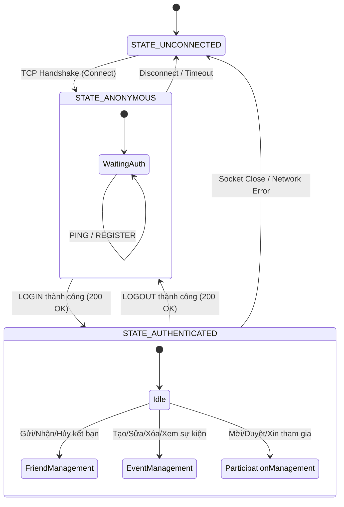
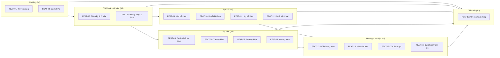

# Đặc tả yêu cầu chức năng (Feature Specification) — Eventora

| Thông tin dự án | Chi tiết |
| :--- | :--- |
| **Tên dự án** | **Eventora** — Ứng dụng quản lý sự kiện và kết nối bạn bè |
| **Mã tài liệu** | `DOC-SPEC-01` |
| **Đường dẫn tệp** | `docs/FEATURE_SPEC.md` |
| **Phiên bản** | `1.0.0` |
| **Ngày lập** | 13/11/2026 |
| **Nhóm tác giả** | `SonNX24042005` & `FATng` |
| **Trạng thái** | Đang hoàn thiện (Draft) |

---

## 1. Giới thiệu tổng quan

### 1.1. Mục đích tài liệu
Tài liệu này xác định chi tiết đặc tả yêu cầu nghiệp vụ và kỹ thuật cho toàn bộ **17 chức năng (tổng điểm: 20 điểm)** của hệ thống **Eventora** theo quy định tại [README.md](../README.md) và [ROADMAP.md](../ROADMAP.md). Tài liệu đóng vai trò là cơ sở thống nhất giữa hai thành viên phát triển để:
1. Thiết kế lược đồ cơ sở dữ liệu quan hệ (`docs/DATABASE_SCHEMA.md` & sơ đồ ERD).
2. Chuẩn hóa giao thức tầng ứng dụng (`docs/PROTOCOL_SPEC.md`).
3. Cài đặt mã nguồn phía Server (C/C++ socket, I/O multiplexing, thread pool, SQLite) và Client (CLI/UI).
4. Xây dựng kịch bản kiểm thử đơn vị (unit test, `coverage > 90%`) và kiểm thử tải (`load_tester`).

### 1.2. Phạm vi hệ thống
Hệ thống hoạt động theo mô hình Client-Server tập trung trên nền tảng giao thức TCP. Server quản lý trạng thái kết nối, điều phối truy vấn cơ sở dữ liệu, đảm bảo phân quyền dữ liệu và chủ động đẩy (push notification) các sự kiện thời gian thực (lời mời kết bạn, lời mời sự kiện, duyệt tham gia) tới các client đang trực tuyến.

---

## 2. Quy ước chung & Quy tắc hệ thống

### 2.1. Danh mục tác nhân (Actors)
- **`Guest` (Khách / Kết nối ẩn danh)**: Client đã kết nối socket TCP tới server nhưng chưa hoàn tất đăng nhập/xác thực.
- **`User` (Người dùng đã xác thực)**: Người dùng đã đăng nhập thành công vào hệ thống.
- **`Friend` (Bạn bè)**: Hai người dùng có quan hệ kết bạn hai chiều ở trạng thái `ACCEPTED`.
- **`Organizer` (Chủ sở hữu sự kiện)**: Người dùng khởi tạo sự kiện, nắm toàn quyền sửa, xóa và phê duyệt người tham gia.
- **`Participant` (Thành viên sự kiện)**: Người dùng đã được chấp nhận tham gia vào sự kiện.
- **`Invitee` (Người được mời)**: Bạn bè nhận được lời mời tham gia sự kiện.
- **`Requester` (Người xin tham gia)**: Người dùng gửi yêu cầu xin gia nhập sự kiện công khai (`PUBLIC`).
- **`Server Core / Logger` (Hạ tầng hệ thống)**: Tiến trình nền quản lý socket, thread pool, database và ghi log kiểm toán.

### 2.2. Máy trạng thái phiên làm việc (Session Finite State Machine)

- **Quy tắc máy trạng thái**:
  - Tại `STATE_ANONYMOUS`: Server **chỉ chấp nhận** các lệnh: `PING`, `REGISTER`, `LOGIN`, `QUIT`. Mọi lệnh nghiệp vụ khác đều bị từ chối với mã lỗi `401 Unauthorized`.
  - Tại `STATE_AUTHENTICATED`: Cho phép truy cập đầy đủ các tính năng tùy theo phân quyền đối tượng. Nếu client gửi lại lệnh `LOGIN` hoặc `REGISTER`, server trả lỗi `400 Bad Request`.

### 2.3. Bảng phân loại mã trạng thái phản hồi (Status Codes)

Hệ thống sử dụng các mã trạng thái số 3 chữ số tương tự chuẩn giao thức Internet:

| Nhóm mã | Ý nghĩa | Ví dụ sử dụng trong Eventora |
| :---: | :--- | :--- |
| **`1xx`** | **Thông báo đẩy thời gian thực (Push Notifications)** | `101 PUSH_FRIEND_REQ`, `102 PUSH_FRIEND_ACC`, `110 PUSH_EVENT_INVITE`, `111 PUSH_JOIN_REQ`, `112 PUSH_JOIN_DECIDED`, `120 PUSH_EVENT_UPDATED` |
| **`2xx`** | **Thành công (Success)** | `200 OK`, `201 Created`, `204 No Content` |
| **`4xx`** | **Lỗi người dùng / Nghiệp vụ (Client Errors)** | `400 Bad Request`, `401 Unauthorized`, `403 Forbidden`, `404 Not Found`, `409 Conflict`, `422 Unprocessable Entity` |
| **`5xx`** | **Lỗi máy chủ (Server Errors)** | `500 Internal Server Error`, `503 Service Unavailable` (quá tải thread pool) |

---

## 3. Bảng tổng hợp 17 tính năng hệ thống (20 Điểm)

| STT | Mã tính năng | Tên tính năng | Phân nhóm | Tác nhân chính | Điểm |
| :---: | :---: | :--- | :--- | :--- | :---: |
| 1 | `FEAT-01` | Xử lý truyền dòng | Hạ tầng mạng & giao thức | Server I/O & Client Core | 1 |
| 2 | `FEAT-02` | Cài đặt cơ chế vào/ra socket trên server | Hạ tầng mạng & giao thức | Server Core Engine | 2 |
| 3 | `FEAT-03` | Đăng ký và quản lý tài khoản | Tài khoản & phiên | Guest, User | 2 |
| 4 | `FEAT-04` | Đăng nhập và quản lý phiên | Tài khoản & phiên | Guest, User | 2 |
| 5 | `FEAT-05` | Lấy danh sách sự kiện | Quản lý sự kiện | User | 1 |
| 6 | `FEAT-06` | Tạo mới sự kiện | Quản lý sự kiện | User (Organizer) | 1 |
| 7 | `FEAT-07` | Sửa thông tin sự kiện | Quản lý sự kiện | Organizer | 1 |
| 8 | `FEAT-08` | Xóa thông tin sự kiện | Quản lý sự kiện | Organizer | 1 |
| 9 | `FEAT-09` | Gửi lời mời kết bạn | Kết nối bạn bè | User (Sender) | 1 |
| 10 | `FEAT-10` | Chấp nhận/từ chối lời mời kết bạn | Kết nối bạn bè | User (Receiver) | 1 |
| 11 | `FEAT-11` | Hủy kết bạn | Kết nối bạn bè | User | 1 |
| 12 | `FEAT-12` | Hiển thị danh sách bạn bè | Kết nối bạn bè | User | 1 |
| 13 | `FEAT-13` | Gửi lời mời tham gia sự kiện | Tham gia sự kiện | Organizer / Member | 1 |
| 14 | `FEAT-14` | Chấp nhận lời mời tham gia | Tham gia sự kiện | Invitee | 1 |
| 15 | `FEAT-15` | Yêu cầu tham gia sự kiện | Tham gia sự kiện | Requester | 1 |
| 16 | `FEAT-16` | Chấp nhận yêu cầu tham gia sự kiện | Tham gia sự kiện | Organizer | 1 |
| 17 | `FEAT-17` | Ghi log hoạt động | Hệ thống & giám sát | Server Engine & Logger | 1 |

---

## 4. Đặc tả chi tiết toàn bộ 17 tính năng

---

### PHÂN NHÓM I: HẠ TẦNG MẠNG & GIAO THỨC

---

#### 4.1. FEAT-01: Xử lý truyền dòng (Stream Framing & Buffer Management)
- **Mức độ quan trọng / Điểm**: Nền tảng giao thức (1 điểm).
- **Tác nhân**: Tầng Network I/O trên Server và Client Core (`libeventora_client`).
- **Mục tiêu**: Loại bỏ hiện tượng dính gói (packet concatenation) và phân mảnh gói (packet fragmentation) vốn có của giao thức truyền dòng TCP.
- **Đầu vào**:
  - Dòng byte thô nhận từ socket (`recv()` / `read()`).
  - Cấu trúc bộ đệm kết nối riêng biệt theo từng client (`per-client buffer` dung lượng mặc định 64 KB).
  - Khung thông điệp ứng dụng chuẩn (Application Frame):
    - Dạng độ dài cố định header + payload: `[Payload_Length: 4 bytes big-endian][Opcode/Command: 4 bytes][Payload Data...]` hoặc dạng chuỗi có ký tự kết thúc ranh giới `\r\n`.
  - Dữ liệu gửi: Con trỏ vùng nhớ cần truyền, kích thước, socket descriptor.
- **Quy tắc kiểm tra nghiệp vụ**:
  - Mỗi kết nối có một cấu trúc `client_session_t` lưu trữ bộ đệm đọc (`rx_buf`, `rx_len`, `rx_capacity`) và bộ đệm ghi (`tx_buf`, `tx_len`).
  - **Chống dính gói**: Sau khi đọc từ socket vào bộ đệm, hàm phân giải (parser) lặp trích xuất từng khung bản tin hoàn chỉnh để đưa vào hàng đợi xử lý. Dữ liệu chưa trích xuất được dời lên đầu buffer (`memmove`).
  - **Chống phân mảnh**: Nếu dữ liệu trong buffer chưa đủ cấu thành một khung hoàn chỉnh (chưa đủ header hoặc chưa đủ `Payload_Length`), giữ nguyên trạng thái buffer, thoát khỏi hàm đọc và chờ sự kiện `POLLIN`/`EPOLLIN` tiếp theo.
  - **Giới hạn kích thước**: Khung bản tin có kích thước tối đa là **65,535 bytes (64 KB)** nhằm ngăn chặn tấn công cạn kiệt bộ nhớ (Buffer Overflow / Memory Exhaustion DoS).
  - **Hàm `send_all()`**: Khi gửi dữ liệu, bắt buộc phải lặp gửi trong vòng lặp `while (total_sent < total_bytes)` cho đến khi gửi hết, xử lý linh hoạt mã lỗi phi nghẽn `EAGAIN` / `EWOULDBLOCK`.
- **Kết quả mong muốn**:
  - Tầng nghiệp vụ nhận đúng, đủ và trọn vẹn từng thông điệp theo đúng thứ tự gửi (FIFO).
  - Không rò rỉ byte thừa, không đọc tràn bộ nhớ.
  - Unit test mô phỏng cắt nhỏ gói tin thành từng mảng 1-byte, 2-byte hoặc ghép 100 gói tin vào 1 lần đọc đều được phân giải chính xác 100%.
- **Các trường hợp lỗi**:
  - Khung dữ liệu vượt quá kích thước 64 KB -> Ghi log cảnh báo, trả mã `400 Bad Request (PAYLOAD_TOO_LARGE)` và chủ động ngắt kết nối client vi phạm.
  - Khung dữ liệu sai cấu trúc (header rác, độ dài âm) -> Trả mã `400 Bad Request (MALFORMED_FRAME)` và đóng kết nối.
  - Socket phía đối diện đóng đột ngột (`recv() == 0`) -> Giải phóng bộ đệm phiên, đóng descriptor.
  - Ghi vào socket đã đóng (`SIGPIPE` / `EPIPE`) -> Bắt lỗi an toàn, không làm đổ vỡ tiến trình server.

---

#### 4.2. FEAT-02: Cài đặt cơ chế vào/ra socket trên server (Server I/O Multiplexing & Worker Pool)
- **Mức độ quan trọng / Điểm**: Trọng tâm kỹ thuật hệ thống (2 điểm).
- **Tác nhân**: Server Core Daemon.
- **Mục tiêu**: Xử lý đồng thời hàng nghìn kết nối kết hợp Non-blocking socket, I/O Multiplexing (`poll()`/`epoll`) và Thread Pool, đạt hiệu năng cao trong bài kiểm thử chịu tải.
- **Đầu vào**:
  - Tham số khởi chạy server: `PORT` (mặc định: `8888`), `IP_BIND` (`0.0.0.0`), `THREAD_POOL_SIZE` (ví dụ: 4 - 16 threads), `MAX_CLIENTS` (ví dụ: 2048 connections).
  - Sự kiện từ hệ điều hành: `POLLIN`, `POLLOUT`, `POLLERR`, `POLLHUP`.
- **Quy tắc kiểm tra nghiệp vụ**:
  - Socket lắng nghe (`listen_fd`) và toàn bộ socket kết nối (`client_fd`) phải được gán cờ `O_NONBLOCK` bằng `fcntl()`.
  - Cấu hình socket tùy chọn: Bật `SO_REUSEADDR` để khởi động lại nhanh; chặn tín hiệu ngắt đường ống `signal(SIGPIPE, SIG_IGN)`.
  - **Kiến trúc phân chia luồng**:
    - *Network Thread (Vòng lặp I/O)*: Lắng nghe sự kiện socket bằng `poll()`/`epoll`, nhận kết nối mới (`accept4()` với `SOCK_NONBLOCK`), đọc dữ liệu thô vào `rx_buf` của client, trích xuất bản tin đóng gói.
    - *Task Queue*: Lưu trữ các tác vụ thông điệp đã hoàn chỉnh.
    - *Worker Thread Pool*: Lấy tác vụ từ hàng đợi, thực thi logic nghiệp vụ (truy vấn SQLite, xử lý xác thực, kiểm tra quyền), chuẩn bị dữ liệu phản hồi và đẩy vào `tx_buf` của client.
  - **Đồng bộ hóa an toàn đa luồng**:
    - Dùng `pthread_mutex_t` và `pthread_cond_t` để quản trị Task Queue.
    - Dùng mutex riêng hoặc `pthread_rwlock_t` để bảo vệ Bảng danh sách phiên trực tuyến (`session_map`) và kết nối cơ sở dữ liệu SQLite (`sqlite3 *`).
- **Kết quả mong muốn**:
  - Server duy trì kết nối ổn định với hàng trăm đến hàng nghìn client cùng lúc.
  - Vòng lặp I/O không bị tắc nghẽn (không sleep, không block I/O lâu).
  - Vượt qua bài kiểm thử chịu tải `load_tester` với thông lượng ổn định, độ trễ p95 < 50ms, không rò rỉ bộ nhớ (kiểm tra bằng `Valgrind`) và không rò rỉ file descriptor.
- **Các trường hợp lỗi**:
  - Hết file descriptor của tiến trình (`EMFILE`, `ENFILE`) -> Ghi log mức `CRITICAL`, tạm thời không accept kết nối mới hoặc từ chối lịch sự bằng phản hồi `503 Service Unavailable`.
  - Hàng đợi tác vụ (Task queue) bị tràn -> Áp dụng cơ chế backpressure, từ chối xử lý tác vụ tạm thời với mã lỗi `503 Service Unavailable (SERVER_OVERLOADED)`.
  - Worker thread gặp exception/lỗi nội bộ -> Bắt lỗi, khôi phục trạng thái, trả về `500 Internal Server Error`, không làm dừng toàn bộ server.

---

### PHÂN NHÓM II: TÀI KHOẢN & PHIÊN LÀM VIỆC

---

#### 4.3. FEAT-03: Đăng ký và quản lý tài khoản (User Registration & Profile Management)
- **Mức độ quan trọng / Điểm**: Trọng tâm (2 điểm).
- **Tác nhân**: Khách chưa xác thực (`Guest`), Người dùng đã đăng nhập (`User`).
- **Đầu vào**:
  - *Đăng ký tài khoản (`REGISTER`)*:
    - `username`: Tên đăng nhập (chuỗi ký tự chữ và số `[a-zA-Z0-9_]`, độ dài 3 - 32 ký tự).
    - `password`: Mật khẩu người dùng (độ dài 6 - 64 ký tự).
    - `full_name`: Họ và tên hiển thị (chuỗi UTF-8, độ dài 2 - 100 ký tự).
    - `email`: Địa chỉ email (tùy chọn, đúng định dạng RFC 5322, tối đa 100 ký tự).
  - *Xem thông tin tài khoản (`GET_PROFILE`)*:
    - `target_user_id`: ID người dùng cần xem (nếu bỏ trống: xem chính mình).
  - *Cập nhật hồ sơ (`UPDATE_PROFILE`)*:
    - `full_name`, `email`, `bio` (tiểu sử, tối đa 255 ký tự).
  - *Đổi mật khẩu (`CHANGE_PASSWORD`)*:
    - `old_password`, `new_password`.
- **Quy tắc kiểm tra nghiệp vụ**:
  - Không cho phép đăng ký tài khoản mới khi socket đang ở trạng thái đã đăng nhập (`STATE_AUTHENTICATED`).
  - `username` phải là duy nhất trên toàn hệ thống (Case-insensitive unique). Trùng lặp sẽ bị từ chối ngay lập tức.
  - **Mật khẩu an toàn**: Tuyệt đối không lưu plain-text vào database. Server sinh một chuỗi muối ngẫu nhiên (`salt` 16 hoặc 32 bytes) cho mỗi người dùng, sau đó băm bằng giải thuật mã hóa an toàn (`SHA-256(salt + password)` hoặc `PBKDF2`/`bcrypt`).
  - Cập nhật thông tin: Người dùng chỉ có quyền chỉnh sửa hồ sơ của chính mình.
  - Đổi mật khẩu: Bắt buộc cung cấp chính xác `old_password`. Mật khẩu mới không được trùng mật khẩu cũ.
- **Kết quả mong muốn**:
  - Đăng ký thành công: Tạo bản ghi trong bảng `users`, trả về mã `201 Created` kèm `user_id` và thông báo thành công.
  - Cập nhật thành công: Cập nhật dữ liệu vào database, trả về mã `200 OK` kèm dữ liệu hồ sơ mới nhất.
  - Ghi log kiểm toán sự kiện đăng ký và đổi thông tin cá nhân.
- **Các trường hợp lỗi**:
  - `username` đã tồn tại -> Trả mã `409 Conflict (USERNAME_ALREADY_EXISTS)`.
  - Định dạng username/password/email không hợp lệ -> Trả mã `400 Bad Request (INVALID_INPUT_FORMAT)`.
  - Đổi mật khẩu nhưng `old_password` sai -> Trả mã `401 Unauthorized (OLD_PASSWORD_INCORRECT)`.
  - Xem profile của `target_user_id` không tồn tại -> Trả mã `404 Not Found (USER_NOT_FOUND)`.
  - Đang đăng nhập mà gửi lệnh `REGISTER` -> Trả mã `400 Bad Request (ALREADY_LOGGED_IN)`.

---

#### 4.4. FEAT-04: Đăng nhập và quản lý phiên (Authentication & Session Management)
- **Mức độ quan trọng / Điểm**: Trọng tâm (2 điểm).
- **Tác nhân**: Khách chưa xác thực (`Guest`), Người dùng đã đăng nhập (`User`).
- **Đầu vào**:
  - *Đăng nhập (`LOGIN`)*: `username`, `password`.
  - *Đăng xuất (`LOGOUT`)*: Không có tham số (sử dụng phiên hiện hành).
  - *Sự kiện đóng kết nối*: Client ngắt kết nối đột ngột hoặc gửi tín hiệu `QUIT`.
- **Quy tắc kiểm tra nghiệp vụ**:
  - Chỉ cho phép gửi lệnh `LOGIN` khi kết nối ở trạng thái `STATE_ANONYMOUS`.
  - **Quy trình xác thực**: Truy vấn bảng `users` theo `username`. Nếu không tìm thấy hoặc mật khẩu sau khi băm với `salt` không khớp với `password_hash` trong DB -> Từ chối xác thực.
  - **Bảo vệ phòng thủ**: Thông báo lỗi chung, không phân biệt "tài khoản không tồn tại" hay "sai mật khẩu" để chống tấn công dò quét người dùng (User Enumeration Attack).
  - **Chính sách phiên làm việc**:
    - Mỗi socket liên kết với duy nhất một `user_id` tại một thời điểm.
    - *Chống đăng nhập xung đột (Concurrent Login Policy)*: Nếu tài khoản đang có phiên đăng nhập hoạt động trên một socket khác, server có thể:
      - (Cách 1 - Khuyến nghị): Ngắt kết nối phiên cũ (`Force Logout / Kicked out` với thông báo đẩy `199 SESSION_TERMINATED_ELSEWHERE`) và cấp quyền cho phiên mới.
      - (Cách 2): Từ chối phiên đăng nhập mới với mã `409 Conflict (ACCOUNT_ALREADY_ACTIVE)`.
  - Khi đăng nhập thành công:
    - Gán `user_id`, thời điểm đăng nhập vào cấu trúc phiên của socket.
    - Cập nhật trạng thái người dùng trong RAM (`session_map`) thành `ONLINE`.
    - Chuyển trạng thái kết nối sang `STATE_AUTHENTICATED`.
  - Đăng xuất (`LOGOUT`):
    - Chuyển trạng thái kết nối về `STATE_ANONYMOUS`.
    - Xóa khỏi danh sách online trong RAM, cập nhật `last_seen` vào DB.
    - Gửi thông báo đẩy cập nhật trạng thái offline tới bạn bè đang trực tuyến.
  - **Thu hồi phiên tự động khi ngắt kết nối**: Khi socket bị đóng (`read() == 0` hoặc lỗi mạng), server tự động gọi hàm cleanup phiên làm việc, đảm bảo không rò rỉ phiên "ma" trên RAM.
- **Kết quả mong muốn**:
  - Đăng nhập thành công: Trả về mã `200 OK` kèm `user_id`, `username`, `session_token` (nếu dùng) và danh sách thống kê sơ bộ (số lời mời kết bạn chưa đọc, số sự kiện sắp diễn ra).
  - Đăng xuất thành công: Trả về mã `200 OK (LOGGED_OUT)`.
  - Ghi log hoạt động đăng nhập/đăng xuất (bao gồm IP, Port, thời gian, kết quả).
- **Các trường hợp lỗi**:
  - Sai username hoặc sai password -> Trả mã `401 Unauthorized (INVALID_CREDENTIALS)`.
  - Tài khoản đang bị khóa/vô hiệu hóa -> Trả mã `403 Forbidden (ACCOUNT_SUSPENDED)`.
  - Gửi lệnh `LOGIN` khi đã đăng nhập trên chính socket đó -> Trả mã `400 Bad Request (ALREADY_AUTHENTICATED)`.
  - Gửi lệnh yêu cầu xác thực khi chưa đăng nhập -> Trả mã `401 Unauthorized (AUTHENTICATION_REQUIRED)`.

---

### PHÂN NHÓM III: QUẢN LÝ SỰ KIỆN

---

#### 4.5. FEAT-05: Lấy danh sách sự kiện (Get Event List & Access Filter)
- **Mức độ quan trọng / Điểm**: Cần thiết (1 điểm).
- **Tác nhân**: Người dùng đã xác thực (`User`).
- **Đầu vào**:
  - Bộ lọc tùy chọn (`GET_EVENTS`):
    - `scope`: `ALL` (mặc định), `MINE` (sự kiện tôi làm chủ), `JOINED` (sự kiện tôi đã tham gia), `INVITED` (đang có lời mời).
    - `keyword`: Chuỗi tìm kiếm theo tiêu đề hoặc mô tả sự kiện (tối đa 100 ký tự).
    - `from_time`, `to_time`: Giới hạn khoảng thời gian bắt đầu (timestamp Unix).
    - `page`, `page_size`: Tham số phân trang (mặc định: `page=1`, `page_size=20`, tối đa `page_size=100`).
- **Quy tắc kiểm tra nghiệp vụ**:
  - Yêu cầu trạng thái phiên: `STATE_AUTHENTICATED`.
  - **Quy tắc phân quyền hiển thị (Crucial Access Rule)**:
    - Sự kiện `PUBLIC`: Hiển thị cho toàn bộ người dùng trong hệ thống.
    - Sự kiện `PRIVATE`: **Chỉ** được hiển thị khi người dùng thỏa mãn một trong các điều kiện sau:
      1. Người dùng là Chủ sở hữu sự kiện (`creator_id == current_user_id`).
      2. Người dùng đã được chấp nhận tham gia (`status == 'ACCEPTED'` trong bảng người tham gia sự kiện).
      3. Người dùng đang nhận được lời mời tham gia sự kiện (`status == 'INVITED'`).
    - *Người dùng lạ tuyệt đối không nhìn thấy hoặc tìm thấy bất kỳ thông tin nào của sự kiện `PRIVATE`*.
- **Kết quả mong muốn**:
  - Trả về mã `200 OK` kèm mảng danh sách sự kiện:
    - Mỗi sự kiện gồm: `event_id`, `title`, `description`, `location`, `start_time`, `end_time`, `visibility` (`PUBLIC`/`PRIVATE`), `creator_id`, `creator_name`, `participant_count`, `max_participants`, `my_relation` (`OWNER`, `ACCEPTED`, `INVITED`, `REQUEST_PENDING`, `NONE`).
- **Các trường hợp lỗi**:
  - Chưa đăng nhập -> Trả mã `401 Unauthorized`.
  - Tham số phân trang âm hoặc vượt quá giới hạn -> Trả mã `400 Bad Request (INVALID_PAGINATION)`.
  - Khoảng thời gian không hợp lệ (`from_time > to_time`) -> Trả mã `400 Bad Request (INVALID_TIME_RANGE)`.

---

#### 4.6. FEAT-06: Tạo mới sự kiện (Create Event)
- **Mức độ quan trọng / Điểm**: Cần thiết (1 điểm).
- **Tác nhân**: Người dùng đã xác thực (`User` -> trở thành `Organizer`).
- **Đầu vào**:
  - Gói tin yêu cầu tạo sự kiện (`CREATE_EVENT`):
    - `title`: Tiêu đề sự kiện (chuỗi UTF-8, độ dài 3 - 150 ký tự).
    - `description`: Mô tả chi tiết (chuỗi UTF-8, tối đa 2000 ký tự, có thể rỗng).
    - `location`: Địa điểm tổ chức (chuỗi UTF-8, độ dài 3 - 255 ký tự).
    - `start_time`: Thời điểm bắt đầu (Unix timestamp).
    - `end_time`: Thời điểm kết thúc (Unix timestamp).
    - `visibility`: Phân loại hiển thị, nhận 1 trong 2 giá trị chuỗi: `PUBLIC` hoặc `PRIVATE`.
    - `max_participants`: Số lượng người tham gia tối đa (số nguyên > 0; giá trị `0` biểu thị không giới hạn, mặc định `0`).
- **Quy tắc kiểm tra nghiệp vụ**:
  - Yêu cầu trạng thái phiên: `STATE_AUTHENTICATED`.
  - `title` và `location` không được rỗng hoặc chỉ toàn khoảng trắng.
  - **Quy tắc thời gian**:
    - `start_time` phải nằm trong tương lai so với thời gian hiện tại của server (`start_time > current_server_time`).
    - `end_time` phải diễn ra sau `start_time` (`end_time > start_time`).
    - Khoảng thời gian tối thiểu của sự kiện: ít nhất 15 phút (`(end_time - start_time) >= 900`).
  - `visibility` bắt buộc phải là `PUBLIC` hoặc `PRIVATE`.
  - **Khởi tạo quan hệ**: Người tạo tự động trở thành Chủ sự kiện (`creator_id = current_user_id`), đồng thời tự động thêm 1 bản ghi vào bảng tham gia sự kiện với vai trò `ORGANIZER` và trạng thái `ACCEPTED`.
- **Kết quả mong muốn**:
  - Tạo bản ghi mới trong bảng `events` và `event_participants`.
  - Trả về mã `201 Created` kèm `event_id` mới tạo và toàn bộ thông tin chi tiết của sự kiện.
  - Ghi log kiểm toán hành động tạo sự kiện.
- **Các trường hợp lỗi**:
  - Chưa đăng nhập -> Trả mã `401 Unauthorized`.
  - Thiếu trường bắt buộc hoặc vượt quá độ dài quy định -> Trả mã `400 Bad Request (MISSING_OR_INVALID_FIELDS)`.
  - Thời gian bắt đầu trong quá khứ -> Trả mã `422 Unprocessable Entity (START_TIME_IN_PAST)`.
  - Thời gian kết thúc trước hoặc bằng thời gian bắt đầu -> Trả mã `422 Unprocessable Entity (END_TIME_MUST_BE_AFTER_START)`.
  - Giá trị `visibility` không đúng quy chuẩn -> Trả mã `400 Bad Request (INVALID_VISIBILITY_TYPE)`.

---

#### 4.7. FEAT-07: Sửa thông tin sự kiện (Update Event)
- **Mức độ quan trọng / Điểm**: Cần thiết (1 điểm).
- **Tác nhân**: Chủ sở hữu sự kiện (`Organizer`).
- **Đầu vào**:
  - Gói tin cập nhật sự kiện (`UPDATE_EVENT`):
    - `event_id`: Định danh sự kiện cần chỉnh sửa.
    - Các trường cập nhật tùy chọn: `title`, `description`, `location`, `start_time`, `end_time`, `visibility`, `max_participants`.
- **Quy tắc kiểm tra nghiệp vụ**:
  - Yêu cầu trạng thái phiên: `STATE_AUTHENTICATED`.
  - Sự kiện phải tồn tại trong cơ sở dữ liệu.
  - **Quyền sở hữu**: Chỉ người tạo ra sự kiện (`events.creator_id == current_user_id`) mới có quyền thực hiện. Người khác yêu cầu sửa lập tức trả lỗi `403 Forbidden`.
  - Sự kiện đã kết thúc trong quá khứ (`end_time <= current_server_time`) không được phép chỉnh sửa thông tin cốt lõi.
  - Nếu cập nhật thời gian: Vẫn phải đảm bảo `end_time > start_time` và `end_time > current_server_time`.
  - Nếu cập nhật `max_participants`: Giá trị mới không được nhỏ hơn số lượng thành viên hiện tại đã tham gia (`current_accepted_count`).
- **Kết quả mong muốn**:
  - Cập nhật bản ghi tương ứng trong bảng `events` (cập nhật trường `updated_at`).
  - Trả về mã `200 OK` kèm dữ liệu sự kiện đã cập nhật cho Organizer.
  - **Thông báo đẩy thời gian thực**: Server gửi thông báo `120 PUSH_EVENT_UPDATED` tới tất cả các thành viên đang tham gia sự kiện mà hiện đang trực tuyến (`ONLINE`).
  - Ghi log kiểm toán thao tác sửa sự kiện.
- **Các trường hợp lỗi**:
  - Chưa đăng nhập -> Trả mã `401 Unauthorized`.
  - Sự kiện không tồn tại -> Trả mã `404 Not Found (EVENT_NOT_FOUND)`.
  - Không phải người tạo sự kiện -> Trả mã `403 Forbidden (NOT_EVENT_ORGANIZER)`.
  - Sự kiện đã kết thúc -> Trả mã `409 Conflict (CANNOT_MODIFY_FINISHED_EVENT)`.
  - Logic thời gian cập nhật không hợp lệ -> Trả mã `422 Unprocessable Entity (INVALID_EVENT_TIMES)`.
  - `max_participants` nhỏ hơn số người đang tham gia -> Trả mã `409 Conflict (CAPACITY_LESS_THAN_CURRENT_MEMBERS)`.

---

#### 4.8. FEAT-08: Xóa thông tin sự kiện (Delete Event)
- **Mức độ quan trọng / Điểm**: Cần thiết (1 điểm).
- **Tác nhân**: Chủ sở hữu sự kiện (`Organizer`).
- **Đầu vào**:
  - Gói tin yêu cầu xóa sự kiện (`DELETE_EVENT`): `event_id`.
- **Quy tắc kiểm tra nghiệp vụ**:
  - Yêu cầu trạng thái phiên: `STATE_AUTHENTICATED`.
  - Sự kiện phải tồn tại trong hệ thống.
  - **Quyền hạn**: Bắt buộc người gửi lệnh phải là Chủ sở hữu sự kiện (`events.creator_id == current_user_id`). Người khác gửi lệnh lập tức bị từ chối với mã lỗi `403 Forbidden`.
  - **Dọn dẹp liên kết dữ liệu (Cascade Cleanup)**:
    - Khi xóa sự kiện, toàn bộ dữ liệu phụ thuộc trong bảng `event_participants`, `event_invitations`, `event_join_requests` phải được xóa sạch (CASCADE DELETE) hoặc cập nhật trạng thái hủy để tránh dữ liệu mồ côi (orphaned records).
- **Kết quả mong muốn**:
  - Bản ghi sự kiện và dữ liệu tham gia liên quan bị xóa hoàn toàn khỏi cơ sở dữ liệu.
  - Trả về mã `200 OK (EVENT_DELETED_SUCCESSFULLY)` cho Organizer.
  - **Thông báo đẩy thời gian thực**: Server gửi thông báo `121 PUSH_EVENT_CANCELLED` tới toàn bộ thành viên và người đang có lời mời/yêu cầu liên quan đến sự kiện (nếu họ đang online).
  - Ghi log kiểm toán hoạt động xóa sự kiện.
- **Các trường hợp lỗi**:
  - Chưa đăng nhập -> Trả mã `401 Unauthorized`.
  - Sự kiện không tồn tại -> Trả mã `404 Not Found (EVENT_NOT_FOUND)`.
  - Người dùng không phải là chủ sở hữu sự kiện -> Trả mã `403 Forbidden (NOT_EVENT_ORGANIZER)`.

---

### PHÂN NHÓM IV: KẾT NỐI BẠN BÈ

---

#### 4.9. FEAT-09: Gửi lời mời kết bạn (Send Friend Request)
- **Mức độ quan trọng / Điểm**: Cần thiết (1 điểm).
- **Tác nhân**: Người dùng đã xác thực (`User` - Người gửi).
- **Đầu vào**:
  - Gói tin gửi lời mời (`SEND_FRIEND_REQUEST`):
    - `target_user_id` (hoặc `target_username`): Người nhận lời mời.
    - `message`: Lời nhắn đính kèm (tùy chọn, tối đa 200 ký tự).
- **Quy tắc kiểm tra nghiệp vụ**:
  - Yêu cầu trạng thái phiên: `STATE_AUTHENTICATED`.
  - Người nhận phải tồn tại trong hệ thống.
  - **Chặn tự kết bạn**: Không cho phép người dùng tự gửi lời mời kết bạn cho chính mình (`sender_id != target_user_id`).
  - **Kiểm tra trạng thái quan hệ hiện hữu**:
    - Hai người chưa phải là bạn bè (không có bản ghi trạng thái `ACCEPTED`).
    - Người gửi chưa có lời mời kết bạn nào đang chờ xử lý (`PENDING`) gửi tới đối phương.
    - *Trường hợp đối phương đã gửi lời mời cho người gửi từ trước và đang chờ duyệt*: Hệ thống thông báo xung đột hoặc gợi ý người dùng chấp nhận lời mời có sẵn (`409 Conflict - INVITATION_ALREADY_RECEIVED`).
- **Kết quả mong muốn**:
  - Tạo bản ghi mới trong bảng `friendships` với trạng thái `PENDING` (`requester_id = current_user_id`, `addressee_id = target_user_id`).
  - Trả về mã `201 Created` kèm `request_id` cho người gửi.
  - **Thông báo đẩy thời gian thực**: Nếu người nhận đang trực tuyến (`ONLINE`), server đẩy ngay thông báo `101 PUSH_FRIEND_REQ` tới socket của họ kèm thông tin người gửi và lời nhắn.
  - Ghi log hoạt động kết bạn.
- **Các trường hợp lỗi**:
  - Chưa đăng nhập -> Trả mã `401 Unauthorized`.
  - Người nhận không tồn tại -> Trả mã `404 Not Found (USER_NOT_FOUND)`.
  - Tự gửi lời mời cho bản thân -> Trả mã `400 Bad Request (CANNOT_FRIEND_SELF)`.
  - Đã là bạn bè từ trước -> Trả mã `409 Conflict (ALREADY_FRIENDS)`.
  - Đã gửi lời mời và đang chờ xử lý -> Trả mã `409 Conflict (FRIEND_REQUEST_PENDING)`.
  - Đối phương đã gửi lời mời trước đó -> Trả mã `409 Conflict (INVITATION_ALREADY_RECEIVED)`.

---

#### 4.10. FEAT-10: Chấp nhận/từ chối lời mời kết bạn (Respond to Friend Request)
- **Mức độ quan trọng / Điểm**: Cần thiết (1 điểm).
- **Tác nhân**: Người dùng nhận lời mời (`User` - Người nhận).
- **Đầu vào**:
  - Gói tin phản hồi lời mời (`RESPOND_FRIEND_REQUEST`):
    - `request_id` (hoặc `sender_user_id`).
    - `action`: Chuỗi hành động, nhận 1 trong 2 giá trị: `ACCEPT` (Đồng ý) hoặc `REJECT` (Từ chối).
- **Quy tắc kiểm tra nghiệp vụ**:
  - Yêu cầu trạng thái phiên: `STATE_AUTHENTICATED`.
  - Bản ghi yêu cầu kết bạn phải tồn tại và đang ở trạng thái `PENDING`.
  - **Quyền xử lý**: Bắt buộc người thực hiện phải là Người nhận đích danh (`friendships.addressee_id == current_user_id`). Người gửi không được tự duyệt yêu cầu của chính mình.
  - Xử lý hành động:
    - Nếu `ACCEPT`: Cập nhật trạng thái trong bảng `friendships` thành `ACCEPTED`. Quan hệ bạn bè chính thức được kích hoạt hai chiều.
    - Nếu `REJECT`: Xóa bản ghi quan hệ hoặc cập nhật trạng thái thành `REJECTED`.
- **Kết quả mong muốn**:
  - Cập nhật cơ sở dữ liệu bền vững.
  - Trả về mã `200 OK` cho người nhận lời mời.
  - **Thông báo đẩy thời gian thực**: Nếu `action == ACCEPT` và người gửi lời mời đang online, server gửi thông báo `102 PUSH_FRIEND_ACC` tới socket người gửi để cập nhật danh bạ ngay lập tức.
  - Ghi log kiểm toán việc thiết lập quan hệ bạn bè.
- **Các trường hợp lỗi**:
  - Chưa đăng nhập -> Trả mã `401 Unauthorized`.
  - Yêu cầu kết bạn không tồn tại -> Trả mã `404 Not Found (FRIEND_REQUEST_NOT_FOUND)`.
  - Không phải người nhận của lời mời -> Trả mã `403 Forbidden (NOT_AUTHORIZED_TO_RESPOND)`.
  - Yêu cầu đã được phản hồi trước đó -> Trả mã `409 Conflict (REQUEST_ALREADY_PROCESSED)`.
  - Tham số `action` không hợp lệ -> Trả mã `400 Bad Request (INVALID_ACTION_VALUE)`.

---

#### 4.11. FEAT-11: Hủy kết bạn (Unfriend)
- **Mức độ quan trọng / Điểm**: Cần thiết (1 điểm).
- **Tác nhân**: Người dùng đã xác thực (`User`).
- **Đầu vào**:
  - Gói tin hủy kết bạn (`UNFRIEND`):
    - `target_user_id`: ID người bạn muốn hủy quan hệ.
- **Quy tắc kiểm tra nghiệp vụ**:
  - Yêu cầu trạng thái phiên: `STATE_AUTHENTICATED`.
  - `target_user_id` phải tồn tại trong cơ sở dữ liệu.
  - Giữa `current_user_id` và `target_user_id` phải đang tồn tại mối quan hệ bạn bè ở trạng thái `ACCEPTED`.
  - Không cho phép tự unfriend chính mình (`current_user_id != target_user_id`).
  - Sau khi hủy kết bạn: Mối quan hệ trở về trạng thái người lạ. Hai người sẽ không nhìn thấy sự kiện `PRIVATE` của nhau nếu chưa được mời trước đó.
- **Kết quả mong muốn**:
  - Xóa bản ghi tương ứng trong bảng `friendships` (hoặc chuyển thành `UNFRIENDED`).
  - Trả về mã `200 OK (UNFRIENDED_SUCCESSFULLY)`.
  - Ghi log kiểm toán thao tác hủy kết bạn.
- **Các trường hợp lỗi**:
  - Chưa đăng nhập -> Trả mã `401 Unauthorized`.
  - Người dùng mục tiêu không tồn tại -> Trả mã `404 Not Found (USER_NOT_FOUND)`.
  - Hai người hiện không phải là bạn bè -> Trả mã `400 Bad Request (NOT_FRIENDS)`.
  - Truyền ID chính mình -> Trả mã `400 Bad Request (INVALID_TARGET_USER)`.

---

#### 4.12. FEAT-12: Hiển thị danh sách bạn bè (List Friends & Online Status)
- **Mức độ quan trọng / Điểm**: Cần thiết (1 điểm).
- **Tác nhân**: Người dùng đã xác thực (`User`).
- **Đầu vào**:
  - Gói tin truy vấn (`GET_FRIENDS`):
    - `filter_status`: `ALL` (tất cả, mặc định), `ONLINE_ONLY` (chỉ lấy người đang online).
    - `keyword`: Tìm kiếm bạn bè theo tên (tùy chọn).
- **Quy tắc kiểm tra nghiệp vụ**:
  - Yêu cầu trạng thái phiên: `STATE_AUTHENTICATED`.
  - Truy vấn toàn bộ người dùng có quan hệ bạn bè hai chiều `ACCEPTED` với `current_user_id`.
  - **Trạng thái trực tuyến thời gian thực (Real-time Online Mapping)**:
    - Server đối chiếu danh sách bạn bè với Bảng phiên kết nối đang mở trong RAM (`active_session_map`).
    - Nếu `user_id` đang có socket kết nối hợp lệ -> Đánh dấu `status = 'ONLINE'`.
    - Nếu không có kết nối -> Đánh dấu `status = 'OFFLINE'` và trả về thời gian hoạt động cuối (`last_seen`).
- **Kết quả mong muốn**:
  - Trả về mã `200 OK` kèm danh sách mảng bạn bè:
    - Cấu trúc mỗi phần tử: `user_id`, `username`, `full_name`, `online_status` (`ONLINE`/`OFFLINE`), `last_seen_timestamp`.
- **Các trường hợp lỗi**:
  - Chưa đăng nhập -> Trả mã `401 Unauthorized`.
  - Bộ lọc không hợp lệ -> Trả mã `400 Bad Request (INVALID_FILTER)`.

---

## 5. Ma trận phân quyền chức năng theo tác nhân (Access Control Matrix)

Bảng ma trận dưới đây phân định rõ quyền thực thi của từng vai trò đối với 17 chức năng hệ thống:

| Mã chức năng | Tên chức năng | Guest (Ẩn danh) | User (Đã đăng nhập) | Friend (Bạn bè) | Organizer (Chủ sự kiện) | Participant (Thành viên) |
| :---: | :--- | :---: | :---: | :---: | :---: | :---: |
| `FEAT-01` | Xử lý truyền dòng | ✔ | ✔ | ✔ | ✔ | ✔ |
| `FEAT-02` | Vào/ra socket server | ✔ | ✔ | ✔ | ✔ | ✔ |
| `FEAT-03` | Đăng ký & tài khoản | ✔ | ✔ (Sửa hồ sơ) | ✔ | ✔ | ✔ |
| `FEAT-04` | Đăng nhập & phiên | ✔ (Login) | ✔ (Logout) | ✔ | ✔ | ✔ |
| `FEAT-05` | Lấy danh sách sự kiện | ✖ | ✔ (Public / Đã mời) | ✔ | ✔ (Tất cả của mình) | ✔ (Đã tham gia) |
| `FEAT-06` | Tạo mới sự kiện | ✖ | ✔ | ✔ | ✔ | ✔ |
| `FEAT-07` | Sửa thông tin sự kiện | ✖ | ✖ | ✖ | ✔ (Chỉ của mình) | ✖ |
| `FEAT-08` | Xóa thông tin sự kiện | ✖ | ✖ | ✖ | ✔ (Chỉ của mình) | ✖ |
| `FEAT-09` | Gửi lời mời kết bạn | ✖ | ✔ | ✖ (Đã là bạn) | ✔ | ✔ |
| `FEAT-10` | Duyệt lời mời kết bạn | ✖ | ✔ (Người nhận) | ✖ | ✔ | ✔ |
| `FEAT-11` | Hủy kết bạn | ✖ | ✖ | ✔ | ✔ | ✔ |
| `FEAT-12` | Hiển thị danh sách bạn | ✖ | ✔ | ✔ | ✔ | ✔ |
| `FEAT-13` | Mời tham gia sự kiện | ✖ | ✖ | ✖ | ✔ | ✔ (Nếu cho phép) |
| `FEAT-14` | Nhận lời mời sự kiện | ✖ | ✔ (Người được mời) | ✔ | ✖ | ✖ |
| `FEAT-15` | Xin tham gia sự kiện | ✖ | ✔ (Sự kiện Public) | ✔ | ✖ (Đã là chủ) | ✖ (Đã tham gia) |
| `FEAT-16` | Duyệt xin tham gia | ✖ | ✖ | ✖ | ✔ (Chỉ của mình) | ✖ |
| `FEAT-17` | Ghi log hoạt động | Tự động | Tự động | Tự động | Tự động | Tự động |

*Ghi chú*:
- `✔`: Được phép thực thi nếu thỏa mãn quy tắc nghiệp vụ.
- `✖`: Bị từ chối thực thi với mã lỗi tương ứng (`401 Unauthorized` hoặc `403 Forbidden`).

---

## 6. Tiêu chí kiểm thử & Nghiệm thu chức năng (Testing & Acceptance Criteria)

Mọi tính năng được xem là hoàn thành khi đáp ứng đủ các tiêu chuẩn nghiệm thu sau:

1. **Kiểm thử đơn vị (Unit Tests)**:
   - Mỗi tính năng trong 17 tính năng bắt buộc phải có ít nhất 1 tệp test suite tương ứng trong thư mục `tests/`.
   - Bao phủ toàn bộ các luồng: Thành công (`Happy path`), Kiểm tra tính hợp lệ đầu vào (`Validation`), Phân quyền (`Authorization`), và Tất cả các trường hợp biên/mã lỗi quy định trong tài liệu này.
   - Tổng độ bao phủ dòng mã nguồn toàn dự án phải đạt **Coverage > 90%** (đo lường bằng công cụ `gcov`/`lcov` và chạy tự động trên GitHub Actions CI).
2. **Kiểm thử phân giải giao thức & truyền dòng**:
   - Chạy kịch bản cắt nhỏ bản tin TCP thành nhiều đoạn ngắn và dính nhiều bản tin liên tiếp để kiểm chứng tính bền bỉ của `FEAT-01`.
   - Kết nối trực tiếp bằng công cụ `netcat` (`nc`) hoặc `telnet` để xác thực phản hồi của từng opcode.
3. **Kiểm thử thông báo đẩy thời gian thực (Real-time Push Tests)**:
   - Mở đồng thời ít nhất 2 client kết nối tới server.
   - Client A gửi lời mời kết bạn / lời mời sự kiện -> Kiểm chứng socket của Client B nhận được ngay lập tức thông báo đẩy mã `1xx` mà không cần phải chủ động bấm refresh.
4. **Kiểm thử chịu tải (Stress & Load Testing)**:
   - Công cụ `load_tester` giả lập đồng thời tối thiểu **100 đến 1,000 kết nối hoạt động song song**, thực hiện liên tục chuỗi hành động: `Connect` -> `Login` -> `Get Events` -> `Create Event` -> `Logout`.
   - Tỷ lệ lỗi cho phép < 0.1%, không xảy ra deadlock giữa các worker threads, không rò rỉ bộ nhớ khi kiểm tra với `Valgrind Memcheck`.
