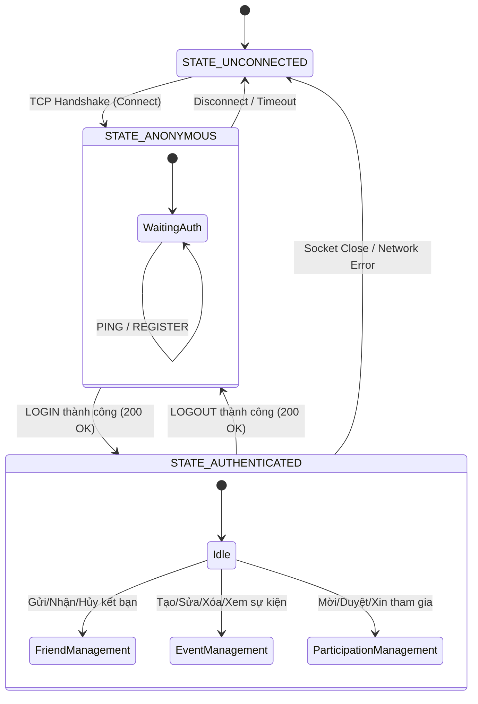
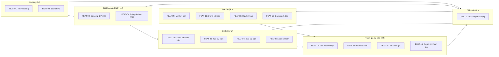

# Đặc tả yêu cầu chức năng (Feature Specification) — Eventora

| Thông tin dự án | Chi tiết |
| :--- | :--- |
| **Tên dự án** | **Eventora** — Ứng dụng quản lý sự kiện và kết nối bạn bè |
| **Mã tài liệu** | `DOC-SPEC-01` |
| **Đường dẫn tệp** | `docs/FEATURE_SPEC.md` |
| **Phiên bản** | `1.0.0` |
| **Ngày lập** | 12/11/2026 |
| **Nhóm tác giả** | `SonNX24042005` & `FATng` |
| **Trạng thái** | Đang hoàn thiện (Draft) |

---

## 1. Giới thiệu tổng quan

### 1.1. Mục đích tài liệu
Tài liệu này xác định chi tiết đặc tả yêu cầu nghiệp vụ và kỹ thuật cho toàn bộ **17 chức năng (tổng điểm: 20 điểm)** của hệ thống **Eventora** theo quy định tại [README.md](../README.md) và [ROADMAP.md](../ROADMAP.md). Tài liệu đóng vai trò là cơ sở thống nhất giữa hai thành viên phát triển để:
1. Thiết kế lược đồ cơ sở dữ liệu quan hệ (`docs/DATABASE_SCHEMA.md` & sơ đồ ERD).
2. Chuẩn hóa giao thức tầng ứng dụng (`docs/PROTOCOL_SPEC.md`).
3. Cài đặt mã nguồn phía Server (C/C++ socket, I/O multiplexing, thread pool, SQLite) và Client (CLI/UI).
4. Xây dựng kịch bản kiểm thử đơn vị (unit test, `coverage > 90%`) và kiểm thử tải (`load_tester`).

### 1.2. Phạm vi hệ thống
Hệ thống hoạt động theo mô hình Client-Server tập trung trên nền tảng giao thức TCP. Server quản lý trạng thái kết nối, điều phối truy vấn cơ sở dữ liệu, đảm bảo phân quyền dữ liệu và chủ động đẩy (push notification) các sự kiện thời gian thực (lời mời kết bạn, lời mời sự kiện, duyệt tham gia) tới các client đang trực tuyến.

---

## 2. Quy ước chung & Quy tắc hệ thống

### 2.1. Danh mục tác nhân (Actors)
- **`Guest` (Khách / Kết nối ẩn danh)**: Client đã kết nối socket TCP tới server nhưng chưa hoàn tất đăng nhập/xác thực.
- **`User` (Người dùng đã xác thực)**: Người dùng đã đăng nhập thành công vào hệ thống.
- **`Friend` (Bạn bè)**: Hai người dùng có quan hệ kết bạn hai chiều ở trạng thái `ACCEPTED`.
- **`Organizer` (Chủ sở hữu sự kiện)**: Người dùng khởi tạo sự kiện, nắm toàn quyền sửa, xóa và phê duyệt người tham gia.
- **`Participant` (Thành viên sự kiện)**: Người dùng đã được chấp nhận tham gia vào sự kiện.
- **`Invitee` (Người được mời)**: Bạn bè nhận được lời mời tham gia sự kiện.
- **`Requester` (Người xin tham gia)**: Người dùng gửi yêu cầu xin gia nhập sự kiện công khai (`PUBLIC`).
- **`Server Core / Logger` (Hạ tầng hệ thống)**: Tiến trình nền quản lý socket, thread pool, database và ghi log kiểm toán.

### 2.2. Máy trạng thái phiên làm việc (Session Finite State Machine)

- **Quy tắc máy trạng thái**:
  - Tại `STATE_ANONYMOUS`: Server **chỉ chấp nhận** các lệnh: `PING`, `REGISTER`, `LOGIN`, `QUIT`. Mọi lệnh nghiệp vụ khác đều bị từ chối với mã lỗi `401 Unauthorized`.
  - Tại `STATE_AUTHENTICATED`: Cho phép truy cập đầy đủ các tính năng tùy theo phân quyền đối tượng. Nếu client gửi lại lệnh `LOGIN` hoặc `REGISTER`, server trả lỗi `400 Bad Request`.

### 2.3. Bảng phân loại mã trạng thái phản hồi (Status Codes)

Hệ thống sử dụng các mã trạng thái số 3 chữ số tương tự chuẩn giao thức Internet:

| Nhóm mã | Ý nghĩa | Ví dụ sử dụng trong Eventora |
| :---: | :--- | :--- |
| **`1xx`** | **Thông báo đẩy thời gian thực (Push Notifications)** | `101 PUSH_FRIEND_REQ`, `102 PUSH_FRIEND_ACC`, `110 PUSH_EVENT_INVITE`, `111 PUSH_JOIN_REQ`, `112 PUSH_JOIN_DECIDED`, `120 PUSH_EVENT_UPDATED` |
| **`2xx`** | **Thành công (Success)** | `200 OK`, `201 Created`, `204 No Content` |
| **`4xx`** | **Lỗi người dùng / Nghiệp vụ (Client Errors)** | `400 Bad Request`, `401 Unauthorized`, `403 Forbidden`, `404 Not Found`, `409 Conflict`, `422 Unprocessable Entity` |
| **`5xx`** | **Lỗi máy chủ (Server Errors)** | `500 Internal Server Error`, `503 Service Unavailable` (quá tải thread pool) |

---

## 3. Bảng tổng hợp 17 tính năng hệ thống (20 Điểm)

| STT | Mã tính năng | Tên tính năng | Phân nhóm | Tác nhân chính | Điểm |
| :---: | :---: | :--- | :--- | :--- | :---: |
| 1 | `FEAT-01` | Xử lý truyền dòng | Hạ tầng mạng & giao thức | Server I/O & Client Core | 1 |
| 2 | `FEAT-02` | Cài đặt cơ chế vào/ra socket trên server | Hạ tầng mạng & giao thức | Server Core Engine | 2 |
| 3 | `FEAT-03` | Đăng ký và quản lý tài khoản | Tài khoản & phiên | Guest, User | 2 |
| 4 | `FEAT-04` | Đăng nhập và quản lý phiên | Tài khoản & phiên | Guest, User | 2 |
| 5 | `FEAT-05` | Lấy danh sách sự kiện | Quản lý sự kiện | User | 1 |
| 6 | `FEAT-06` | Tạo mới sự kiện | Quản lý sự kiện | User (Organizer) | 1 |
| 7 | `FEAT-07` | Sửa thông tin sự kiện | Quản lý sự kiện | Organizer | 1 |
| 8 | `FEAT-08` | Xóa thông tin sự kiện | Quản lý sự kiện | Organizer | 1 |
| 9 | `FEAT-09` | Gửi lời mời kết bạn | Kết nối bạn bè | User (Sender) | 1 |
| 10 | `FEAT-10` | Chấp nhận/từ chối lời mời kết bạn | Kết nối bạn bè | User (Receiver) | 1 |
| 11 | `FEAT-11` | Hủy kết bạn | Kết nối bạn bè | User | 1 |
| 12 | `FEAT-12` | Hiển thị danh sách bạn bè | Kết nối bạn bè | User | 1 |
| 13 | `FEAT-13` | Gửi lời mời tham gia sự kiện | Tham gia sự kiện | Organizer / Member | 1 |
| 14 | `FEAT-14` | Chấp nhận lời mời tham gia | Tham gia sự kiện | Invitee | 1 |
| 15 | `FEAT-15` | Yêu cầu tham gia sự kiện | Tham gia sự kiện | Requester | 1 |
| 16 | `FEAT-16` | Chấp nhận yêu cầu tham gia sự kiện | Tham gia sự kiện | Organizer | 1 |
| 17 | `FEAT-17` | Ghi log hoạt động | Hệ thống & giám sát | Server Engine & Logger | 1 |

---

## 4. Đặc tả chi tiết toàn bộ 17 tính năng

---

### PHÂN NHÓM I: HẠ TẦNG MẠNG & GIAO THỨC

---

#### 4.1. FEAT-01: Xử lý truyền dòng (Stream Framing & Buffer Management)
- **Mức độ quan trọng / Điểm**: Nền tảng giao thức (1 điểm).
- **Tác nhân**: Tầng Network I/O trên Server và Client Core (`libeventora_client`).
- **Mục tiêu**: Loại bỏ hiện tượng dính gói (packet concatenation) và phân mảnh gói (packet fragmentation) vốn có của giao thức truyền dòng TCP.
- **Đầu vào**:
  - Dòng byte thô nhận từ socket (`recv()` / `read()`).
  - Cấu trúc bộ đệm kết nối riêng biệt theo từng client (`per-client buffer` dung lượng mặc định 64 KB).
  - Khung thông điệp ứng dụng chuẩn (Application Frame):
    - Dạng độ dài cố định header + payload: `[Payload_Length: 4 bytes big-endian][Opcode/Command: 4 bytes][Payload Data...]` hoặc dạng chuỗi có ký tự kết thúc ranh giới `\r\n`.
  - Dữ liệu gửi: Con trỏ vùng nhớ cần truyền, kích thước, socket descriptor.
- **Quy tắc kiểm tra nghiệp vụ**:
  - Mỗi kết nối có một cấu trúc `client_session_t` lưu trữ bộ đệm đọc (`rx_buf`, `rx_len`, `rx_capacity`) và bộ đệm ghi (`tx_buf`, `tx_len`).
  - **Chống dính gói**: Sau khi đọc từ socket vào bộ đệm, hàm phân giải (parser) lặp trích xuất từng khung bản tin hoàn chỉnh để đưa vào hàng đợi xử lý. Dữ liệu chưa trích xuất được dời lên đầu buffer (`memmove`).
  - **Chống phân mảnh**: Nếu dữ liệu trong buffer chưa đủ cấu thành một khung hoàn chỉnh (chưa đủ header hoặc chưa đủ `Payload_Length`), giữ nguyên trạng thái buffer, thoát khỏi hàm đọc và chờ sự kiện `POLLIN`/`EPOLLIN` tiếp theo.
  - **Giới hạn kích thước**: Khung bản tin có kích thước tối đa là **65,535 bytes (64 KB)** nhằm ngăn chặn tấn công cạn kiệt bộ nhớ (Buffer Overflow / Memory Exhaustion DoS).
  - **Hàm `send_all()`**: Khi gửi dữ liệu, bắt buộc phải lặp gửi trong vòng lặp `while (total_sent < total_bytes)` cho đến khi gửi hết, xử lý linh hoạt mã lỗi phi nghẽn `EAGAIN` / `EWOULDBLOCK`.
- **Kết quả mong muốn**:
  - Tầng nghiệp vụ nhận đúng, đủ và trọn vẹn từng thông điệp theo đúng thứ tự gửi (FIFO).
  - Không rò rỉ byte thừa, không đọc tràn bộ nhớ.
  - Unit test mô phỏng cắt nhỏ gói tin thành từng mảng 1-byte, 2-byte hoặc ghép 100 gói tin vào 1 lần đọc đều được phân giải chính xác 100%.
- **Các trường hợp lỗi**:
  - Khung dữ liệu vượt quá kích thước 64 KB -> Ghi log cảnh báo, trả mã `400 Bad Request (PAYLOAD_TOO_LARGE)` và chủ động ngắt kết nối client vi phạm.
  - Khung dữ liệu sai cấu trúc (header rác, độ dài âm) -> Trả mã `400 Bad Request (MALFORMED_FRAME)` và đóng kết nối.
  - Socket phía đối diện đóng đột ngột (`recv() == 0`) -> Giải phóng bộ đệm phiên, đóng descriptor.
  - Ghi vào socket đã đóng (`SIGPIPE` / `EPIPE`) -> Bắt lỗi an toàn, không làm đổ vỡ tiến trình server.

---

#### 4.2. FEAT-02: Cài đặt cơ chế vào/ra socket trên server (Server I/O Multiplexing & Worker Pool)
- **Mức độ quan trọng / Điểm**: Trọng tâm kỹ thuật hệ thống (2 điểm).
- **Tác nhân**: Server Core Daemon.
- **Mục tiêu**: Xử lý đồng thời hàng nghìn kết nối kết hợp Non-blocking socket, I/O Multiplexing (`poll()`/`epoll`) và Thread Pool, đạt hiệu năng cao trong bài kiểm thử chịu tải.
- **Đầu vào**:
  - Tham số khởi chạy server: `PORT` (mặc định: `8888`), `IP_BIND` (`0.0.0.0`), `THREAD_POOL_SIZE` (ví dụ: 4 - 16 threads), `MAX_CLIENTS` (ví dụ: 2048 connections).
  - Sự kiện từ hệ điều hành: `POLLIN`, `POLLOUT`, `POLLERR`, `POLLHUP`.
- **Quy tắc kiểm tra nghiệp vụ**:
  - Socket lắng nghe (`listen_fd`) và toàn bộ socket kết nối (`client_fd`) phải được gán cờ `O_NONBLOCK` bằng `fcntl()`.
  - Cấu hình socket tùy chọn: Bật `SO_REUSEADDR` để khởi động lại nhanh; chặn tín hiệu ngắt đường ống `signal(SIGPIPE, SIG_IGN)`.
  - **Kiến trúc phân chia luồng**:
    - *Network Thread (Vòng lặp I/O)*: Lắng nghe sự kiện socket bằng `poll()`/`epoll`, nhận kết nối mới (`accept4()` với `SOCK_NONBLOCK`), đọc dữ liệu thô vào `rx_buf` của client, trích xuất bản tin đóng gói.
    - *Task Queue*: Lưu trữ các tác vụ thông điệp đã hoàn chỉnh.
    - *Worker Thread Pool*: Lấy tác vụ từ hàng đợi, thực thi logic nghiệp vụ (truy vấn SQLite, xử lý xác thực, kiểm tra quyền), chuẩn bị dữ liệu phản hồi và đẩy vào `tx_buf` của client.
  - **Đồng bộ hóa an toàn đa luồng**:
    - Dùng `pthread_mutex_t` và `pthread_cond_t` để quản trị Task Queue.
    - Dùng mutex riêng hoặc `pthread_rwlock_t` để bảo vệ Bảng danh sách phiên trực tuyến (`session_map`) và kết nối cơ sở dữ liệu SQLite (`sqlite3 *`).
- **Kết quả mong muốn**:
  - Server duy trì kết nối ổn định với hàng trăm đến hàng nghìn client cùng lúc.
  - Vòng lặp I/O không bị tắc nghẽn (không sleep, không block I/O lâu).
  - Vượt qua bài kiểm thử chịu tải `load_tester` với thông lượng ổn định, độ trễ p95 < 50ms, không rò rỉ bộ nhớ (kiểm tra bằng `Valgrind`) và không rò rỉ file descriptor.
- **Các trường hợp lỗi**:
  - Hết file descriptor của tiến trình (`EMFILE`, `ENFILE`) -> Ghi log mức `CRITICAL`, tạm thời không accept kết nối mới hoặc từ chối lịch sự bằng phản hồi `503 Service Unavailable`.
  - Hàng đợi tác vụ (Task queue) bị tràn -> Áp dụng cơ chế backpressure, từ chối xử lý tác vụ tạm thời với mã lỗi `503 Service Unavailable (SERVER_OVERLOADED)`.
  - Worker thread gặp exception/lỗi nội bộ -> Bắt lỗi, khôi phục trạng thái, trả về `500 Internal Server Error`, không làm dừng toàn bộ server.

---

## 5. Ma trận phân quyền chức năng theo tác nhân (Access Control Matrix)

Bảng ma trận dưới đây phân định rõ quyền thực thi của từng vai trò đối với 17 chức năng hệ thống:

| Mã chức năng | Tên chức năng | Guest (Ẩn danh) | User (Đã đăng nhập) | Friend (Bạn bè) | Organizer (Chủ sự kiện) | Participant (Thành viên) |
| :---: | :--- | :---: | :---: | :---: | :---: | :---: |
| `FEAT-01` | Xử lý truyền dòng | ✔ | ✔ | ✔ | ✔ | ✔ |
| `FEAT-02` | Vào/ra socket server | ✔ | ✔ | ✔ | ✔ | ✔ |
| `FEAT-03` | Đăng ký & tài khoản | ✔ | ✔ (Sửa hồ sơ) | ✔ | ✔ | ✔ |
| `FEAT-04` | Đăng nhập & phiên | ✔ (Login) | ✔ (Logout) | ✔ | ✔ | ✔ |
| `FEAT-05` | Lấy danh sách sự kiện | ✖ | ✔ (Public / Đã mời) | ✔ | ✔ (Tất cả của mình) | ✔ (Đã tham gia) |
| `FEAT-06` | Tạo mới sự kiện | ✖ | ✔ | ✔ | ✔ | ✔ |
| `FEAT-07` | Sửa thông tin sự kiện | ✖ | ✖ | ✖ | ✔ (Chỉ của mình) | ✖ |
| `FEAT-08` | Xóa thông tin sự kiện | ✖ | ✖ | ✖ | ✔ (Chỉ của mình) | ✖ |
| `FEAT-09` | Gửi lời mời kết bạn | ✖ | ✔ | ✖ (Đã là bạn) | ✔ | ✔ |
| `FEAT-10` | Duyệt lời mời kết bạn | ✖ | ✔ (Người nhận) | ✖ | ✔ | ✔ |
| `FEAT-11` | Hủy kết bạn | ✖ | ✖ | ✔ | ✔ | ✔ |
| `FEAT-12` | Hiển thị danh sách bạn | ✖ | ✔ | ✔ | ✔ | ✔ |
| `FEAT-13` | Mời tham gia sự kiện | ✖ | ✖ | ✖ | ✔ | ✔ (Nếu cho phép) |
| `FEAT-14` | Nhận lời mời sự kiện | ✖ | ✔ (Người được mời) | ✔ | ✖ | ✖ |
| `FEAT-15` | Xin tham gia sự kiện | ✖ | ✔ (Sự kiện Public) | ✔ | ✖ (Đã là chủ) | ✖ (Đã tham gia) |
| `FEAT-16` | Duyệt xin tham gia | ✖ | ✖ | ✖ | ✔ (Chỉ của mình) | ✖ |
| `FEAT-17` | Ghi log hoạt động | Tự động | Tự động | Tự động | Tự động | Tự động |

*Ghi chú*:
- `✔`: Được phép thực thi nếu thỏa mãn quy tắc nghiệp vụ.
- `✖`: Bị từ chối thực thi với mã lỗi tương ứng (`401 Unauthorized` hoặc `403 Forbidden`).

---

## 6. Tiêu chí kiểm thử & Nghiệm thu chức năng (Testing & Acceptance Criteria)

Mọi tính năng được xem là hoàn thành khi đáp ứng đủ các tiêu chuẩn nghiệm thu sau:

1. **Kiểm thử đơn vị (Unit Tests)**:
   - Mỗi tính năng trong 17 tính năng bắt buộc phải có ít nhất 1 tệp test suite tương ứng trong thư mục `tests/`.
   - Bao phủ toàn bộ các luồng: Thành công (`Happy path`), Kiểm tra tính hợp lệ đầu vào (`Validation`), Phân quyền (`Authorization`), và Tất cả các trường hợp biên/mã lỗi quy định trong tài liệu này.
   - Tổng độ bao phủ dòng mã nguồn toàn dự án phải đạt **Coverage > 90%** (đo lường bằng công cụ `gcov`/`lcov` và chạy tự động trên GitHub Actions CI).
2. **Kiểm thử phân giải giao thức & truyền dòng**:
   - Chạy kịch bản cắt nhỏ bản tin TCP thành nhiều đoạn ngắn và dính nhiều bản tin liên tiếp để kiểm chứng tính bền bỉ của `FEAT-01`.
   - Kết nối trực tiếp bằng công cụ `netcat` (`nc`) hoặc `telnet` để xác thực phản hồi của từng opcode.
3. **Kiểm thử thông báo đẩy thời gian thực (Real-time Push Tests)**:
   - Mở đồng thời ít nhất 2 client kết nối tới server.
   - Client A gửi lời mời kết bạn / lời mời sự kiện -> Kiểm chứng socket của Client B nhận được ngay lập tức thông báo đẩy mã `1xx` mà không cần phải chủ động bấm refresh.
4. **Kiểm thử chịu tải (Stress & Load Testing)**:
   - Công cụ `load_tester` giả lập đồng thời tối thiểu **100 đến 1,000 kết nối hoạt động song song**, thực hiện liên tục chuỗi hành động: `Connect` -> `Login` -> `Get Events` -> `Create Event` -> `Logout`.
   - Tỷ lệ lỗi cho phép < 0.1%, không xảy ra deadlock giữa các worker threads, không rò rỉ bộ nhớ khi kiểm tra với `Valgrind Memcheck`.
