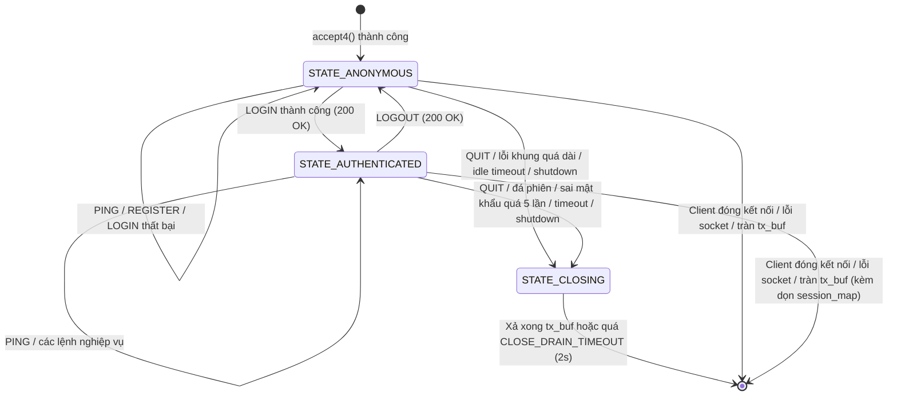

# Đặc tả giao thức tầng ứng dụng (application protocol specification) — Eventora

| Thông tin tài liệu | Chi tiết |
| :--- | :--- |
| **Tên dự án** | **Eventora** — ứng dụng quản lý sự kiện và kết nối bạn bè |
| **Mã tài liệu** | `DOC-PROTO-01` |
| **Đường dẫn tệp** | `docs/PROTOCOL_SPEC.md` |
| **Phiên bản** | `1.0.0` (giao thức `eventora/1`) |
| **Tài liệu gốc** | [FEATURE_SPEC.md](./FEATURE_SPEC.md) (`v2.0.1`), [DATABASE_SCHEMA.md](./DATABASE_SCHEMA.md) (`v1.0.0`, `user_version = 1`) |
| **Phân công** | `FATng` viết chính, `SonNX24042005` duyệt chéo |
| **Trạng thái** | Bản đầu tiên, chờ `SonNX24042005` duyệt chéo |
| **Tầng vận chuyển** | TCP cổng mặc định `8888` (tùy chọn bọc TLS qua OpenSSL `--tls`) |

---

## 1. Mục đích và phạm vi

### 1.1. Mục đích
Tài liệu này chuẩn hóa **giao thức tầng ứng dụng `eventora/1`** cho toàn bộ **17 tính năng (20 điểm)** của hệ thống Eventora, hoàn thành **Bước thiết kế 3** trong [ROADMAP.md](../ROADMAP.md). Mọi thành phần giao tiếp qua mạng đều phải tuân thủ nghiêm ngặt hợp đồng trong tài liệu này:

1. **Module đóng khung dùng chung (`protocol/`)**: bộ tách dòng, bộ mã hóa/giải mã trường `khóa=giá trị`, hàm `send_all()` và cấu trúc `rx_buf`/`tx_buf`.
2. **Server Core (`eventora_server`)**: `network thread` (`epoll`, socket non-blocking), `worker pool`, `auth pool`, `session_map` và bộ đẩy thông báo thời gian thực.
3. **Client Core & Giao diện (`libeventora_client`, CLI/UI)**: bộ phân tách phản hồi đồng bộ và thông báo đẩy bất đồng bộ (`poll()` trên `STDIN_FILENO` và socket), cơ chế `PING` giữ kết nối và truy vấn bù sau đăng nhập.
4. **Công cụ kiểm thử (`tests/unit/`, `load_tester`, kiểm thử `nc`/`telnet`)**: tạo gói tin chuẩn, kiểm thử cắt mảnh/dính gói và đối chiếu mã lỗi xác định.

### 1.2. Ranh giới với các tài liệu thiết kế trước
- **Nghiệp vụ và thứ tự kiểm tra lỗi**: kế thừa nguyên vẹn từ `FEATURE_SPEC.md` (`v2.0.1`). Tài liệu này quy định chi tiết cú pháp trên đường truyền (`wire format`), tên khóa, kiểu dữ liệu, phản hồi thành công, payload của thông báo đẩy và bảng ánh xạ mã lỗi.
- **Lưu trữ bền vững**: mọi tên trường, kiểu giá trị, giới hạn độ dài, miền giá trị `enum` và ràng buộc dữ liệu khớp trực tiếp với `DATABASE_SCHEMA.md` (`v1.0.0`, `user_version = 1`).
- **Tính nhất quán đa nhánh**: phiên bản `FEATURE_SPEC.md` (`v2.0.1`) và `DATABASE_SCHEMA.md` (`v1.0.0`) hiện nằm trên nhánh `origin/docs/feature-spec-v2` trong khi nhánh `main` còn bản đặc tả `1.0.0`. Đặc tả giao thức này bám theo bản đã rà soát `v2.0.1` và `v1.0.0`.

---

## 2. Tầng vận chuyển, đóng khung và mã hóa trường (`FEAT-01`)

### 2.1. Kết nối và ranh giới bản tin
- **Tầng vận chuyển**: TCP (IPv4/IPv6), cổng lắng nghe mặc định `8888`, địa chỉ `0.0.0.0`. Khi bật tùy chọn `--tls`, toàn bộ luồng byte được truyền bên trong kênh TLS (OpenSSL `SSL_read`/`SSL_write`), giữ nguyên hoàn toàn cấu trúc khung bên dưới.
- **Mã hóa ký tự**: UTF-8 hợp lệ (RFC 3629), không dùng BOM. Dữ liệu không phải UTF-8 hợp lệ bị từ chối với mã `400|MALFORMED_FRAME`.
- **Ranh giới khung (Frame Delimiter)**:
  - Mỗi bản tin là đúng **một dòng** kết thúc bằng `\n` (`0x0A`).
  - **Chiều Client → Server**: server chấp nhận cả `\r\n` (`0x0D 0x0A`) lẫn `\n` (`0x0A`) để tương thích trực tiếp với `nc` (chỉ gửi `\n`), `nc -C` và `telnet` (gửi `\r\n`). Nếu có `\r` đứng ngay trước `\n`, server cắt bỏ `\r` trước khi phân giải; mọi `\r` nằm tại vị trí khác chưa được escape là lỗi khung (`400|MALFORMED_FRAME`).
  - **Chiều Server → Client**: server **luôn** gửi kết thúc bằng `\r\n`.
- **Giới hạn kích thước khung (`MAX_FRAME_SIZE`)**:
  - Tối đa **`65.536` byte (64 KiB)** tính **gộp cả ký tự kết thúc dòng** (`\n` hoặc `\r\n`), áp dụng đối xứng cho cả hai chiều.
  - Dòng dài đúng `65.536` byte là **hợp lệ**.
  - Nếu `rx_buf` đã tích lũy đủ `65.536` byte mà vẫn chưa gặp `\n`, hoặc dòng kết thúc vượt quá `65.536` byte: server dừng đọc thêm từ socket, trả `400|FRAME_TOO_LARGE` và chuyển ngay kết nối sang `STATE_CLOSING`.
  - Phía gửi (client hoặc server) phải tự kiểm tra độ dài khung sau khi escape; server không bao giờ phát sinh khung vượt `MAX_FRAME_SIZE`.
- **Dòng rỗng**: một dòng chỉ gồm `\n` hoặc `\r\n` (độ dài phần thân bằng `0`) bị từ chối với `400|MALFORMED_FRAME` (giữ kết nối).

### 2.2. Văn phạm chính thức (ABNF)
Định nghĩa theo RFC 5234 cho phần thân bản tin (sau khi đã loại bỏ `\r\n` hoặc `\n` ở cuối dòng):

```abnf
frame           = request-frame / response-frame / item-frame / push-frame

request-frame   = command *( "|" field )
response-frame  = status-code "|" reason-code *( "|" field )
item-frame      = "ITEM" *( "|" field )
push-frame      = push-code "|" push-name *( "|" field )

command         = UPALPHA *( UPALPHA / DIGIT / "_" )
status-code     = ("2" / "4" / "5") 2DIGIT
reason-code     = UPALPHA *( UPALPHA / DIGIT / "_" )
push-code       = "1" 2DIGIT
push-name       = "PUSH_" UPALPHA *( UPALPHA / DIGIT / "_" )

field           = key "=" value
key             = 1*( lcalpha / DIGIT / "_" )   ; khớp [a-z0-9_]+
value           = *safe-char

lcalpha         = %x61-7A                       ; a-z
UPALPHA         = %x41-5A                       ; A-Z
DIGIT           = %x30-39                       ; 0-9
safe-char       = escaped-seq / utf8-no-ctrl
escaped-seq     = "\\" / "\|" / "\r" / "\n" / "\t"
; utf8-no-ctrl: mọi Unicode scalar value >= U+0020, khác U+007F, khác '\' (%x5C) và '|' (%x7C)
```

**Quy tắc phân tách trường (`field`)**:
1. Tách các đoạn theo ký tự `|` **chưa được escape** (tức không đứng sau số lẻ dấu `\`).
2. Nếu một đoạn sau đầu dòng không chứa dấu `=` → `400|MALFORMED_FRAME`.
3. Với đoạn hợp lệ, `key` là phần bên trái dấu `=` **đầu tiên**; `value` là toàn bộ phần còn lại bên phải dấu `=` đầu tiên (vì vậy ký tự `=` trong giá trị **không cần** và **không được** escape).
4. `key` phải khớp `[a-z0-9_]+` và **không được trùng lặp** trong cùng một bản tin. Vi phạm → `400|MALFORMED_FRAME`.
5. Nếu `key` hợp lệ về cú pháp nhưng không được định nghĩa cho lệnh hiện tại → `400|INVALID_FIELD|field=<key>`.

### 2.3. Quy tắc escape, làm sạch và kiểm tra độ dài
Bảng ánh xạ escape bắt buộc khi mã hóa và giải mã phần `value`:

| Ký tự gốc | Mã hóa trên đường truyền | Ghi chú |
| :---: | :---: | :--- |
| `\` (`U+005C`) | `\\` | Bắt buộc escape đầu tiên để tránh nhầm với chuỗi escape |
| `\|` (`U+007C`) | `\|` | Phân tách trường trong bản tin |
| CR (`U+000D`) | `\r` | Chỉ hợp lệ trong trường cho phép nhiều dòng |
| LF (`U+000A`) | `\n` | Chỉ hợp lệ trong trường cho phép nhiều dòng |
| TAB (`U+0009`) | `\t` | Chỉ hợp lệ trong trường cho phép nhiều dòng |

**Quy tắc xử lý chuỗi theo thứ tự sau khi cắt khung**:
1. **Kiểm tra UTF-8 & ký tự điều khiển thô**: chuỗi trên đường truyền không được chứa ký tự điều khiển thô `U+0000–U+001F` (bao gồm NUL, TAB, LF, CR) hoặc `U+007F`. Vi phạm → `400|MALFORMED_FRAME`.
2. **Giải mã escape (`unescape`)**: mọi chuỗi `\` theo sau bởi ký tự khác `\`, `|`, `r`, `n`, `t` hoặc dấu `\` đứng cuối giá trị → `400|MALFORMED_FRAME`.
3. **Kiểm tra trường một dòng vs đa dòng**:
   - Chỉ `events.description` và `users.bio` được phép chứa ký tự xuống dòng (`\n`, `\r`) hoặc `\t` sau khi unescape.
   - Mọi trường văn bản khác (`username`, `full_name`, `email`, `title`, `location`, `message`, `keyword`, `password`...) là **trường một dòng**: nếu sau unescape vẫn chứa `\r`, `\n` hoặc `\t` → `400|INVALID_FIELD|field=<tên khóa>`.
4. **Cắt khoảng trắng hai đầu (`trim`)**:
   - Mọi trường văn bản **trừ mật khẩu** (`password`, `old_password`, `new_password`) được loại bỏ khoảng trắng hai đầu (`' '`, `'\t'`, `'\r'`, `'\n'`) **sau** bước unescape, rồi mới kiểm tra độ dài tối thiểu/tối đa và lưu xuống SQLite.
   - Các trường mật khẩu **không** bị trim.
5. **Đo độ dài**: mọi giới hạn độ dài văn bản tính theo **số lượng Unicode code point**, khớp trực tiếp với hàm `length(TEXT)` của SQLite (ví dụ `'Nguyễn An'` là 9 ký tự).

### 2.4. Khóa vắng mặt, khóa rỗng và kiểu dữ liệu
- **Phân biệt vắng mặt vs rỗng**:
  - Không gửi khóa `foo` → *không cung cấp* (giữ nguyên giá trị cũ trong `UPDATE_*`, hoặc dùng giá trị mặc định trong `CREATE_*`/`GET_*`).
  - Gửi `foo=` (giá trị rỗng) → *chuỗi rỗng* (dùng để xóa `email` về `NULL`, xóa `bio` hoặc `description` về `''`).
- **Quy ước kiểu dữ liệu trên đường truyền**:

| Kiểu ký hiệu | Biểu diễn trên đường truyền | Quy tắc kiểm tra |
| :--- | :--- | :--- |
| `int64` | Chuỗi thập phân `[0-9]+` (hoặc `-[0-9]+` nếu cho phép âm), không dấu `+`, không khoảng trắng | Nằm trong miền `int64_t`; các ID (`user_id`, `event_id`, `request_id`) bắt buộc `>= 1` |
| `timestamp` | `int64` Unix timestamp (giây, UTC) | Theo giờ chuẩn server `now` |
| `bool` | `'0'` hoặc `'1'` | Giá trị khác `'0'`/`'1'` → `400|INVALID_FIELD` |
| `enum` | Chuỗi `UPPER_SNAKE_CASE` (phân biệt chữ hoa/thường chính xác) | Ngoài tập giá trị hợp lệ → `400|INVALID_FIELD` |
| `string` | Chuỗi UTF-8 đã escape | Kiểm tra một dòng/đa dòng, trim và độ dài |
| `csv` | Danh sách tên trường cách nhau bởi dấu `,`, không khoảng trắng (ví dụ `title,location`) | Dùng trong `120|PUSH_EVENT_UPDATED` |

- **Quy tắc tham chiếu người dùng đích (`<target_user_ref>`)**:
  - Áp dụng cho `SEND_FRIEND_REQUEST`, `UNFRIEND`, `INVITE_TO_EVENT`, `DECIDE_JOIN_REQUEST`: yêu cầu truyền **đúng một** trong hai khóa `user_id` hoặc `username`.
  - Thiếu cả hai khóa → `400|INVALID_FIELD|field=user_id`.
  - Truyền đồng thời cả `user_id` và `username` → `400|INVALID_FIELD|field=username`.
  - Riêng `GET_PROFILE`: có thể bỏ trống cả hai khóa để xem hồ sơ của chính mình; nếu truyền cả hai cùng lúc → `400|INVALID_FIELD|field=username`.

### 2.5. Khối phản hồi danh sách, thứ tự FIFO và kiểm soát luồng
- **Khối phản hồi danh sách nhiều dòng**:
  - Áp dụng cho `GET_EVENTS`, `GET_EVENT_MEMBERS`, `GET_FRIENDS`, `GET_FRIEND_REQUESTS`.
  - Dòng tiêu đề: `200|OK|total=<int>|page=<int>|page_size=<int>|count=<N>` (`total` là tổng số bản ghi khớp bộ lọc trên toàn bộ dữ liệu; `N` là số phần tử thực tế trong trang hiện tại, `0 <= N <= page_size`).
  - Tiếp theo ngay sau dòng tiêu đề là **đúng `N` dòng** bắt đầu bằng `ITEM|<khóa>=<giá trị>...`.
  - **Tính nguyên tử trên đường truyền**: server giữ mutex của `tx_buf` để ghi trọn vẹn dòng tiêu đề và toàn bộ `N` dòng `ITEM` liên tiếp nhau. Không có thông báo đẩy `1xx` nào được phép xen vào giữa dòng tiêu đề và dòng `ITEM` cuối cùng.
  - Nếu `page` vượt quá tổng số trang có dữ liệu, lệnh **không** báo lỗi mà trả `200|OK|total=<T>|page=<P>|page_size=<S>|count=0` (không có dòng `ITEM` theo sau).
- **Pipelining & thứ tự FIFO**:
  - Client được phép gửi liên tiếp nhiều lệnh mà không cần chờ phản hồi trước (`pipelining`).
  - Server đẩy khung vào `inbox` của phiên (sức chứa `MAX_INBOX_FRAMES = 32`). Khi `inbox` đầy, `network thread` tạm gỡ `EPOLLIN` trên socket đó để TCP tự hãm tốc phía gửi; khi worker xử lý xong bớt sẽ đăng ký lại `EPOLLIN`.
  - Trong phạm vi một kết nối, mỗi thời điểm chỉ tối đa một worker xử lý bản tin đầu hàng đợi của phiên đó → **phản hồi luôn ra đúng thứ tự yêu cầu**.
  - Thông báo đẩy `1xx` có thể xuất hiện giữa hai phản hồi `2xx`/`4xx`/`5xx` bất kỳ; client nhận diện thông báo đẩy bằng tiền tố `1` ở mã 3 chữ số đầu dòng.
- **Tràn bộ đệm gửi (`MAX_TX_BUFFER = 1.048.576` byte)**:
  - Nếu việc ghi phản hồi hoặc thông báo đẩy vào `tx_buf` làm dung lượng vượt 1 MiB (client treo hoặc không đọc), server hủy thao tác ghi đó, ghi log `WARN` và **đóng kết nối ngay lập tức** (không qua `STATE_CLOSING`).

---

## 3. Máy trạng thái phiên, thời gian chờ và chính sách bảo mật (`FEAT-02`, `FEAT-04`)

### 3.1. Sơ đồ chuyển trạng thái kết nối



### 3.2. Bảng lệnh hợp lệ theo trạng thái và hàng đợi xử lý

| Lệnh | `STATE_ANONYMOUS` | `STATE_AUTHENTICATED` | `STATE_CLOSING` | Pool xử lý |
| :--- | :--- | :--- | :--- | :--- |
| `PING` | `200\|PONG` | `200\|PONG` | Bỏ qua | `worker pool` |
| `QUIT` | `200\|BYE` → `STATE_CLOSING` | `200\|BYE` → `STATE_CLOSING` | Bỏ qua | `worker pool` |
| `REGISTER`, `LOGIN` | Cho phép | `400\|ALREADY_AUTHENTICATED` | Bỏ qua | `auth pool` |
| `CHANGE_PASSWORD` | `401\|AUTHENTICATION_REQUIRED` | Cho phép | Bỏ qua | `auth pool` |
| `LOGOUT` và 15 lệnh nghiệp vụ còn lại | `401\|AUTHENTICATION_REQUIRED` | Cho phép (theo phân quyền) | Bỏ qua | `worker pool` |
| Tên lệnh không tồn tại | `400\|UNKNOWN_COMMAND` | `400\|UNKNOWN_COMMAND` | Bỏ qua | `worker pool` |

> **Lưu ý về tách `auth pool`**: `REGISTER`, `LOGIN` và `CHANGE_PASSWORD` chạy PBKDF2-HMAC-SHA256 (`600.000` vòng, khoảng `125 ms` CPU/lần) trên `auth_queue` riêng (`AUTH_POOL_SIZE = 4`) để không làm nghẽn `worker pool` (`THREAD_POOL_SIZE = 8`). Tuy nhiên, để giữ đúng thứ tự phản hồi FIFO trên từng kết nối, phiên vẫn chỉ được xử lý tuần tự từng bản tin một (cơ chế `scheduled` bảo đảm lệnh đứng sau không vượt lên trước lệnh auth đang chạy).

### 3.3. Thời gian chờ và chính sách đóng kết nối
- **Thời gian chờ không hoạt động (Idle Timeout)**: đồng hồ đếm lại mỗi khi server nhận được một bản tin hợp lệ (kể cả `PING`):
  - Tại `STATE_ANONYMOUS`: **`ANON_IDLE_TIMEOUT = 60` giây**.
  - Tại `STATE_AUTHENTICATED`: **`AUTH_IDLE_TIMEOUT = 300` giây**.
  - Khi hết hạn: server đẩy `199|PUSH_SESSION_TERMINATED|reason=IDLE_TIMEOUT`, dọn phiên nếu đang đăng nhập (cập nhật `last_seen = now`, xóa khỏi `session_map`, gửi `103|PUSH_FRIEND_STATUS|...|status=OFFLINE`), rồi chuyển kết nối sang `STATE_CLOSING`.
  - Phía `libeventora_client`: khi đã đăng nhập và rảnh, tự gửi `PING` định kỳ sau mỗi **`CLIENT_PING_INTERVAL = 60` giây**. Nếu bị đóng ở `STATE_ANONYMOUS` do chờ lâu, client tự mở lại kết nối TCP ở lệnh kế tiếp.
- **Trạng thái xả bộ đệm (`STATE_CLOSING`)**: server gỡ `EPOLLIN` (ngừng nhận thêm dữ liệu từ client), tiếp tục bật `EPOLLOUT` để xả nốt `tx_buf` và đóng socket khi `tx_buf` rỗng hoặc khi vượt **`CLOSE_DRAIN_TIMEOUT = 2` giây**.
- **Đăng nhập trùng (Concurrent Login — Phiên mới thắng)**: dưới khóa ghi của `session_map`, nếu `user_id` đã có phiên đang mở trên kết nối cũ:
  1. Gửi `199|PUSH_SESSION_TERMINATED|reason=LOGGED_IN_ELSEWHERE` tới kết nối cũ và đưa kết nối cũ vào `STATE_CLOSING`.
  2. Gắn `user_id` vào kết nối mới và thay thế con trỏ trong `session_map`.
  3. Vì người dùng vẫn trực tuyến liên tục, server **không** cập nhật `last_seen` và **không** phát `103|PUSH_FRIEND_STATUS` cho bạn bè.
- **Chống dò mật khẩu**:
  - *Theo kết nối*: mỗi phiên giữ bộ đếm số lần sai liên tiếp (tính gộp `LOGIN` sai mật khẩu và `CHANGE_PASSWORD` sai `old_password`; đăng nhập hoặc đổi mật khẩu thành công đặt lại về `0`). Khi chạm ngưỡng **`MAX_FAILED_LOGINS_PER_CONN = 5`**: server gửi phản hồi lỗi của lần sai thứ 5 (`401|INVALID_CREDENTIALS` hoặc `403|OLD_PASSWORD_INCORRECT`), nối tiếp bằng `199|PUSH_SESSION_TERMINATED|reason=TOO_MANY_FAILED_ATTEMPTS`, rồi chuyển sang `STATE_CLOSING`.
  - *Theo tài khoản (`LOGIN`)*: sau **`ACCOUNT_LOCK_THRESHOLD = 10`** lần sai mật khẩu liên tiếp trên mọi kết nối, tài khoản bị đặt `locked_until = now + 900` (`ACCOUNT_LOCK_DURATION = 900` giây) và `failed_login_count` đặt về `0` (truy vấn Q11 trong `DATABASE_SCHEMA.md`). Mọi lần `LOGIN` tiếp theo trong thời gian khóa trả `403|ACCOUNT_LOCKED|retry_after=<số giây còn lại>` mà **không** chạy PBKDF2.
- **Tắt server an toàn (`SIGINT`/`SIGTERM`)**: server ngừng `accept()`, gửi `199|PUSH_SESSION_TERMINATED|reason=SERVER_SHUTDOWN` tới mọi phiên đang mở, chuyển sang `STATE_CLOSING` để xả `tx_buf`, chờ các luồng hoàn tất và đóng SQLite.
