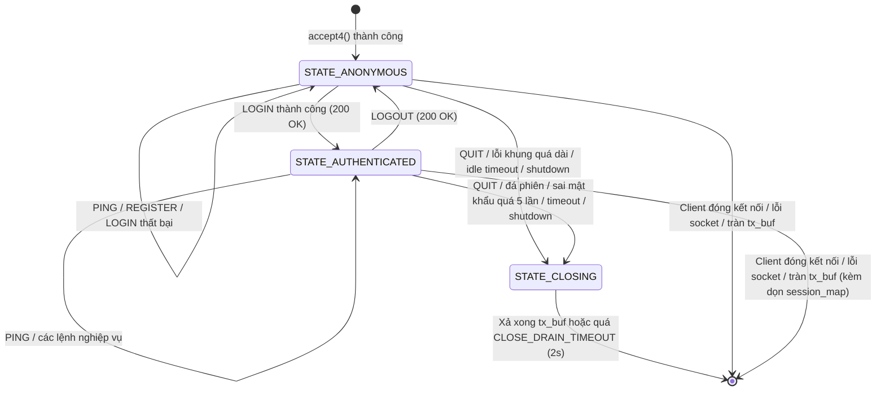

# Đặc tả giao thức tầng ứng dụng (application protocol specification) — Eventora

| Thông tin tài liệu | Chi tiết |
| :--- | :--- |
| **Tên dự án** | **Eventora** — ứng dụng quản lý sự kiện và kết nối bạn bè |
| **Mã tài liệu** | `DOC-PROTO-01` |
| **Đường dẫn tệp** | `docs/PROTOCOL_SPEC.md` |
| **Phiên bản** | `1.0.0` (giao thức `eventora/1`) |
| **Tài liệu gốc** | [FEATURE_SPEC.md](./FEATURE_SPEC.md) (`v2.0.1`), [DATABASE_SCHEMA.md](./DATABASE_SCHEMA.md) (`v1.0.0`, `user_version = 1`) |
| **Phân công** | `FATng` viết chính, `SonNX24042005` duyệt chéo |
| **Trạng thái** | Bản đầu tiên, chờ `SonNX24042005` duyệt chéo |
| **Tầng vận chuyển** | TCP cổng mặc định `8888` (tùy chọn bọc TLS qua OpenSSL `--tls`) |

---

## 1. Mục đích và phạm vi

### 1.1. Mục đích
Tài liệu này chuẩn hóa **giao thức tầng ứng dụng `eventora/1`** cho toàn bộ **17 tính năng (20 điểm)** của hệ thống Eventora, hoàn thành **Bước thiết kế 3** trong [ROADMAP.md](../ROADMAP.md). Mọi thành phần giao tiếp qua mạng đều phải tuân thủ nghiêm ngặt hợp đồng trong tài liệu này:

1. **Module đóng khung dùng chung (`protocol/`)**: bộ tách dòng, bộ mã hóa/giải mã trường `khóa=giá trị`, hàm `send_all()` và cấu trúc `rx_buf`/`tx_buf`.
2. **Server Core (`eventora_server`)**: `network thread` (`epoll`, socket non-blocking), `worker pool`, `auth pool`, `session_map` và bộ đẩy thông báo thời gian thực.
3. **Client Core & Giao diện (`libeventora_client`, CLI/UI)**: bộ phân tách phản hồi đồng bộ và thông báo đẩy bất đồng bộ (`poll()` trên `STDIN_FILENO` và socket), cơ chế `PING` giữ kết nối và truy vấn bù sau đăng nhập.
4. **Công cụ kiểm thử (`tests/unit/`, `load_tester`, kiểm thử `nc`/`telnet`)**: tạo gói tin chuẩn, kiểm thử cắt mảnh/dính gói và đối chiếu mã lỗi xác định.

### 1.2. Ranh giới với các tài liệu thiết kế trước
- **Nghiệp vụ và thứ tự kiểm tra lỗi**: kế thừa nguyên vẹn từ `FEATURE_SPEC.md` (`v2.0.1`). Tài liệu này quy định chi tiết cú pháp trên đường truyền (`wire format`), tên khóa, kiểu dữ liệu, phản hồi thành công, payload của thông báo đẩy và bảng ánh xạ mã lỗi.
- **Lưu trữ bền vững**: mọi tên trường, kiểu giá trị, giới hạn độ dài, miền giá trị `enum` và ràng buộc dữ liệu khớp trực tiếp với `DATABASE_SCHEMA.md` (`v1.0.0`, `user_version = 1`).
- **Tính nhất quán đa nhánh**: phiên bản `FEATURE_SPEC.md` (`v2.0.1`) và `DATABASE_SCHEMA.md` (`v1.0.0`) hiện nằm trên nhánh `origin/docs/feature-spec-v2` trong khi nhánh `main` còn bản đặc tả `1.0.0`. Đặc tả giao thức này bám theo bản đã rà soát `v2.0.1` và `v1.0.0`.

---

## 2. Tầng vận chuyển, đóng khung và mã hóa trường (`FEAT-01`)

### 2.1. Kết nối và ranh giới bản tin
- **Tầng vận chuyển**: TCP (IPv4/IPv6), cổng lắng nghe mặc định `8888`, địa chỉ `0.0.0.0`. Khi bật tùy chọn `--tls`, toàn bộ luồng byte được truyền bên trong kênh TLS (OpenSSL `SSL_read`/`SSL_write`), giữ nguyên hoàn toàn cấu trúc khung bên dưới.
- **Mã hóa ký tự**: UTF-8 hợp lệ (RFC 3629), không dùng BOM. Dữ liệu không phải UTF-8 hợp lệ bị từ chối với mã `400|MALFORMED_FRAME`.
- **Ranh giới khung (Frame Delimiter)**:
  - Mỗi bản tin là đúng **một dòng** kết thúc bằng `\n` (`0x0A`).
  - **Chiều Client → Server**: server chấp nhận cả `\r\n` (`0x0D 0x0A`) lẫn `\n` (`0x0A`) để tương thích trực tiếp với `nc` (chỉ gửi `\n`), `nc -C` và `telnet` (gửi `\r\n`). Nếu có `\r` đứng ngay trước `\n`, server cắt bỏ `\r` trước khi phân giải; mọi `\r` nằm tại vị trí khác chưa được escape là lỗi khung (`400|MALFORMED_FRAME`).
  - **Chiều Server → Client**: server **luôn** gửi kết thúc bằng `\r\n`.
- **Giới hạn kích thước khung (`MAX_FRAME_SIZE`)**:
  - Tối đa **`65.536` byte (64 KiB)** tính **gộp cả ký tự kết thúc dòng** (`\n` hoặc `\r\n`), áp dụng đối xứng cho cả hai chiều.
  - Dòng dài đúng `65.536` byte là **hợp lệ**.
  - Nếu `rx_buf` đã tích lũy đủ `65.536` byte mà vẫn chưa gặp `\n`, hoặc dòng kết thúc vượt quá `65.536` byte: server dừng đọc thêm từ socket, trả `400|FRAME_TOO_LARGE` và chuyển ngay kết nối sang `STATE_CLOSING`.
  - Phía gửi (client hoặc server) phải tự kiểm tra độ dài khung sau khi escape; server không bao giờ phát sinh khung vượt `MAX_FRAME_SIZE`.
- **Dòng rỗng**: một dòng chỉ gồm `\n` hoặc `\r\n` (độ dài phần thân bằng `0`) bị từ chối với `400|MALFORMED_FRAME` (giữ kết nối).

### 2.2. Văn phạm chính thức (ABNF)
Định nghĩa theo RFC 5234 cho phần thân bản tin (sau khi đã loại bỏ `\r\n` hoặc `\n` ở cuối dòng):

```abnf
frame           = request-frame / response-frame / item-frame / push-frame

request-frame   = command *( "|" field )
response-frame  = status-code "|" reason-code *( "|" field )
item-frame      = "ITEM" *( "|" field )
push-frame      = push-code "|" push-name *( "|" field )

command         = UPALPHA *( UPALPHA / DIGIT / "_" )
status-code     = ("2" / "4" / "5") 2DIGIT
reason-code     = UPALPHA *( UPALPHA / DIGIT / "_" )
push-code       = "1" 2DIGIT
push-name       = "PUSH_" UPALPHA *( UPALPHA / DIGIT / "_" )

field           = key "=" value
key             = 1*( lcalpha / DIGIT / "_" )   ; khớp [a-z0-9_]+
value           = *safe-char

lcalpha         = %x61-7A                       ; a-z
UPALPHA         = %x41-5A                       ; A-Z
DIGIT           = %x30-39                       ; 0-9
safe-char       = escaped-seq / utf8-no-ctrl
escaped-seq     = "\\" / "\|" / "\r" / "\n" / "\t"
; utf8-no-ctrl: mọi Unicode scalar value >= U+0020, khác U+007F, khác '\' (%x5C) và '|' (%x7C)
```

**Quy tắc phân tách trường (`field`)**:
1. Tách các đoạn theo ký tự `|` **chưa được escape** (tức không đứng sau số lẻ dấu `\`).
2. Nếu một đoạn sau đầu dòng không chứa dấu `=` → `400|MALFORMED_FRAME`.
3. Với đoạn hợp lệ, `key` là phần bên trái dấu `=` **đầu tiên**; `value` là toàn bộ phần còn lại bên phải dấu `=` đầu tiên (vì vậy ký tự `=` trong giá trị **không cần** và **không được** escape).
4. `key` phải khớp `[a-z0-9_]+` và **không được trùng lặp** trong cùng một bản tin. Vi phạm → `400|MALFORMED_FRAME`.
5. Nếu `key` hợp lệ về cú pháp nhưng không được định nghĩa cho lệnh hiện tại → `400|INVALID_FIELD|field=<key>`.

### 2.3. Quy tắc escape, làm sạch và kiểm tra độ dài
Bảng ánh xạ escape bắt buộc khi mã hóa và giải mã phần `value`:

| Ký tự gốc | Mã hóa trên đường truyền | Ghi chú |
| :---: | :---: | :--- |
| `\` (`U+005C`) | `\\` | Bắt buộc escape đầu tiên để tránh nhầm với chuỗi escape |
| `\|` (`U+007C`) | `\|` | Phân tách trường trong bản tin |
| CR (`U+000D`) | `\r` | Chỉ hợp lệ trong trường cho phép nhiều dòng |
| LF (`U+000A`) | `\n` | Chỉ hợp lệ trong trường cho phép nhiều dòng |
| TAB (`U+0009`) | `\t` | Chỉ hợp lệ trong trường cho phép nhiều dòng |

**Quy tắc xử lý chuỗi theo thứ tự sau khi cắt khung**:
1. **Kiểm tra UTF-8 & ký tự điều khiển thô**: chuỗi trên đường truyền không được chứa ký tự điều khiển thô `U+0000–U+001F` (bao gồm NUL, TAB, LF, CR) hoặc `U+007F`. Vi phạm → `400|MALFORMED_FRAME`.
2. **Giải mã escape (`unescape`)**: mọi chuỗi `\` theo sau bởi ký tự khác `\`, `|`, `r`, `n`, `t` hoặc dấu `\` đứng cuối giá trị → `400|MALFORMED_FRAME`.
3. **Kiểm tra trường một dòng vs đa dòng**:
   - Chỉ `events.description` và `users.bio` được phép chứa ký tự xuống dòng (`\n`, `\r`) hoặc `\t` sau khi unescape.
   - Mọi trường văn bản khác (`username`, `full_name`, `email`, `title`, `location`, `message`, `keyword`, `password`...) là **trường một dòng**: nếu sau unescape vẫn chứa `\r`, `\n` hoặc `\t` → `400|INVALID_FIELD|field=<tên khóa>`.
4. **Cắt khoảng trắng hai đầu (`trim`)**:
   - Mọi trường văn bản **trừ mật khẩu** (`password`, `old_password`, `new_password`) được loại bỏ khoảng trắng hai đầu (`' '`, `'\t'`, `'\r'`, `'\n'`) **sau** bước unescape, rồi mới kiểm tra độ dài tối thiểu/tối đa và lưu xuống SQLite.
   - Các trường mật khẩu **không** bị trim.
5. **Đo độ dài**: mọi giới hạn độ dài văn bản tính theo **số lượng Unicode code point**, khớp trực tiếp với hàm `length(TEXT)` của SQLite (ví dụ `'Nguyễn An'` là 9 ký tự).

### 2.4. Khóa vắng mặt, khóa rỗng và kiểu dữ liệu
- **Phân biệt vắng mặt vs rỗng**:
  - Không gửi khóa `foo` → *không cung cấp* (giữ nguyên giá trị cũ trong `UPDATE_*`, hoặc dùng giá trị mặc định trong `CREATE_*`/`GET_*`).
  - Gửi `foo=` (giá trị rỗng) → *chuỗi rỗng* (dùng để xóa `email` về `NULL`, xóa `bio` hoặc `description` về `''`).
- **Quy ước kiểu dữ liệu trên đường truyền**:

| Kiểu ký hiệu | Biểu diễn trên đường truyền | Quy tắc kiểm tra |
| :--- | :--- | :--- |
| `int64` | Chuỗi thập phân `[0-9]+` (hoặc `-[0-9]+` nếu cho phép âm), không dấu `+`, không khoảng trắng | Nằm trong miền `int64_t`; các ID (`user_id`, `event_id`, `request_id`) bắt buộc `>= 1` |
| `timestamp` | `int64` Unix timestamp (giây, UTC) | Theo giờ chuẩn server `now` |
| `bool` | `'0'` hoặc `'1'` | Giá trị khác `'0'`/`'1'` → `400|INVALID_FIELD` |
| `enum` | Chuỗi `UPPER_SNAKE_CASE` (phân biệt chữ hoa/thường chính xác) | Ngoài tập giá trị hợp lệ → `400|INVALID_FIELD` |
| `string` | Chuỗi UTF-8 đã escape | Kiểm tra một dòng/đa dòng, trim và độ dài |
| `csv` | Danh sách tên trường cách nhau bởi dấu `,`, không khoảng trắng (ví dụ `title,location`) | Dùng trong `120|PUSH_EVENT_UPDATED` |

- **Quy tắc tham chiếu người dùng đích (`<target_user_ref>`)**:
  - Áp dụng cho `SEND_FRIEND_REQUEST`, `UNFRIEND`, `INVITE_TO_EVENT`, `DECIDE_JOIN_REQUEST`: yêu cầu truyền **đúng một** trong hai khóa `user_id` hoặc `username`.
  - Thiếu cả hai khóa → `400|INVALID_FIELD|field=user_id`.
  - Truyền đồng thời cả `user_id` và `username` → `400|INVALID_FIELD|field=username`.
  - Riêng `GET_PROFILE`: có thể bỏ trống cả hai khóa để xem hồ sơ của chính mình; nếu truyền cả hai cùng lúc → `400|INVALID_FIELD|field=username`.

### 2.5. Khối phản hồi danh sách, thứ tự FIFO và kiểm soát luồng
- **Khối phản hồi danh sách nhiều dòng**:
  - Áp dụng cho `GET_EVENTS`, `GET_EVENT_MEMBERS`, `GET_FRIENDS`, `GET_FRIEND_REQUESTS`.
  - Dòng tiêu đề: `200|OK|total=<int>|page=<int>|page_size=<int>|count=<N>` (`total` là tổng số bản ghi khớp bộ lọc trên toàn bộ dữ liệu; `N` là số phần tử thực tế trong trang hiện tại, `0 <= N <= page_size`).
  - Tiếp theo ngay sau dòng tiêu đề là **đúng `N` dòng** bắt đầu bằng `ITEM|<khóa>=<giá trị>...`.
  - **Tính nguyên tử trên đường truyền**: server giữ mutex của `tx_buf` để ghi trọn vẹn dòng tiêu đề và toàn bộ `N` dòng `ITEM` liên tiếp nhau. Không có thông báo đẩy `1xx` nào được phép xen vào giữa dòng tiêu đề và dòng `ITEM` cuối cùng.
  - Nếu `page` vượt quá tổng số trang có dữ liệu, lệnh **không** báo lỗi mà trả `200|OK|total=<T>|page=<P>|page_size=<S>|count=0` (không có dòng `ITEM` theo sau).
- **Pipelining & thứ tự FIFO**:
  - Client được phép gửi liên tiếp nhiều lệnh mà không cần chờ phản hồi trước (`pipelining`).
  - Server đẩy khung vào `inbox` của phiên (sức chứa `MAX_INBOX_FRAMES = 32`). Khi `inbox` đầy, `network thread` tạm gỡ `EPOLLIN` trên socket đó để TCP tự hãm tốc phía gửi; khi worker xử lý xong bớt sẽ đăng ký lại `EPOLLIN`.
  - Trong phạm vi một kết nối, mỗi thời điểm chỉ tối đa một worker xử lý bản tin đầu hàng đợi của phiên đó → **phản hồi luôn ra đúng thứ tự yêu cầu**.
  - Thông báo đẩy `1xx` có thể xuất hiện giữa hai phản hồi `2xx`/`4xx`/`5xx` bất kỳ; client nhận diện thông báo đẩy bằng tiền tố `1` ở mã 3 chữ số đầu dòng.
- **Tràn bộ đệm gửi (`MAX_TX_BUFFER = 1.048.576` byte)**:
  - Nếu việc ghi phản hồi hoặc thông báo đẩy vào `tx_buf` làm dung lượng vượt 1 MiB (client treo hoặc không đọc), server hủy thao tác ghi đó, ghi log `WARN` và **đóng kết nối ngay lập tức** (không qua `STATE_CLOSING`).

---

## 3. Máy trạng thái phiên, thời gian chờ và chính sách bảo mật (`FEAT-02`, `FEAT-04`)

### 3.1. Sơ đồ chuyển trạng thái kết nối



### 3.2. Bảng lệnh hợp lệ theo trạng thái và hàng đợi xử lý

| Lệnh | `STATE_ANONYMOUS` | `STATE_AUTHENTICATED` | `STATE_CLOSING` | Pool xử lý |
| :--- | :--- | :--- | :--- | :--- |
| `PING` | `200\|PONG` | `200\|PONG` | Bỏ qua | `worker pool` |
| `QUIT` | `200\|BYE` → `STATE_CLOSING` | `200\|BYE` → `STATE_CLOSING` | Bỏ qua | `worker pool` |
| `REGISTER`, `LOGIN` | Cho phép | `400\|ALREADY_AUTHENTICATED` | Bỏ qua | `auth pool` |
| `CHANGE_PASSWORD` | `401\|AUTHENTICATION_REQUIRED` | Cho phép | Bỏ qua | `auth pool` |
| `LOGOUT` và 15 lệnh nghiệp vụ còn lại | `401\|AUTHENTICATION_REQUIRED` | Cho phép (theo phân quyền) | Bỏ qua | `worker pool` |
| Tên lệnh không tồn tại | `400\|UNKNOWN_COMMAND` | `400\|UNKNOWN_COMMAND` | Bỏ qua | `worker pool` |

> **Lưu ý về tách `auth pool`**: `REGISTER`, `LOGIN` và `CHANGE_PASSWORD` chạy PBKDF2-HMAC-SHA256 (`600.000` vòng, khoảng `125 ms` CPU/lần) trên `auth_queue` riêng (`AUTH_POOL_SIZE = 4`) để không làm nghẽn `worker pool` (`THREAD_POOL_SIZE = 8`). Tuy nhiên, để giữ đúng thứ tự phản hồi FIFO trên từng kết nối, phiên vẫn chỉ được xử lý tuần tự từng bản tin một (cơ chế `scheduled` bảo đảm lệnh đứng sau không vượt lên trước lệnh auth đang chạy).

### 3.3. Thời gian chờ và chính sách đóng kết nối
- **Thời gian chờ không hoạt động (Idle Timeout)**: đồng hồ đếm lại mỗi khi server nhận được một bản tin hợp lệ (kể cả `PING`):
  - Tại `STATE_ANONYMOUS`: **`ANON_IDLE_TIMEOUT = 60` giây**.
  - Tại `STATE_AUTHENTICATED`: **`AUTH_IDLE_TIMEOUT = 300` giây**.
  - Khi hết hạn: server đẩy `199|PUSH_SESSION_TERMINATED|reason=IDLE_TIMEOUT`, dọn phiên nếu đang đăng nhập (cập nhật `last_seen = now`, xóa khỏi `session_map`, gửi `103|PUSH_FRIEND_STATUS|...|status=OFFLINE`), rồi chuyển kết nối sang `STATE_CLOSING`.
  - Phía `libeventora_client`: khi đã đăng nhập và rảnh, tự gửi `PING` định kỳ sau mỗi **`CLIENT_PING_INTERVAL = 60` giây**. Nếu bị đóng ở `STATE_ANONYMOUS` do chờ lâu, client tự mở lại kết nối TCP ở lệnh kế tiếp.
- **Trạng thái xả bộ đệm (`STATE_CLOSING`)**: server gỡ `EPOLLIN` (ngừng nhận thêm dữ liệu từ client), tiếp tục bật `EPOLLOUT` để xả nốt `tx_buf` và đóng socket khi `tx_buf` rỗng hoặc khi vượt **`CLOSE_DRAIN_TIMEOUT = 2` giây**.
- **Đăng nhập trùng (Concurrent Login — Phiên mới thắng)**: dưới khóa ghi của `session_map`, nếu `user_id` đã có phiên đang mở trên kết nối cũ:
  1. Gửi `199|PUSH_SESSION_TERMINATED|reason=LOGGED_IN_ELSEWHERE` tới kết nối cũ và đưa kết nối cũ vào `STATE_CLOSING`.
  2. Gắn `user_id` vào kết nối mới và thay thế con trỏ trong `session_map`.
  3. Vì người dùng vẫn trực tuyến liên tục, server **không** cập nhật `last_seen` và **không** phát `103|PUSH_FRIEND_STATUS` cho bạn bè.
- **Chống dò mật khẩu**:
  - *Theo kết nối*: mỗi phiên giữ bộ đếm số lần sai liên tiếp (tính gộp `LOGIN` sai mật khẩu và `CHANGE_PASSWORD` sai `old_password`; đăng nhập hoặc đổi mật khẩu thành công đặt lại về `0`). Khi chạm ngưỡng **`MAX_FAILED_LOGINS_PER_CONN = 5`**: server gửi phản hồi lỗi của lần sai thứ 5 (`401|INVALID_CREDENTIALS` hoặc `403|OLD_PASSWORD_INCORRECT`), nối tiếp bằng `199|PUSH_SESSION_TERMINATED|reason=TOO_MANY_FAILED_ATTEMPTS`, rồi chuyển sang `STATE_CLOSING`.
  - *Theo tài khoản (`LOGIN`)*: sau **`ACCOUNT_LOCK_THRESHOLD = 10`** lần sai mật khẩu liên tiếp trên mọi kết nối, tài khoản bị đặt `locked_until = now + 900` (`ACCOUNT_LOCK_DURATION = 900` giây) và `failed_login_count` đặt về `0` (truy vấn Q11 trong `DATABASE_SCHEMA.md`). Mọi lần `LOGIN` tiếp theo trong thời gian khóa trả `403|ACCOUNT_LOCKED|retry_after=<số giây còn lại>` mà **không** chạy PBKDF2.
- **Tắt server an toàn (`SIGINT`/`SIGTERM`)**: server ngừng `accept()`, gửi `199|PUSH_SESSION_TERMINATED|reason=SERVER_SHUTDOWN` tới mọi phiên đang mở, chuyển sang `STATE_CLOSING` để xả `tx_buf`, chờ các luồng hoàn tất và đóng SQLite.

---

## 4. Danh mục chi tiết toàn bộ 23 lệnh giao thức

### 4.1. Bảng tóm tắt 23 lệnh

| Nhóm | Lệnh | Mã tính năng | Trạng thái cho phép | Pool | Mã thành công | Thông báo đẩy phát sinh |
| :--- | :--- | :---: | :--- | :---: | :---: | :--- |
| **Phiên** | `PING` | `FEAT-04` | Mọi trạng thái trừ `CLOSING` | `worker` | `200\|PONG` | — |
| **Phiên** | `QUIT` | `FEAT-04` | Mọi trạng thái trừ `CLOSING` | `worker` | `200\|BYE` | `103` (nếu đang đăng nhập) |
| **Phiên** | `LOGIN` | `FEAT-04` | `STATE_ANONYMOUS` | `auth` | `200\|OK` | `103`, `199` (nếu đá phiên cũ / sai quá 5 lần) |
| **Phiên** | `LOGOUT` | `FEAT-04` | `STATE_AUTHENTICATED` | `worker` | `200\|OK` | `103` |
| **Tài khoản** | `REGISTER` | `FEAT-03` | `STATE_ANONYMOUS` | `auth` | `201\|CREATED` | — |
| **Tài khoản** | `GET_PROFILE` | `FEAT-03` | `STATE_AUTHENTICATED` | `worker` | `200\|OK` | — |
| **Tài khoản** | `UPDATE_PROFILE` | `FEAT-03` | `STATE_AUTHENTICATED` | `worker` | `200\|OK` | — |
| **Tài khoản** | `CHANGE_PASSWORD` | `FEAT-03` | `STATE_AUTHENTICATED` | `auth` | `200\|OK` | `199` (nếu sai mật khẩu cũ 5 lần) |
| **Sự kiện** | `GET_EVENTS` | `FEAT-05` | `STATE_AUTHENTICATED` | `worker` | `200\|OK` (+ `ITEM`) | — |
| **Sự kiện** | `GET_EVENT_DETAIL` | `FEAT-05` | `STATE_AUTHENTICATED` | `worker` | `200\|OK` | — |
| **Sự kiện** | `GET_EVENT_MEMBERS` | `FEAT-05` | `STATE_AUTHENTICATED` | `worker` | `200\|OK` (+ `ITEM`) | — |
| **Sự kiện** | `CREATE_EVENT` | `FEAT-06` | `STATE_AUTHENTICATED` | `worker` | `201\|CREATED` | — |
| **Sự kiện** | `UPDATE_EVENT` | `FEAT-07` | `STATE_AUTHENTICATED` | `worker` | `200\|OK` | `112`, `114`, `120` |
| **Sự kiện** | `DELETE_EVENT` | `FEAT-08` | `STATE_AUTHENTICATED` | `worker` | `200\|OK` | `121` |
| **Bạn bè** | `SEND_FRIEND_REQUEST` | `FEAT-09` | `STATE_AUTHENTICATED` | `worker` | `201\|CREATED` / `200\|OK` | `101` / `102` |
| **Bạn bè** | `RESPOND_FRIEND_REQUEST` | `FEAT-10` | `STATE_AUTHENTICATED` | `worker` | `200\|OK` | `102` (khi `ACCEPT`) |
| **Bạn bè** | `UNFRIEND` | `FEAT-11` | `STATE_AUTHENTICATED` | `worker` | `200\|OK` | `104`, `114` |
| **Bạn bè** | `GET_FRIENDS` | `FEAT-12` | `STATE_AUTHENTICATED` | `worker` | `200\|OK` (+ `ITEM`) | — |
| **Bạn bè** | `GET_FRIEND_REQUESTS` | `FEAT-12` | `STATE_AUTHENTICATED` | `worker` | `200\|OK` (+ `ITEM`) | — |
| **Tham gia** | `INVITE_TO_EVENT` | `FEAT-13` | `STATE_AUTHENTICATED` | `worker` | `201\|CREATED` / `200\|OK` | `110` / `112` |
| **Tham gia** | `RESPOND_EVENT_INVITATION` | `FEAT-14` | `STATE_AUTHENTICATED` | `worker` | `200\|OK` | `113`, `111` (khi thành chờ duyệt) |
| **Tham gia** | `REQUEST_JOIN_EVENT` | `FEAT-15` | `STATE_AUTHENTICATED` | `worker` | `201\|CREATED` / `200\|OK` | `111` / `113` |
| **Tham gia** | `DECIDE_JOIN_REQUEST` | `FEAT-16` | `STATE_AUTHENTICATED` | `worker` | `200\|OK` | `112` |

---

### 4.2. Nhóm Phiên và kết nối (`FEAT-04`)

#### 4.2.1. `PING` — Kiểm tra kết nối và làm mới bộ đếm chờ
- **Mô tả**: giữ kết nối sống (heartbeat) và làm mới đồng hồ `ANON_IDLE_TIMEOUT` / `AUTH_IDLE_TIMEOUT`. Không chạm cơ sở dữ liệu.
- **Tham số yêu cầu**: không có tham số (truyền bất kỳ khóa nào → `400|INVALID_FIELD|field=<key>`).
- **Phản hồi thành công**: `200|PONG`.
- **Lỗi có thể gặp**: `400|INVALID_FIELD`.
- **Ví dụ**:
```text
C: PING
S: 200|PONG
```

#### 4.2.2. `QUIT` — Đóng kết nối chủ động
- **Mô tả**: thông báo đóng phiên làm việc sạch sẽ. Nếu đang ở `STATE_AUTHENTICATED`, server thực hiện dọn phiên (xóa khỏi `session_map`, cập nhật `users.last_seen = now`, phát `103|PUSH_FRIEND_STATUS|...|status=OFFLINE` tới bạn bè online), trả `200|BYE`, rồi chuyển kết nối sang `STATE_CLOSING`.
- **Tham số yêu cầu**: không có tham số.
- **Phản hồi thành công**: `200|BYE`.
- **Lỗi có thể gặp**: `400|INVALID_FIELD`.
- **Ví dụ**:
```text
C: QUIT
S: 200|BYE
```

#### 4.2.3. `LOGIN` — Đăng nhập tài khoản
- **Mô tả**: xác thực tài khoản trên `auth pool` bằng PBKDF2-HMAC-SHA256 và `CRYPTO_memcmp()`. Nếu tài khoản đang dùng phiên với số vòng lặp PBKDF2 cũ hơn `PBKDF2_ITERATIONS`, server tự động băm lại theo số vòng mới sau khi xác thực thành công. Nếu thành công, chuyển kết nối sang `STATE_AUTHENTICATED` và trả kèm bộ đếm chờ từ truy vấn `q12_login_counters`.
- **Tham số yêu cầu**:

| Khóa | Kiểu | Bắt buộc | Ràng buộc & quy tắc |
| :--- | :---: | :---: | :--- |
| `username` | `string` | Có | 3–32 ký tự `[A-Za-z0-9_]`, một dòng, so khớp không phân biệt hoa thường (`COLLATE NOCASE`). |
| `password` | `string` | Có | 1–64 ký tự, một dòng, **không trim**, không chứa ký tự điều khiển. |

- **Phản hồi thành công**:
  `200|OK|user_id=<int64>|username=<string>|full_name=<string>|pending_friend_requests=<int>|pending_event_invitations=<int>|pending_join_requests=<int>`
  *(Lưu ý: `username` trả về đúng dạng người dùng đã đăng ký trong DB).*
- **Thông báo đẩy phát sinh**:
  - `199|PUSH_SESSION_TERMINATED|reason=LOGGED_IN_ELSEWHERE` tới phiên cũ (nếu tài khoản đang online ở nơi khác).
  - `103|PUSH_FRIEND_STATUS|...|status=ONLINE` tới bạn bè đang online (chỉ khi tài khoản trước đó đang offline).
  - `199|PUSH_SESSION_TERMINATED|reason=TOO_MANY_FAILED_ATTEMPTS` tới chính kết nối này nếu sai mật khẩu chạm ngưỡng `5` lần liên tiếp.
- **Lỗi theo thứ tự kiểm tra**:
  1. `400|ALREADY_AUTHENTICATED`
  2. `400|INVALID_FIELD` (`field=username` hoặc `field=password` hoặc khóa lạ)
  3. `403|ACCOUNT_LOCKED|retry_after=<int>`
  4. `401|INVALID_CREDENTIALS`
- **Ví dụ**:
```text
C: LOGIN|username=an_nguyen|password=MatKhau#2026
S: 200|OK|user_id=5|username=an_nguyen|full_name=Nguyễn An|pending_friend_requests=2|pending_event_invitations=1|pending_join_requests=0

C: LOGIN|username=an_nguyen|password=sai_roi
S: 401|INVALID_CREDENTIALS
```

#### 4.2.4. `LOGOUT` — Đăng xuất phiên hiện tại
- **Mô tả**: đăng xuất tài khoản nhưng vẫn giữ nguyên socket TCP mở (đưa kết nối về `STATE_ANONYMOUS`), cập nhật `users.last_seen = now`, xóa khỏi `session_map` và thông báo bạn bè.
- **Tham số yêu cầu**: không có tham số.
- **Phản hồi thành công**: `200|OK`.
- **Thông báo đẩy phát sinh**: `103|PUSH_FRIEND_STATUS|...|status=OFFLINE` tới bạn bè đang online.
- **Lỗi theo thứ tự kiểm tra**:
  1. `401|AUTHENTICATION_REQUIRED`
  2. `400|INVALID_FIELD`
- **Ví dụ**:
```text
C: LOGOUT
S: 200|OK
```

---

### 4.3. Nhóm Tài khoản và hồ sơ (`FEAT-03`)

#### 4.3.1. `REGISTER` — Đăng ký tài khoản mới
- **Mô tả**: tạo bản ghi mới trong bảng `users` trên `auth pool`. Băm mật khẩu bằng `PKCS5_PBKDF2_HMAC` với `salt` 16 byte ngẫu nhiên từ `RAND_bytes()` và `PBKDF2_ITERATIONS` (`600.000`). **Không** tự động đăng nhập; client phải gửi `LOGIN` sau khi đăng ký.
- **Tham số yêu cầu**:

| Khóa | Kiểu | Bắt buộc | Ràng buộc & quy tắc |
| :--- | :---: | :---: | :--- |
| `username` | `string` | Có | 3–32 ký tự chỉ gồm `[A-Za-z0-9_]`, một dòng, duy nhất không phân biệt hoa thường. |
| `password` | `string` | Có | 8–64 ký tự, một dòng, **không trim**, không chứa ký tự điều khiển. |
| `full_name` | `string` | Có | 2–100 ký tự sau trim, một dòng. |
| `email` | `string` | Không | Nếu bỏ trống hoặc rỗng (`email=`): lưu `NULL`. Nếu có giá trị: sau trim 3–100 ký tự, một dòng, không khoảng trắng, đúng 1 ký tự `@`, phần trước `@` ≥ 1 ký tự, phần sau `@` chứa ít nhất một dấu `.` không ở đầu hoặc cuối. |

- **Phản hồi thành công**: `201|CREATED|user_id=<int64>`
- **Thông báo đẩy phát sinh**: không có.
- **Lỗi theo thứ tự kiểm tra**:
  1. `400|ALREADY_AUTHENTICATED`
  2. `400|INVALID_FIELD` (`field=username|password|full_name|email` hoặc khóa lạ)
  3. `409|USERNAME_ALREADY_EXISTS`
- **Ví dụ**:
```text
C: REGISTER|username=an_nguyen|password=MatKhau#2026|full_name=Nguyễn An|email=an@example.com
S: 201|CREATED|user_id=5
```

#### 4.3.2. `GET_PROFILE` — Xem thông tin hồ sơ người dùng
- **Mô tả**: đọc thông tin từ `users` và trạng thái cặp từ `friendships` (`q1_friend_pair`). Chỉ chính chủ (`SELF`) và bạn bè (`FRIEND`) mới nhìn thấy trường `email` và `online_status`. Không bao giờ trả `password_hash`, `salt`, `pbkdf2_iterations`, `failed_login_count` hay `locked_until`.
- **Tham số yêu cầu**:

| Khóa | Kiểu | Bắt buộc | Ràng buộc & quy tắc |
| :--- | :---: | :---: | :--- |
| `user_id` | `int64` | Không* | ID người dùng cần xem (`>= 1`). Không truyền cùng `username`. |
| `username` | `string` | Không* | Tên đăng nhập cần xem (3–32 ký tự `[A-Za-z0-9_]`). Không truyền cùng `user_id`. |

*\*Nếu vắng cả `user_id` lẫn `username`: xem hồ sơ của chính người gọi.*

- **Phản hồi thành công**:
  `200|OK|user_id=<int64>|username=<string>|full_name=<string>|bio=<string>|created_at=<timestamp>|last_seen=<timestamp>|relation=<enum>[|request_id=<int64>][|email=<string>|online_status=<enum>]`
  - `relation`: một trong `SELF`, `FRIEND`, `REQUEST_SENT`, `REQUEST_RECEIVED`, `NONE`.
  - `request_id`: **chỉ có mặt** khi `relation` là `REQUEST_SENT` hoặc `REQUEST_RECEIVED`.
  - `email` và `online_status` (`ONLINE` hoặc `OFFLINE`): **chỉ có mặt** khi `relation` là `SELF` hoặc `FRIEND` (nếu cột `email` là `NULL` trong DB, trả `email=`).
- **Thông báo đẩy phát sinh**: không có.
- **Lỗi theo thứ tự kiểm tra**:
  1. `401|AUTHENTICATION_REQUIRED`
  2. `400|INVALID_FIELD` (truyền cả hai khóa, khóa sai kiểu/độ dài, hoặc khóa lạ)
  3. `404|USER_NOT_FOUND`
- **Ví dụ**:
```text
C: GET_PROFILE|username=binh_tran
S: 200|OK|user_id=7|username=binh_tran|full_name=Trần Bình|bio=Yêu chạy bộ\nHà Nội|created_at=1794643200|last_seen=1795400000|relation=FRIEND|email=binh@example.com|online_status=ONLINE
```

#### 4.3.3. `UPDATE_PROFILE` — Cập nhật hồ sơ cá nhân
- **Mô tả**: chỉ sửa hồ sơ của chính người đang đăng nhập (`users`). Cho phép cập nhật từng phần: khóa không gửi sẽ giữ nguyên giá trị cũ.
- **Tham số yêu cầu** *(bắt buộc có ít nhất 1 trong 3 khóa dưới đây)*:

| Khóa | Kiểu | Bắt buộc | Ràng buộc & quy tắc |
| :--- | :---: | :---: | :--- |
| `full_name` | `string` | Không | 2–100 ký tự sau trim, một dòng (`full_name=` rỗng bị từ chối). |
| `email` | `string` | Không | `email=` (rỗng) → xóa về `NULL`. Nếu không rỗng: tuân thủ quy tắc `email` của `REGISTER`. |
| `bio` | `string` | Không | 0–255 ký tự sau trim, **cho phép nhiều dòng** (`bio=` xóa về `''`). |

- **Phản hồi thành công**: `200|OK` kèm đầy đủ các trường giống `GET_PROFILE` với `relation=SELF` (bao gồm `email` và `online_status=ONLINE`).
- **Thông báo đẩy phát sinh**: không có.
- **Lỗi theo thứ tự kiểm tra**:
  1. `401|AUTHENTICATION_REQUIRED`
  2. `400|INVALID_FIELD` (sai định dạng trường hoặc khóa lạ)
  3. `400|NOTHING_TO_UPDATE` (không truyền trường nào trong `{full_name, email, bio}`)
- **Ví dụ**:
```text
C: UPDATE_PROFILE|bio=Thích cà phê\nLập trình C++|email=
S: 200|OK|user_id=5|username=an_nguyen|full_name=Nguyễn An|bio=Thích cà phê\nLập trình C++|created_at=1794640000|last_seen=0|relation=SELF|email=|online_status=ONLINE
```

#### 4.3.4. `CHANGE_PASSWORD` — Đổi mật khẩu
- **Mô tả**: xác minh `old_password` bằng PBKDF2 trên `auth pool`, sinh `salt` 16 byte mới hoàn toàn, băm `new_password` và cập nhật `users` (`password_hash`, `salt`, `pbkdf2_iterations`, `updated_at`). Nếu `old_password` sai, tăng bộ đếm sai mật khẩu của kết nối (đủ `5` lần sẽ gửi `199|...|reason=TOO_MANY_FAILED_ATTEMPTS` và đóng kết nối).
- **Tham số yêu cầu**:

| Khóa | Kiểu | Bắt buộc | Ràng buộc & quy tắc |
| :--- | :---: | :---: | :--- |
| `old_password` | `string` | Có | 1–64 ký tự, một dòng, không trim, không ký tự điều khiển. |
| `new_password` | `string` | Có | 8–64 ký tự, một dòng, không trim, không ký tự điều khiển, phải khác `old_password`. |

- **Phản hồi thành công**: `200|OK`.
- **Thông báo đẩy phát sinh**: `199|PUSH_SESSION_TERMINATED|reason=TOO_MANY_FAILED_ATTEMPTS` (nếu sai `old_password` chạm ngưỡng `5` lần trên kết nối).
- **Lỗi theo thứ tự kiểm tra**:
  1. `401|AUTHENTICATION_REQUIRED`
  2. `400|INVALID_FIELD`
  3. `403|OLD_PASSWORD_INCORRECT`
  4. `422|PASSWORD_UNCHANGED`
- **Ví dụ**:
```text
C: CHANGE_PASSWORD|old_password=MatKhau#2026|new_password=MatKhauMoi#99
S: 200|OK
```

---

### 4.4. Nhóm Quản lý sự kiện (`FEAT-05` → `FEAT-08`)

#### 4.4.1. `GET_EVENTS` — Lấy danh sách sự kiện có lọc & phân trang
- **Mô tả**: truy vấn danh sách sự kiện mà người gọi có quyền xem (`PUBLIC` hoặc `PRIVATE` có `role='ORGANIZER'` hoặc `status IN ('ACCEPTED','INVITED')`, khớp truy vấn `q5_events`), sắp xếp theo `(start_time ASC, event_id ASC)`. Để khung nhỏ gọn, từng `ITEM` **không** chứa `description`.
- **Tham số yêu cầu**:

| Khóa | Kiểu | Bắt buộc | Ràng buộc & quy tắc |
| :--- | :---: | :---: | :--- |
| `scope` | `enum` | Không | `ALL` (mặc định), `MINE`, `JOINED`, `INVITED`, `REQUESTED`. |
| `keyword` | `string` | Không | 1–100 ký tự sau trim, một dòng; tìm trong `title` và `description` (escape `%`, `_`, `\` cho SQLite `LIKE`). |
| `from_time` | `timestamp` | Không | `>= 0`. Lọc `start_time >= from_time`. |
| `to_time` | `timestamp` | Không | `>= 0`. Lọc `start_time <= to_time`. Nếu có cả hai phải thỏa `from_time <= to_time`. |
| `include_finished` | `bool` | Không | `0` (mặc định: chỉ lấy `end_time > now`) hoặc `1` (lấy cả sự kiện đã kết thúc). |
| `page` | `int64` | Không | `>= 1` (mặc định `1`). |
| `page_size` | `int64` | Không | `1..50` (mặc định `20`, giới hạn bởi `MAX_PAGE_SIZE = 50`). |

- **Phản hồi thành công**:
  - Dòng tiêu đề: `200|OK|total=<int>|page=<int>|page_size=<int>|count=<N>`
  - Theo sau là `N` dòng:
    `ITEM|event_id=<int64>|title=<string>|location=<string>|start_time=<timestamp>|end_time=<timestamp>|visibility=<enum>|creator_id=<int64>|creator_name=<string>|participant_count=<int>|max_participants=<int>|my_relation=<enum>[|pending_request_count=<int>]`
  - `visibility`: `PUBLIC` hoặc `PRIVATE`.
  - `participant_count`: chỉ đếm `PARTICIPANT` có `status = 'ACCEPTED'` (không tính `Organizer`).
  - `my_relation`: `OWNER`, `ACCEPTED`, `INVITED`, `REQUEST_PENDING`, `DECLINED`, `REJECTED`, hoặc `NONE`.
  - `pending_request_count`: **chỉ có mặt** khi `my_relation=OWNER`.
- **Lỗi theo thứ tự kiểm tra**:
  1. `401|AUTHENTICATION_REQUIRED`
  2. `400|INVALID_FIELD` (sai `scope`, `keyword` rỗng hoặc `> 100`, `from_time > to_time`, `include_finished`, `page`, `page_size` ngoài miền)
- **Ví dụ**:
```text
C: GET_EVENTS|scope=ALL|page=1|page_size=2
S: 200|OK|total=2|page=1|page_size=2|count=2
S: ITEM|event_id=12|title=Họp lớp K68|location=Hà Nội|start_time=1796475600|end_time=1796482800|visibility=PUBLIC|creator_id=5|creator_name=Nguyễn An|participant_count=3|max_participants=0|my_relation=OWNER|pending_request_count=1
S: ITEM|event_id=15|title=Đá bóng \| giao hữu|location=Sân Bách Khoa|start_time=1796562000|end_time=1796569200|visibility=PUBLIC|creator_id=7|creator_name=Trần Bình|participant_count=8|max_participants=14|my_relation=NONE
```

#### 4.4.2. `GET_EVENT_DETAIL` — Xem chi tiết một sự kiện
- **Mô tả**: trả thông tin đầy đủ (gồm cả `description`) của một sự kiện mà người gọi có quyền xem (`q4_visible_event`). Sự kiện `PRIVATE` không xem được luôn trả `404|EVENT_NOT_FOUND` để chống dò tìm `event_id`.
- **Tham số yêu cầu**:

| Khóa | Kiểu | Bắt buộc | Ràng buộc & quy tắc |
| :--- | :---: | :---: | :--- |
| `event_id` | `int64` | Có | `>= 1`. |

- **Phản hồi thành công**:
  `200|OK|event_id=<int64>|title=<string>|description=<string>|location=<string>|start_time=<timestamp>|end_time=<timestamp>|visibility=<enum>|creator_id=<int64>|creator_name=<string>|participant_count=<int>|max_participants=<int>|my_relation=<enum>|created_at=<timestamp>|updated_at=<timestamp>[|invited_count=<int>|pending_request_count=<int>]`
  *(Các khóa `invited_count` và `pending_request_count` **chỉ có mặt** khi người gọi là `Organizer`, tức `my_relation=OWNER`).*
- **Lỗi theo thứ tự kiểm tra**:
  1. `401|AUTHENTICATION_REQUIRED`
  2. `400|INVALID_FIELD`
  3. `404|EVENT_NOT_FOUND`
- **Ví dụ**:
```text
C: GET_EVENT_DETAIL|event_id=12
S: 200|OK|event_id=12|title=Họp lớp K68|description=Gặp mặt cuối năm\nMang theo quà nhỏ|location=Hà Nội|start_time=1796475600|end_time=1796482800|visibility=PUBLIC|creator_id=5|creator_name=Nguyễn An|participant_count=3|max_participants=0|my_relation=OWNER|created_at=1795400000|updated_at=1795400000|invited_count=2|pending_request_count=1
```

#### 4.4.3. `GET_EVENT_MEMBERS` — Xem danh sách thành viên / lời mời / yêu cầu của sự kiện
- **Mô tả**: truy vấn `event_participants` (`q13_event_members`), sắp xếp theo `(updated_at ASC, user_id ASC)` để yêu cầu chờ lâu nhất hiển thị trước. `status=ACCEPTED` mở cho mọi người xem được sự kiện (kết quả bao gồm cả `Organizer` với `role=ORGANIZER`); `INVITED` và `REQUEST_PENDING` chỉ dành cho `Organizer`.
- **Tham số yêu cầu**:

| Khóa | Kiểu | Bắt buộc | Ràng buộc & quy tắc |
| :--- | :---: | :---: | :--- |
| `event_id` | `int64` | Có | `>= 1`. |
| `status` | `enum` | Không | `ACCEPTED` (mặc định), `INVITED`, `REQUEST_PENDING`. |
| `page` | `int64` | Không | `>= 1` (mặc định `1`). |
| `page_size` | `int64` | Không | `1..50` (mặc định `20`). |

- **Phản hồi thành công**:
  - Dòng tiêu đề: `200|OK|total=<int>|page=<int>|page_size=<int>|count=<N>`
  - Theo sau là `N` dòng:
    `ITEM|user_id=<int64>|username=<string>|full_name=<string>|role=<enum>|status=<enum>|updated_at=<timestamp>[|invited_by=<int64>][|message=<string>]`
  - `role`: `ORGANIZER` hoặc `PARTICIPANT`.
  - `invited_by`: có mặt khi cột `invited_by` khác `NULL`.
  - `message`: có mặt khi truy vấn `status=REQUEST_PENDING`.
- **Lỗi theo thứ tự kiểm tra**:
  1. `401|AUTHENTICATION_REQUIRED`
  2. `400|INVALID_FIELD`
  3. `404|EVENT_NOT_FOUND`
  4. `403|NOT_EVENT_ORGANIZER` (khi `status` là `INVITED` hoặc `REQUEST_PENDING` mà người gọi không phải `Organizer`)
- **Ví dụ**:
```text
C: GET_EVENT_MEMBERS|event_id=12|status=REQUEST_PENDING|page=1|page_size=20
S: 200|OK|total=1|page=1|page_size=20|count=1
S: ITEM|user_id=9|username=chi_le|full_name=Lê Chi|role=PARTICIPANT|status=REQUEST_PENDING|updated_at=1795412000|message=Cho mình tham gia với nhé
```

#### 4.4.4. `CREATE_EVENT` — Tạo mới sự kiện
- **Mô tả**: chèn một bản ghi vào `events` và một bản ghi `role='ORGANIZER'`, `status='ACCEPTED'` vào `event_participants` trong cùng một giao dịch `BEGIN IMMEDIATE`.
- **Tham số yêu cầu**:

| Khóa | Kiểu | Bắt buộc | Ràng buộc & quy tắc |
| :--- | :---: | :---: | :--- |
| `title` | `string` | Có | 3–150 ký tự sau trim, một dòng. |
| `description` | `string` | Không | 0–2000 ký tự sau trim, **cho phép nhiều dòng** (mặc định `''`). |
| `location` | `string` | Có | 3–255 ký tự sau trim, một dòng. |
| `start_time` | `timestamp` | Có | Phải thỏa `now < start_time <= now + 63.072.000` (tối đa 2 năm tới). |
| `end_time` | `timestamp` | Có | Phải thỏa `900 <= end_time - start_time <= 2.592.000` (15 phút đến 30 ngày). |
| `visibility` | `enum` | Có | `PUBLIC` hoặc `PRIVATE`. |
| `max_participants` | `int64` | Không | `0..10.000` (mặc định `0` = không giới hạn; không tính `Organizer`). |

- **Phản hồi thành công**: `201|CREATED` kèm đầy đủ các trường như `GET_EVENT_DETAIL` (`participant_count=0`, `my_relation=OWNER`, `invited_count=0`, `pending_request_count=0`).
- **Thông báo đẩy phát sinh**: không có.
- **Lỗi theo thứ tự kiểm tra**:
  1. `401|AUTHENTICATION_REQUIRED`
  2. `400|INVALID_FIELD`
  3. `422|START_TIME_IN_PAST` (`start_time <= now`)
  4. `422|INVALID_EVENT_TIMES` (`start_time > now + 63072000`, hoặc `end_time - start_time` ngoài đoạn `[900, 2592000]`)
- **Ví dụ**:
```text
C: CREATE_EVENT|title=Họp lớp K68|description=Gặp mặt cuối năm|location=Hà Nội|start_time=1796475600|end_time=1796482800|visibility=PUBLIC|max_participants=0
S: 201|CREATED|event_id=12|title=Họp lớp K68|description=Gặp mặt cuối năm|location=Hà Nội|start_time=1796475600|end_time=1796482800|visibility=PUBLIC|creator_id=5|creator_name=Nguyễn An|participant_count=0|max_participants=0|my_relation=OWNER|created_at=1795400000|updated_at=1795400000|invited_count=0|pending_request_count=0
```

#### 4.4.5. `UPDATE_EVENT` — Sửa thông tin sự kiện
- **Mô tả**: chỉ `Organizer` được sửa, và chỉ khi sự kiện chưa kết thúc (`end_time > now`). Nếu chuyển `visibility` từ `PUBLIC` sang `PRIVATE`, giao dịch tự động chạy `q9_cleanup_on_private` để xóa các `REQUEST_PENDING` và các `INVITED` không phải của `Organizer`.
- **Tham số yêu cầu** *(ngoài `event_id`, bắt buộc có ít nhất 1 trường cập nhật)*:

| Khóa | Kiểu | Bắt buộc | Ràng buộc & quy tắc |
| :--- | :---: | :---: | :--- |
| `event_id` | `int64` | Có | `>= 1`. |
| `title` | `string` | Không | 3–150 ký tự sau trim, một dòng. |
| `description` | `string` | Không | 0–2000 ký tự sau trim, đa dòng (`description=` xóa về `''`). |
| `location` | `string` | Không | 3–255 ký tự sau trim, một dòng. |
| `start_time` | `timestamp` | Không | Sự kiện chưa bắt đầu: `new_start > now` và `<= now + 63072000`. Sự kiện đang diễn ra: cấm đổi (`new_start` khác giá trị cũ → `422|INVALID_EVENT_TIMES`). |
| `end_time` | `timestamp` | Không | `new_end > now` và `900 <= new_end - new_start <= 2592000`. |
| `visibility` | `enum` | Không | `PUBLIC` hoặc `PRIVATE`. |
| `max_participants` | `int64` | Không | `0..10.000`; nếu `> 0` phải `>= current_accepted_count`. |

- **Phản hồi thành công**: `200|OK` kèm đầy đủ các trường sau cập nhật giống `GET_EVENT_DETAIL`.
- **Thông báo đẩy phát sinh** *(sau khi commit thành công)*:
  1. Nếu chuyển `PUBLIC` → `PRIVATE`: `112|PUSH_JOIN_DECIDED` (`result=REJECTED`, `reason=EVENT_BECAME_PRIVATE`) cho các `REQUEST_PENDING` bị xóa; `114|PUSH_INVITATION_REVOKED` (`reason=EVENT_BECAME_PRIVATE`) cho các `INVITED` do `Participant` gửi bị xóa.
  2. `120|PUSH_EVENT_UPDATED` (`changed_fields=<csv>`) tới mọi người dùng còn ở trạng thái `ACCEPTED`, `INVITED`, `REQUEST_PENDING` (trừ `Organizer`) đang online.
- **Lỗi theo thứ tự kiểm tra**:
  1. `401|AUTHENTICATION_REQUIRED`
  2. `400|INVALID_FIELD`
  3. `400|NOTHING_TO_UPDATE`
  4. `404|EVENT_NOT_FOUND`
  5. `403|NOT_EVENT_ORGANIZER`
  6. `409|EVENT_ALREADY_FINISHED`
  7. `409|CAPACITY_LESS_THAN_CURRENT_MEMBERS`
  8. `422|START_TIME_IN_PAST`
  9. `422|INVALID_EVENT_TIMES`
- **Ví dụ**:
```text
C: UPDATE_EVENT|event_id=12|location=Phòng 302 - B1|max_participants=30
S: 200|OK|event_id=12|title=Họp lớp K68|description=Gặp mặt cuối năm|location=Phòng 302 - B1|start_time=1796475600|end_time=1796482800|visibility=PUBLIC|creator_id=5|creator_name=Nguyễn An|participant_count=3|max_participants=30|my_relation=OWNER|created_at=1795400000|updated_at=1795450000|invited_count=2|pending_request_count=1
```

#### 4.4.6. `DELETE_EVENT` — Xóa sự kiện
- **Mô tả**: chỉ `Organizer` được xóa (ở mọi thời điểm, kể cả sự kiện đã kết thúc). Trong một giao dịch `BEGIN IMMEDIATE`, lấy danh sách người nhận (`q10a_cancel_recipients`), rồi xóa bản ghi `events` (`q10b_delete_event`, tự động xóa dây chuyền `event_participants`).
- **Tham số yêu cầu**:

| Khóa | Kiểu | Bắt buộc | Ràng buộc & quy tắc |
| :--- | :---: | :---: | :--- |
| `event_id` | `int64` | Có | `>= 1`. |

- **Phản hồi thành công**: `200|OK`.
- **Thông báo đẩy phát sinh**: nếu sự kiện **chưa kết thúc** (`end_time > now`), phát `121|PUSH_EVENT_CANCELLED` tới các người dùng trong danh sách `ACCEPTED`, `INVITED`, `REQUEST_PENDING` (trừ `Organizer`) đang online. Sự kiện đã kết thúc không gửi đẩy.
- **Lỗi theo thứ tự kiểm tra**:
  1. `401|AUTHENTICATION_REQUIRED`
  2. `400|INVALID_FIELD`
  3. `404|EVENT_NOT_FOUND`
  4. `403|NOT_EVENT_ORGANIZER`
- **Ví dụ**:
```text
C: DELETE_EVENT|event_id=12
S: 200|OK
```
